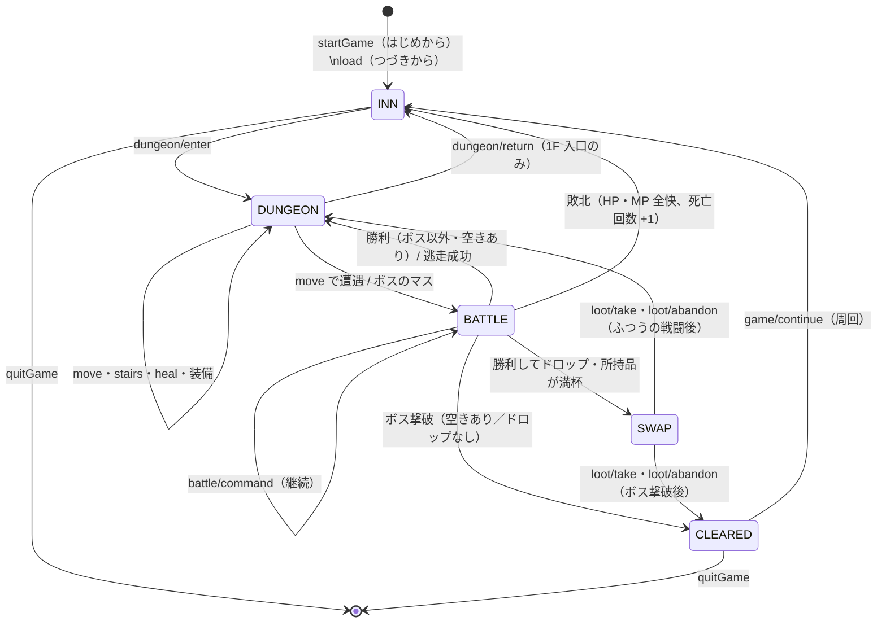

# WIZ 再現開発仕様書

- 版：1.1（2026-10-26）
- 対象：「WIZ」（正式版 v1.0 ＋ Update4〜6。画面の版表示は `1.0`）を、サーバーなしの PWA として作り直すための仕様
- 位置づけ：この 1 冊だけで作れるようにまとめた仕様書。ブラウザで遊ぶ 1 人用のダンジョン探索 RPG を、ブラウザだけで動くアプリ（インストール可・オフライン動作の PWA）として作り、GitHub Pages で公開する。スマートフォンの縦画面のタップで遊べ、PC のキーボード・マウスでも遊べる。構成は `mini-blockbreaking-game` と同じ

### この仕様書の構成

| 部 | 章 | 決めること |
| --- | --- | --- |
| 第 1 部 製品仕様 | 1〜16 | **何を作るか**：キャラクター・ダンジョン・探索・戦闘・敵・回復・装備・周回と実績・状態遷移・画面・効果音と BGM・敵の絵・非機能要件・数値パラメータ・受け入れ基準 |
| 第 2 部 実装仕様 | 17〜32 | **どう作るか**：開発環境、技術構成、設定、ファイル構成と層、端末内保存、ゲーム API、乱数、主なデータ型と関数、効果音の音色、BGM の曲データ、画面の骨組み、テスト用の入口、テスト、PWA・CI と公開、進め方と再現の確認 |
| 付録 | A | 元の WIZ のコードと文書（docs/・wiki/・README）の食い違い（v1.0 の記録） |

- 第 1 部の値（ルール・数値・乱数を引く順序・文言・音色・曲データ）は、元の WIZ の実装（2026-10-26 時点）から写したもの。v1.0 では「正はコード」としたが、v1.1 からは **本書を正** とする（新しく作るため）。
- v1.1 で、構成をサーバーなしの PWA に改めた（`docs/requests/2026-10-26-serverless-pwa.md`）。ゲームのルール・数値・文言は変えていない。元の API・DB・React に関わる書き方は、ブラウザの中の「ゲーム API」と端末内保存の書き方に置き換えた（§1.3）。
- 第 1 部と第 2 部が食い違ったときは、第 1 部を正とする。第 2 部は、実装の選択（技術・ファイル・設定）を決める。
- 乱数を使う処理は、**乱数を引く順序と個数** まで定める。同じシードを与えれば、同じダンジョン・同じ戦闘結果になる（テストはこれに頼っている）。
- 画面に出る文言は、ひらがな表記・全角スペースも含めてそのまま写している。
- 本書の中の「（○○の章）」「§○○」は、本書の該当する章を指す。

### 改訂履歴

| 版 | 日付 | 内容 |
| --- | --- | --- |
| 1.0 | 2026-10-26 | 初版。MVP〜Update6 の実装を 1 冊にまとめた（`docs/reproduction/project-brief-*.md` は MVP〜Update3 の再現用ブリーフとして残す） |
| 1.1 | 2026-10-26 | 構成をサーバーなしの PWA（`mini-blockbreaking-game` と同じ）に改めた。第 1 部：§1.1・§1.3・§1.4 の前提、API を「ゲーム API」（`api.xxx()`）に、DB を端末内保存に読み替え（§2〜§10）、§11 を UI フレームワークに依らない書き方に改め、ハッシュのルート・保存できないときの表示・PWA の画面（§11.12）を足した。§12・§13 のファイルの場所と持ち込み方、音の設定の保存キー、§14〜§16 の非機能要件・パラメータ・受け入れ基準（§16.6 を追加）。第 2 部（§17〜§32）を書き直した（§23〜§26 の値は変えていない）。付録 A に v1.1 での扱いを足した。オーナーの決定で、ページの題名を「WIZ ～死霊術師の迷宮～」に、フォントを端末のもの（DotGothic16 を同梱しない）にし、画面はスマートフォンの表示を最優先にした（§1.3・§11.1） |

---

## 目次

**第 1 部 製品仕様**

1. [概要](#1-概要)
2. [キャラクター](#2-キャラクター)
3. [ダンジョン](#3-ダンジョン)
4. [探索](#4-探索)
5. [戦闘](#5-戦闘)
6. [敵](#6-敵)
7. [回復](#7-回復)
8. [装備・所持品・ドロップ](#8-装備所持品ドロップ)
9. [クリア・周回・実績](#9-クリア周回実績)
10. [ゲーム状態と状態遷移](#10-ゲーム状態と状態遷移)
11. [画面仕様](#11-画面仕様)
12. [効果音と BGM](#12-効果音と-bgm)
13. [敵の絵](#13-敵の絵)
14. [非機能要件](#14-非機能要件)
15. [パラメータ一覧](#15-パラメータ一覧)
16. [受け入れ基準](#16-受け入れ基準)

**第 2 部 実装仕様**

17. [開発環境](#17-開発環境)
18. [技術構成](#18-技術構成)
19. [プロジェクトの設定](#19-プロジェクトの設定)
20. [ファイル構成と層](#20-ファイル構成と層)
21. [端末内保存](#21-端末内保存)
22. [ゲーム API](#22-ゲーム-api)
23. [乱数](#23-乱数)
24. [主なデータ型と関数](#24-主なデータ型と関数)
25. [効果音の音色](#25-効果音の音色)
26. [BGM の実装と曲データ](#26-bgm-の実装と曲データ)
27. [画面の骨組みと画面切替え](#27-画面の骨組みと画面切替え)
28. [テスト用の入口](#28-テスト用の入口)
29. [テスト](#29-テスト)
30. [PWA・アイコン・CI と公開](#30-pwaアイコンci-と公開)
31. [開発の進め方と再現の確認](#31-開発の進め方と再現の確認)
32. [別の環境に移すときの注意](#32-別の環境に移すときの注意)

**付録**

- [付録 A. コードと既存の文書の食い違い](#付録-a-コードと既存の文書の食い違い)

---

# 第 1 部 製品仕様

## 1. 概要

ブラウザで遊ぶ 1 人用のダンジョン探索 RPG である（インストールして通信なしでも遊べる）。プレイヤーは宿屋を拠点に、出発ごとにランダムに作られる **5 階層（各 10×10）** のダンジョンを **疑似3D（一人称のワイヤーフレーム）** で探索する。階段で階を行き来し、敵と戦ってレベルを上げ、敵が落とす装備を集め、5F の最奥にいるボス「暗黒のネクロマンサー」を倒すとクリアになる。クリアの後も、同じキャラクターで次の周を遊べる。

### 1.1 範囲

| 区分 | 内容 |
| --- | --- |
| 本仕様で定める | キャラクターの作成と成長、ダンジョンの生成、探索、戦闘、敵、回復、装備・所持品・ドロップ、クリア・周回・実績、セーブとつづきから、画面と画面遷移、メッセージと演出、効果音と BGM、敵の絵、ゲーム API、端末内保存、インストール・オフライン・更新、数値パラメータ、乱数を引く順序 |
| 第 2 部で固定する | 技術構成（Vite + TypeScript、UI フレームワークなし、vite-plugin-pwa / Vitest + Playwright / ESLint）、ファイル構成と層、GitHub Actions の CI と GitHub Pages への公開、テストの構成 |
| 作らない | ログイン・複数ユーザー、複数のセーブスロット、サーバー・DB・通信（ほかの端末との共有・ランキング）、記録の書き出し・読み込み、ゲームエンジン・3D ライブラリ・UI フレームワーク、音声ファイル、横画面の専用レイアウト |

### 1.2 機能の成り立ち（フェーズ）

| フェーズ | 主な内容 |
| --- | --- |
| MVP（技術検証） | 名前入力、宿屋（やすむ・セーブ）、ダンジョン 1 階、戦闘、レベルアップ、ボス、セーブとつづきから |
| Update1（ゲーム化） | 5 階層・各 10×10 のランダム生成、疑似3D、階段、2D の自動地図、5 種類の敵、回避（素早さ）、クリア時の自動セーブ |
| Update2（ハクスラ化） | 装備 32 種（4 部位 × 8 段階）、レアリティ 5 段階、ドロップ、所持品 50 個、付け替え・捨てる・入れ替え |
| Update3（正式版 v1.0） | 周回、ボス撃破の経験値 1,000 とレジェンド装備、実績、ステータス画面、演出と効果音、ダークファンタジーの配色と二重線のウィンドウ |
| Update4（操作性の改善） | 「もどる」を一番上に、カーソルは端で止まる、装備の強い順・弱い順、ダンジョンでのヒール、遭遇の音、ソロモンのゆびわの防御 |
| Update5（敵の絵） | 戦闘画面に敵のドット絵（6 体、64×64） |
| Update6（BGM） | 場面ごとの FM 音源風 BGM（5 曲） |

元の WIZ は、各フェーズの更新で保存データの形を古い版から読み込めるようにしていた（第 2 部「端末内保存」）。v1.1 は最初から最新の形で作り、古い版の読み込み（移行）の関数も同じように持つ（§21.4）。

v1.1（この仕様書）は、上のすべての機能を、サーバーなしの PWA として作り直す（ルール・数値・文言は変えない）。

### 1.3 前提

- **1 人用・認証なし**：ログインはない。同時に遊ぶのは 1 人で、プレイ中の状態とセーブ（1 スロット）は **その端末のブラウザの中（端末内保存）** に 1 件ずつ保存する。サーバーを持たず、外部へデータを送らない。ほかの端末とは共有しない。
- **ゲーム API が正**：移動・戦闘・成長・ドロップ・乱数はすべて「ゲーム API」で計算する。ゲーム API は、ブラウザの中で動く操作の窓口で、元の WIZ の API サーバーと同じ操作・同じ結果の形・同じエラーを持つ（第 2 部 §22）。画面はゲーム API が返した状態（GameView）とメッセージを表示するだけで、HP やダメージを画面で計算しない。
- **見せてはいけない情報を返さない**：未踏破のマス、ボスの位置、敵の HP はゲーム API の結果に含めない（画面の層に渡さない）。端末内保存は利用者が読めるので、これはネタばれを防ぎ層を分けるための決まりで、不正を防ぐ仕組みではない。
- **想定する端末**：スマートフォンの縦画面（iPhone の Safari、Android の Chrome）を基準にし、タップで遊べることを必須とする。PC の Chrome / Edge では、キーボードだけ、またはマウス（クリック）でも遊べる。
- **画面はスマートフォンの表示を最優先する**（オーナーの決定、2026-10-26）。画面の配置・大きさ・操作は、まずスマートフォンの縦画面で決め、PC の広い画面はそれを崩さない範囲で整える（§11.1）。
- **インストール・オフライン**：公開 URL を開くだけで遊べ、ホーム画面に追加（インストール）でき、一度開いた後は通信なしでも起動して遊べる（§11.12）。
- **読み替え**：v1.0 の文の書き方を、次のように読み替えて書いている。
  - 「API」「サーバー」→ ゲーム API。`POST /api/dungeon/move { action }` のような元の API は `api.move({ action })` のような操作名で書く（対応表は §22.2）
  - 「409」「404」「400」→ ゲーム API のエラーが持つ番号 `status`（元の HTTP ステータスと同じ番号。§22.3）
  - 「DB」「行」「トランザクション」→ 端末内保存の 1 件・まとめて書く（§21）
  - 画面の「ルート」（`/inn` など）→ ハッシュ（`#/inn` など。§27.4）

### 1.4 ゲームのルールの前提

- **ゲーム API が正**：能力値・ダメージ・回避・逃走・成長・敵の選択など、ルールの計算と乱数はすべてゲーム API（の中のルールの関数）で行う。画面は返ってきた状態とメッセージを表示するだけである。
- **ルールは純粋関数**：ルールは `src/domain/` の関数に書き、乱数源 `Rng` を引数で受け取る。`Math.random` を直接呼ばない（§乱数）。
- **装備込みの能力値（実効値）**：戦闘・回復・表示に使う能力値は、すべて「基礎値 ＋ 装備 4 枠の補正の合計」とする（関数 `effectiveStats`）。装備そのもの（種類・補正値）は（§8）で定める。以降の章の式に出てくる「攻撃力」「防御力」「素早さ」「最大 HP」「最大 MP」は、プレイヤー側は実効値、敵側はマスタの値である。
- **用語**
  - 基礎値：キャラクターに保存される能力値（`attack` 等の列の値）。レベルアップの成長はここに加わる
  - 実効値：基礎値 ＋ 装備の補正。保存せず毎回計算する
  - 場所（location）：`INN`（宿屋）・`DUNGEON`（ダンジョン）・`BATTLE`（戦闘）・`CLEARED`（クリア画面）・`SWAP`（所持品が満杯で入れ替え待ち）の 5 つ
  - メッセージ：操作の結果として画面のメッセージ欄に出す 1 行。文言・色調（tone）・演出の印（effect）を持つ（第 2 部 `Message`）

---

## 2. キャラクター

### 2.1 作成

「はじめから」で名前を受け取り、キャラクターを 1 人作る（`api.startGame({ name })`）。既存のプレイ中状態は上書きし、セーブスロットには触れない。

**名前の規則**（関数 `validateName`。画面とゲーム API の両方で検査する）

| 順 | 処理・検査 | 違反時の文言（`details[0].message`） |
| --- | --- | --- |
| 1 | Unicode NFC に正規化し、前後の空白（半角の空白文字類 `\s` と全角空白 `　`）を取り除く | — |
| 2 | 文字数（コードポイント数。サロゲートペアは 1 文字）が 0 | `名前を入力してください` |
| 3 | 文字数が 8 を超える | `名前は1〜8文字で入力してください` |
| 4 | 正規表現 `^[\p{L}\p{N}ー・](?:[\p{L}\p{N}ー・ 　]*[\p{L}\p{N}ー・])?$`（`u` フラグ）に合わない | `つかえない もじが ふくまれています` |

- 使える文字は、文字（`\p{L}`：ひらがな・カタカナ・漢字・英字等）、数字（`\p{N}`）、長音「ー」、中点「・」、名前の途中の半角・全角空白である。絵文字・記号・改行・制御文字は使えない。
- 違反は `ValidationError`（status 400、`code: "validation_error"`、`message: "入力が正しくありません"`、`details: [{ field: "name", message: <上の文言> }]`）。
- 判定は上の表の順で行い、最初に当たったものを返す。
- 保存・表示に使う名前は正規化後の値とする。

| 入力例 | 結果 |
| --- | --- |
| `""`・`"   "`・`"　　"` | 不可（名前を入力してください） |
| `"あ"` | 可 |
| `"ゆうしゃアルド1"`（8 文字） | 可 |
| `"ゆうしゃアルド12"`（9 文字） | 不可 |
| `" ゆうしゃ　"` | 可（`"ゆうしゃ"`） |
| `"Al do"`・`"ゆう　しゃ"` | 可（途中の空白はそのまま） |
| `"𠮷𠮷𠮷𠮷𠮷𠮷𠮷𠮷"`（8 文字） | 可。9 文字なら不可 |
| `"ゆうしゃ😀"`・`"a<b"`・`"a\nb"`・`"a\u0007b"` | 不可（つかえない もじが ふくまれています） |
| `"ルー・Ａ１勇"` | 可 |

**初期能力値**（乱数を使わない。全員同じ）

| 項目 | 値 |
| --- | --- |
| レベル | 1 |
| 経験値（累計） | 0 |
| HP / 最大 HP | 30 / 30 |
| MP / 最大 MP | 10 / 10 |
| こうげき（攻撃力） | 5 |
| ぼうぎょ（防御力） | 5 |
| すばやさ（素早さ） | 5 |
| 場所 | `INN`（宿屋から始まる） |
| 所持品 | 空（装備なし・持ち物なし・`nextId` 1） |
| 実績 | 戦闘 0・討伐 0・死亡 0・周回 1・ボス討伐 0 |

作成時のメッセージは「`<名前>`の ぼうけんが はじまった」（normal）。

### 2.2 能力値の種類と意味

| 項目 | 画面の名前 | 意味 |
| --- | --- | --- |
| level | Lv | 累計経験値で決まる。上限なし |
| exp | 経験値 | 累計。減らない（死亡しても失わない） |
| hp / maxHp | HP | 0 になると死亡。現在値は 0 以上、通常は最大以下 |
| mp / maxMp | MP | ヒールで 3 消費する |
| attack | こうげき | 与えるダメージに加わる |
| defense | ぼうぎょ | 受けるダメージを `floor(防御力 ÷ 2)` 減らす |
| speed | すばやさ | 行動順・回避率・逃走成功率に効く |

- 能力値に上限はない（レベル・経験値・各能力値とも）。
- 画面には実効値を出し、装備の補正を内訳（`base`・`bonus`）として返す（（画面・ゲーム API の章））。
- 「次のレベルまで」の表示用に、ゲーム API は `nextLevelExp = expForLevel(level + 1)` と `expToNext = nextLevelExp − exp` を返す。

### 2.3 経験値とレベルアップ

**必要経験値**：Lv n に到達するための累計経験値を次の式とする。

```text
expForLevel(n) = 12 × n × (n − 1)
```

| Lv | 2 | 3 | 4 | 5 | 10 | 12 | 13 | 15 | 16 | 100 |
| --- | --- | --- | --- | --- | --- | --- | --- | --- | --- | --- |
| 累計経験値 | 24 | 72 | 144 | 240 | 1,080 | 1,584 | 1,872 | 2,520 | 2,880 | 118,800 |

**レベルアップの手順**（関数 `applyExp(state, gained, rng)`）

1. `exp += gained`
2. `exp ≥ expForLevel(level + 1)` である間、次を繰り返す（1 度に何レベルでも上がる）
   1. `level += 1`
   2. 成長値を次の順に乱数で引く（各範囲から一様な整数、両端を含む）：最大 HP `int(8, 12)` → 最大 MP `int(2, 4)` → こうげき `int(1, 2)` → ぼうぎょ `int(1, 2)` → すばやさ `int(1, 2)`
   3. 基礎値に加える：`maxHp += g.maxHp`、`hp += g.maxHp`、`maxMp += g.maxMp`、`mp += g.maxMp`、`attack`・`defense`・`speed` にそれぞれ加える
   4. メッセージを 2 行加える
      - 「レベルが あがった！ Lv`<新レベル>`」（success、effect `levelUp`）
      - 「HP +`<g.maxHp>` MP +`<g.maxMp>` こうげき +`<g.attack>` ぼうぎょ +`<g.defense>` すばやさ +`<g.speed>`」（success、effect なし）
- **レベルアップで全回復しない**。現在の HP・MP は、増えた最大値の分だけ増える。
- 成長は基礎値に加わる（装備の補正には影響しない）。
- 1 レベルにつき乱数をちょうど 5 個消費する。レベルが上がらなければ乱数を消費しない。
- 経験値を得る手段は敵を倒すことだけである（ゴールドはない）。

例：Lv1・経験値 0 に 72 を加えると Lv3 になり、成長 2 回（乱数 10 個）・メッセージ 4 行。成長が最小（8,2,1,1,1）なら最大 HP は 30 + 8 + 8 = 46。

---

## 3. ダンジョン

### 3.1 構成

| 項目 | 値 |
| --- | --- |
| 階層 | 5 階（1F〜5F）。`FLOOR_COUNT = 5` |
| 1 階の広さ | 10 × 10 マス（`DUNGEON_SIZE = 10`、width = height = 10） |
| 座標 | 原点 (0,0) は左上（北西）。x は東向き、y は南向きに増える。北 = y − 1 |
| マスの番号 | `index = y × 10 + x`（0〜99） |
| 生成の時期 | 宿屋から出発する（`api.enterDungeon()`）たびに 5 階層をまとめて新しく作る。出撃中は階を上り下りしても形・階段・ボスは変わらない |
| 破棄の時期 | 宿屋へ戻る（帰還）・敗北・ボス撃破（クリア）・つづきから・はじめから で `dungeon = null` |

### 3.2 壁の表現

各マスの壁は 4 ビットの整数で持つ（1 = 壁あり）。

| 方向 | ビット | dx | dy | 反対側のビット |
| --- | --- | --- | --- | --- |
| N（北） | 1 | 0 | −1 | S = 4 |
| E（東） | 2 | +1 | 0 | W = 8 |
| S（南） | 4 | 0 | +1 | N = 1 |
| W（西） | 8 | −1 | 0 | E = 2 |

- 1 階分の壁は長さ 100 の整数配列 `walls`。全壁は 15（N|E|S|W）
- 壁は両側のマスで必ず一致させる（(x,y) の E ⇔ (x+1,y) の W、(x,y) の S ⇔ (x,y+1) の N）
- 外周は必ず壁（y=0 の N、y=9 の S、x=0 の W、x=9 の E）
- 方向の列挙順は常に `FACINGS = ['N','E','S','W']`。乱数で方向を選ぶときもこの順の配列から選ぶ

### 3.3 1 階分の壁の生成（`generateFloorWalls(rng)`）

1. **全壁**：100 マスすべてを 15 にする。
2. **完全迷路（再帰バックトラッカー、明示的スタック）**
   1. 開始マスを `rng.int(0, 99)` で選び、訪問済みにしてスタックに積む。
   2. スタックが空になるまで繰り返す：
      - スタック先頭のマス `cur` から、`FACINGS` の順（N, E, S, W）に、盤内でまだ訪問していない隣を集めて `options` とする。
      - `options` が空ならスタックから降ろして次へ（乱数は引かない）。
      - 空でなければ `dir = options[rng.int(0, options.length − 1)]`（**候補が 1 つでも `int(0,0)` を 1 回引く**）。`cur` の `dir` ビットと、隣のマスの反対ビットを消す。隣を訪問済みにしてスタックに積む。
   3. 100 マスがすべてつながる。掘った回数は必ず 99 回（= この段で引く乱数は 99 個）。
3. **ループ追加（内部の残存壁の 10% を除去）**
   1. 内部に残る壁を列挙する：`y = 0..9`（外側）、`x = 0..9`（内側）の順に、`x < 9` かつ E ビットが立っていれば `{(x,y), 'E'}`、続けて `y < 9` かつ S ビットが立っていれば `{(x,y), 'S'}` を配列 `remaining` に追加する（同じマスでは E が先）。
   2. `removeCount = floor(remaining.length × 0.1)`。内部の壁は全部で 180 本、完全迷路で 99 本消えるので残りは常に 81 本、`removeCount = 8`。
   3. `i = 0..removeCount−1` について、`j = rng.int(i, remaining.length − 1)` を引き、`remaining[i]` と `remaining[j]` を入れ替え（部分 Fisher–Yates）、`remaining[i]` の壁を両側から消す。

### 3.4 5 階層の生成（`generateFloors(rng)`）

1F から 5F まで順に、各階で次の順に乱数を引く。

| 順 | 処理 | 引く乱数 |
| --- | --- | --- |
| 1 | その階の壁（上記） | `int(0,99)` 1 個 + `int(0,k)` 99 個 + `int(i,80)` 8 個 |
| 2 | 上り階段 `up` = `cellAt(rng.int(0, 99))`（1F は入口） | 1 個 |
| 3 | `up` から幅優先探索（BFS）で全マスの最短歩数を求め、最大値のマスを番号の小さい順に集めた配列 `farthest` から `farthest[rng.int(0, farthest.length − 1)]` を選ぶ | 1 個 |
| 4 | 1F〜4F：選んだマスを下り階段 `down`、`boss = null`。5F：`down = null`、選んだマスを `boss`（暗黒のネクロマンサー） | なし |
| 5 | `visited` を長さ 100 の false で作る | なし |

- 1 階あたり 110 個、5 階で計 550 個の整数乱数を引く（呼び出し元の Rng はこの分だけ進む）。
- 5 階すべてを作った後、1F の入口のマスだけ `visited = true` にする（乱数なし）。
- プレイヤーの初期位置：`floor = 1`、1F の `up`（入口）に **北向き**（`facing: 'N'`）。
- 上り階段の位置は階ごとに独立に選ぶ（n 階の下り階段と n+1 階の上り階段は同じ座標とは限らない）。
- 下り階段（5F はボス）は上り階段から最も遠いマス群のいずれかなので、上り階段とは必ず別のマスで、最短歩数は 9 以上になる（10×10 では、どのマスからも最も遠い角までのマンハッタン距離が 9 以上で、歩数はそれ以上）。
- 参考値：`SeededRng(2026)` で生成すると、プレイヤーの初期位置は `{ x: 9, y: 1, facing: 'N' }`、生成後に `rng.int(1, 1000000)` を引くと 696131、`floors` の `{walls, up, down, boss}` を `JSON.stringify` した SHA-256 の先頭 16 桁は `18a58bdf4b596269`（同じ mulberry32 実装なら一致する。§Rng）。

### 3.5 階ごとの配置と不変条件

| 階 | 上り階段 `up` | 下り階段 `down` | ボス `boss` |
| --- | --- | --- | --- |
| 1F | 入口（宿屋へ帰還するマス） | あり | null |
| 2F〜4F | あり | あり | null |
| 5F | あり | null | あり |

不変条件（`floorViolations(f, floor)` が空であること。開発時の検査とテストに使う）：

- `walls` の長さが 100、外周がすべて壁、両側の壁が一致
- `visited` の長さが 100
- `up` から全 100 マスに到達できる
- 階段とボスの有無が上の表どおり
- 目標（1F〜4F は `down`、5F は `boss`）が `up` からの最遠マスであり、歩数が `MIN_STAIRS_DISTANCE = 5` 以上
- 1 回の 5 階層生成は 50 ms 未満、1,000 回の合計は 10 秒未満（テストの基準）
- 同じシードなら同じ 5 階層。シード 1〜100 の 1F はすべて異なり、同じ出撃内の 5 階も互いに異なる（テストの基準）

---

## 4. 探索

### 4.1 向きと移動

| 操作（`action`） | 結果 |
| --- | --- |
| `forward`（前進） | 向いている方向へ 1 マス。向きは変えない |
| `backward`（後退） | 向きと反対の方向へ 1 マス。向きは変えない（後ろ向きに下がる） |
| `turnLeft`（左を向く） | 位置を変えず、N→W→S→E→N |
| `turnRight`（右を向く） | 位置を変えず、N→E→S→W→N |

- 左右・後ろの対応表：`LEFT = {N:'W', W:'S', S:'E', E:'N'}`、`RIGHT = {N:'E', E:'S', S:'W', W:'N'}`、`BACK = {N:'S', S:'N', E:'W', W:'E'}`
- **壁の判定**：現在の階の、現在のマスの `walls` に進む方向のビットが立っていれば移動しない（`bumped`）。外周は必ず壁なので盤外には出ない。ほかの階の壁は見ない

### 4.2 移動の処理順（`moveInDungeon(state, action, rng)`）

1. 場所が `DUNGEON` でなければ 409 `invalid_state`「その操作は いまは できない」。
2. 移動を計算する。
3. 壁にぶつかった：位置・向きは変えず、メッセージ「かべだ」（normal）。遭遇判定なし・乱数なし・踏破記録の変化なし。
4. 回転だった：向きだけ変え、メッセージなし。遭遇判定なし・乱数なし。
5. 別のマスへ移動した：移動先を踏破済みにしてから（`visitCurrent`）遭遇判定（`checkEncounter`）。遭遇しても移動先は踏破済みになる。

### 4.3 遭遇判定（`checkEncounter(state, rng)`）

上から順に判定する。

| 順 | 条件 | 結果 | 乱数 |
| --- | --- | --- | --- |
| 1 | 現在地がその階の `boss` のマス | 必ず暗黒のネクロマンサー戦（`startBattle(state, 'necromancer')`） | 引かない |
| 2 | 現在地がその階の `up`（1F の入口を含む）または `down` のマス | 遭遇なし | 引かない |
| 3 | `rng.chance(0.2)` が false | 遭遇なし | `int(1,100)` 1 個 |
| 4 | 上記以外 | `pickEnemy(floor, rng)` で選んだ敵と戦闘 | さらに `int(1,100)` 1 個 |

- `chance(p)` は `int(1,100) <= round(p × 100)`。遭遇率 20% なので「1〜20 が出たら遭遇」。
- `pickEnemy`：`r = int(1,100)` を引き、その階の出現表を上から累積し、`r <= 累積` になった最初の敵を返す（どれにも当たらなければ表の最後。合計 100 なので実際には起きない）。

| 階 | 出現表（表の順、%） |
| --- | --- |
| 1F | スライム 70、ゴブリン 30 |
| 2F | スライム 30、ゴブリン 50、スケルトン 20 |
| 3F | ゴブリン 30、スケルトン 50、オーク 20 |
| 4F | スケルトン 30、オーク 50、ダークナイト 20 |
| 5F | オーク 40、ダークナイト 60 |

- 例：3F で乱数列 [20, 31] → 遭遇（20 ≦ 20）、31 は ゴブリン 30 を超え スケルトンの累積 80 以内 → スケルトン。[21] → 遭遇なし、乱数 1 個だけ消費。
- 戦闘開始時のメッセージは「〇〇が あらわれた！」（〇〇は敵の名前。ボスのときだけ `effect: 'bossAppear'`）。場所は `BATTLE`、`records.battles` を +1。敵の能力値・戦闘の流れは別章。
- 統計の基準（テスト）：固定シード 10,000 回で遭遇率 18%〜22%、各階の敵の比率が表の値 ±2.5 ポイント。

### 4.4 階段（`useStairs(state, direction)`、`direction` は `'down' | 'up'`）

| 順 | 判定 | 失敗時 |
| --- | --- | --- |
| 1 | 場所が `DUNGEON` | 409 `invalid_state`「その操作は いまは できない」 |
| 2a | `down`：現在地がその階の `down` のマス（5F は `down` がないので常に失敗） | 409 `invalid_state`「ここには くだり階段は ない」 |
| 2b | `up`：階が 2 以上 かつ 現在地がその階の `up` のマス（1F の入口では失敗） | 409 `invalid_state`「ここには のぼり階段は ない」 |
| 3 | 行き先のマス（下りなら次の階の `up`、上りなら前の階の `down`）が存在する | 409 `invalid_state`「その先には すすめない」（防御的。正しいマップでは起きない） |

- 成功：階を ±1 し、行き先のマスに **向きを変えずに** 立つ。着いたマスをその階で踏破済みにする。メッセージ「{n}F に おりた」または「{n}F に のぼった」（n は着いた階、normal）。
- 乱数は使わない。遭遇判定もしない。HP・MP・経験値・各階の壁・階段・ボス・ほかの階の踏破記録は変えない。
- 階段のマスに乗っただけでは移動しない（ボタン操作で昇降する）。

### 4.5 出発と帰還

| 関数 | 条件 | 結果 | メッセージ |
| --- | --- | --- | --- |
| `enterDungeon(state, rng)` | 場所が `INN`（違えば 409「その操作は いまは できない」） | `location = 'DUNGEON'`、`dungeon = generateFloors(rng)`、`battle = null`。HP・MP は回復しない | 「ダンジョンに ふみこんだ」 |
| `returnToInn(state)` | 場所が `DUNGEON`。さらに 1F かつ 1F の `up`（入口）に立っている | `location = 'INN'`、`dungeon = null`、`battle = null`。HP・MP・経験値・所持品は引き継ぐ | 「宿屋に もどった」 |

- 入口以外で帰還しようとすると 409 `invalid_state`「入口に いないため もどれません」。

### 4.6 踏破記録

- 各階の `visited`（長さ 100 の真偽値）に「一度でも立ったマス」を記録する。
- 記録するとき：出発直後の 1F 入口、前進・後退で別のマスへ移動したとき（遭遇の前）、階段で着いたとき。
- 記録しないとき：回転、壁にぶつかったとき、**ボスのマス**（踏み込むと戦闘になり地図に出す場面がないため）。
- `visitCurrent(d)` は純粋関数で、元のオブジェクトを変えずに新しい `DungeonData` を返す。すでに踏破済みならそのまま返す。
- 階を移っても前の階の記録は残る（出撃中のみ。帰還・敗北・クリアで破棄）。

### 4.7 地図に出す情報（`toAutoMapView(d)`）

現在の階だけを返す。

| フィールド | 内容 |
| --- | --- |
| `width`, `height` | 10, 10 |
| `cells` | 長さ 100、`index = y×10+x`。未踏破は `null`。踏破済みは `{ walls: {n,e,s,w}（真偽値）, stairs }` |
| `player` | `{ x, y }`（向きは含まない） |

- `stairs` は `stairsAt`：`up` のマスなら 1F は `'entrance'`、2F 以上は `'up'`、`down` のマスなら `'down'`、それ以外 `null`。ボスのマスは区別しない（そもそも踏破済みにならない）。
- 未踏破のマスの壁、ほかの階、ボスの位置、マップ全体は返さない。踏破済みのマスについては、四方の壁（隣が未踏破でも、その境界の壁の有無）を返す。

### 4.8 現在地の表示

- 画面の見出しは「{階}F」+ 全角空白 + 向きの漢字。例：「3F　北」。向き：N=北、E=東、S=南、W=西。座標は表示しない。
- 足元が階段・入口のマスに「着いた」とき（直前の状態がダンジョンでない、または階・位置が変わったとき。向きだけの変化は含まない）、画面はメッセージ欄に次の 1 行を足す（画面層の処理）：

| 足元 | 文言 |
| --- | --- |
| `down` | 足元に くだり階段がある |
| `up` | 足元に のぼり階段がある |
| `entrance` | ここは入口だ |

### 4.9 探索のメッセージ一覧（ゲーム API が返すもの）

| 場面 | 文言 | tone |
| --- | --- | --- |
| 出発 | ダンジョンに ふみこんだ | normal |
| 壁にぶつかる | かべだ | normal |
| 回転・移動（遭遇なし） | （なし） | — |
| 遭遇 | {敵の名前}が あらわれた！ | normal（ボスは effect: bossAppear） |
| 階段を下りる | {n}F に おりた | normal |
| 階段を上る | {n}F に のぼった | normal |
| 帰還 | 宿屋に もどった | normal |
| 下り階段がない | ここには くだり階段は ない | 409 の message |
| 上り階段がない | ここには のぼり階段は ない | 409 の message |
| 行き先がない | その先には すすめない | 409 の message |
| 入口以外で帰還 | 入口に いないため もどれません | 409 の message |
| 場所が違う | その操作は いまは できない | 409 の message |

### 4.10 疑似3D の視界（`toFirstPersonView(d)`）

現在の階の、現在地と向きから、奥へ最大 4 段（深さ k = 0〜3、`MAX_DEPTH = 3`）の見え方を返す。

#### 計算手順

1. `cur` = 現在地。`k = 0` から `3` まで繰り返す：
   1. `left` = `cur` の 左方向（`LEFT[facing]`）の壁、`right` = 右方向（`RIGHT[facing]`）の壁、`front` = 向いている方向の壁。それぞれ `'wall'` か `'open'`。
   2. `stairs` = `stairsAt(cur)`（`'up' | 'down' | 'entrance' | null`。ボスは区別しない → null）。
   3. `left` が `'open'` のときだけ `leftFront` = 左隣のマスの、向いている方向の境界（`'wall' | 'open'`）。`right` も同様に `rightFront`。壁のときはキー自体を付けない。
   4. この段を `depths` に追加する。
   5. `front` が `'wall'` なら終了（それより奥は返さない）。そうでなければ `cur` を 1 マス前へ。
2. `underfoot = depths[0].stairs`。

#### 返す形

```ts
{ floor: number; facing: 'N'|'E'|'S'|'W'; underfoot: StairsView; depths: DepthView[] }
```

- キーは `floor`・`facing`・`underfoot`・`depths` のみ。座標・マップ全体・ボス位置は含めない。
- 段数は 1〜4。外周に向かって立てば 1 段（深さ 0 の正面が壁）。一直線の通路なら 4 段（すべて front open。深さ 3 の奥の壁の有無は front に出る）。正面 2 マス先に壁なら 3 段。
- 視界外（正面の壁より奥、左右の壁の向こう、横道の奥）のマスの壁を変えても結果は変わらない（テスト：シード 1〜50 × 全マス × 4 方向）。
- ゲーム API ではこれに地図を足した `{ ...toFirstPersonView(d), map: toAutoMapView(d) }` を `state.dungeon` として返す。

---

## 5. 戦闘

### 5.1 開始条件

戦闘はダンジョンの移動でだけ始まる。移動・階段の仕組みは（ダンジョンの章）で定める。

- 移動の結果、**別のマスへ移動したとき**（向きを変えただけ・壁にぶつかったときは除く）に、移動先のマスで遭遇判定を行う（関数 `checkEncounter`）。階段の昇降・宿屋への帰還・戦闘からの逃走直後には判定しない。
- 判定の順（上から最初に当たったもの）：

| 順 | 条件 | 結果 | 乱数 |
| --- | --- | --- | --- |
| 1 | 現在地がボスのマス（5F のみ） | 必ずボス戦（暗黒のネクロマンサー） | 使わない |
| 2 | 現在地が上り階段（1F は入口）か下り階段 | 遭遇しない | 使わない |
| 3 | `chance(0.2)`（`int(1,100) ≤ 20`）が偽 | 遭遇しない | `int(1,100)` を 1 個 |
| 4 | 上の 3 が真 | 今の階の出現表から敵を 1 体選んで戦闘 | さらに `int(1,100)` を 1 個 |

- 出現表の選び方（関数 `pickEnemy`）：`r = int(1, 100)` を引き、表の順に百分率を累積して、最初に `r ≤ 累積` となった敵を選ぶ（表は §敵）。
- 戦闘開始（関数 `startBattle`、乱数を使わない）
  - 場所を `BATTLE` にし、敵の HP をその敵の最大 HP にする（周回数によらず同じ）
  - `isBoss` は敵が `necromancer` のとき真
  - 実績の総戦闘回数（`battles`）を 1 増やす
  - メッセージ「`<敵の名前>`が あらわれた！」（normal）。ボスのときだけ effect `bossAppear` を付ける
- 戦闘中に再読み込みしても、敵の残り HP を含めて同じ戦闘に戻る（敵の HP は端末内保存のプレイ中状態に持つ。画面には数値を返さない）。

### 5.2 コマンド

`api.battle({ command })` を呼ぶ。値は次の 3 つだけである（それ以外は 400）。

| command | 画面の名前 | 使える条件 | 条件を満たさないとき |
| --- | --- | --- | --- |
| `attack` | たたかう | いつでも | — |
| `heal` | ヒール | MP ≥ 3（実効値ではなく現在の MP） | `InvalidStateError("MP が たりない")`（409）。状態は変えず、乱数も使わない |
| `flee` | にげる | ボス戦でない | `InvalidStateError("にげられない！")`（409）。状態は変えず、乱数も使わない |

- 場所が `BATTLE` でない、または戦闘データがないときは `InvalidStateError("その操作は いまは できない")`（409）。
- 事前条件の検査順：場所 → 戦闘データの有無 → ヒールの MP → ボス戦の逃走。
- 画面は `battle.canHeal`（MP ≥ 3）と `battle.canFlee`（ボス戦でない）でコマンドの可否を表示する。
- 敵の行動は常に「こうげき」である（敵はヒール・逃走をしない）。

### 5.3 1 ターンの解決

1 回のコマンドで 1 ターンを解決する（関数 `resolveTurn`）。装備は戦闘中に変わらないため、プレイヤーの実効値はターンの最初に 1 回だけ計算する。

**行動順**（関数 `turnOrder`）：プレイヤーの素早さ（実効値）≥ 敵の素早さ ならプレイヤーが先、そうでなければ敵が先。同じ値ならプレイヤーが先。

**たたかう・ヒール**：行動順に従って 2 者が 1 回ずつ行動する。

| 行動者 | 行動 | 結果 |
| --- | --- | --- |
| プレイヤー（たたかう） | 敵へ攻撃 1 回（§攻撃 1 回） | 回避されたら何もせず次の行動者へ。当たれば敵の HP を減らし（0 未満にしない）、0 になったら**その場で勝利**（後の敵は行動しない） |
| プレイヤー（ヒール） | ヒール（§回復）。回避判定はない | 次の行動者へ |
| 敵 | プレイヤーへ攻撃 1 回 | 回避されたら何もせず次へ。当たればプレイヤーの HP を減らし（0 未満にしない）、0 になったら**その場で敗北**（後のプレイヤーは行動しない。ヒールも唱えない） |

どちらも倒れなければ、敵の残り HP を保存して戦闘を続ける（outcome `continue`）。

**にげる**

1. `int(1, 100) ≤ fleeChance(プレイヤーの素早さ, 敵の素早さ)` なら逃走成功：場所を `DUNGEON`（同じマス）に戻し、戦闘データを消す。メッセージ「うまく にげきれた」（normal）。経験値・ドロップはない（outcome `fled`）
2. 失敗なら「にげられなかった！」（normal）を出し、**素早さに関係なく敵だけが**攻撃 1 回をする（回避判定あり）。HP が 0 になれば敗北、そうでなければ戦闘を続ける

逃走成功率（百分率の整数）：

```text
fleeChance = clamp(50 + (プレイヤーの素早さ − 敵の素早さ) × 5, 10, 90)
```

| プレイヤー速 | 敵速 | 成功率 |
| --- | --- | --- |
| 5 | 5 | 50% |
| 13 | 5 | 90% |
| 14 | 5 | 90%（上限） |
| 5 | 13 | 10% |
| 5 | 14 | 10%（下限） |

**戻り値の不変条件**：`resolveTurn` が返す状態は「継続（双方の HP > 0）」「勝利処理済み」「逃走成功」「敗北処理済み」のいずれかで、HP 0 の中間状態は返さない。

### 5.4 攻撃 1 回（回避とダメージ）

攻撃 1 回ごとに、攻撃を受ける側の回避を判定する（プレイヤー・通常の敵・ボスとも。逃走失敗時の敵の攻撃も対象。ヒール・逃走そのものは対象外）。

1. `int(1, 100) ≤ evadeChance(受ける側の素早さ, 攻撃する側の素早さ)` なら回避：ダメージ 0。**ダメージの乱数は引かない**
2. 当たったら `damage(攻撃する側の攻撃力, 受ける側の防御力)` を計算する（ここで `int(0, 2)` を 1 個引く）

回避率（百分率の整数）：

```text
evadeChance = clamp(5 + (受ける側の素早さ − 攻撃する側の素早さ) × 2, 5, 30)
```

| 受ける側の速 | 攻撃側の速 | 回避率 |
| --- | --- | --- |
| 10 | 10 | 5% |
| 11 | 10 | 7% |
| 22 | 10 | 29% |
| 23 | 10 | 30% |
| 30 | 10 | 30%（上限） |
| 5 | 10 | 5%（下限） |

ダメージ：

```text
damage = max(1, 攻撃力 − floor(防御力 ÷ 2) + int(0, 2))
```

- 当たれば最低 1 ダメージ。
- プレイヤーが攻撃するときは「プレイヤーの攻撃力の実効値（基礎値 ＋ 装備のこうげき補正）」と「敵のマスタの防御力」を使う。敵が攻撃するときは「敵のマスタの攻撃力」と「プレイヤーの防御力の実効値（基礎値 ＋ 装備のぼうぎょ補正）」を使う。素早さ（行動順・回避・逃走）もプレイヤー側は実効値を使う。

| 攻撃力 | 防御力 | 乱数 | ダメージ |
| --- | --- | --- | --- |
| 5 | 2 | 0 | 4 |
| 5 | 2 | 2 | 6 |
| 5 | 3 | 0 | 4 |
| 4 | 12 | 0 | 1 |
| 2 | 10 | 2 | 1 |

### 5.5 勝利

敵の HP が 0 になったとき（関数 `onVictory`）。メッセージ「`<敵の名前>`を たおした！」（success。ボスのときだけ effect `bossDefeat`）を加え、通常の敵とボスで分ける。

**通常の敵**

1. 「経験値 `<敵の経験値>` を かくとく」（success）
2. 場所を `DUNGEON`（同じマス）、戦闘データを消し、実績の討伐数（`kills`）を 1 増やす
3. 経験値を加えてレベルアップ（§経験値とレベルアップ。乱数：1 レベルにつき 5 個）
4. ドロップの抽選と反映（（装備・ドロップの章）。乱数はレベルアップの後に引く）。空きがあれば所持品に加え、満杯なら場所を `SWAP` にする
5. メッセージの順：たおした → 経験値 → （レベルアップ 2 行 × 上がった数）→（ドロップの行）
- 減った HP・MP は戻らない（outcome `victory`）。

**ボス**：§9。

### 5.6 敗北（死亡）

プレイヤーの HP が 0 になったとき（関数 `onDefeat`）。ボス戦でも同じ。

| 項目 | 結果 |
| --- | --- |
| 場所 | `INN`（宿屋で目覚める） |
| HP・MP | 実効値の最大 HP・最大 MP まで全回復 |
| ダンジョン・戦闘 | 破棄（`dungeon`・`battle` を null） |
| 失わないもの | レベル・経験値・基礎値・装備・持ち物・実績（ペナルティなし） |
| その戦闘の報酬 | 経験値・ドロップなし |
| 実績 | 死亡回数（`deaths`）を 1 増やす |
| セーブ | 自動では更新しない |
| メッセージ | それまでの行に続けて「`<名前>`は たおれた…」（danger）、「気がつくと 宿屋に いた」（normal） |

outcome は `defeat`。

### 5.7 戦闘の乱数を引く順序

1 ターンで引く乱数は、上の手順の順そのものである。まとめると次のとおり。

| 場面 | 引く乱数（この順） |
| --- | --- |
| 攻撃 1 回 | `int(1,100)`（回避）→ 当たったときだけ `int(0,2)`（ダメージ） |
| たたかう | 行動順に、攻撃 1 回ずつ（相手が倒れたら以降は引かない） |
| ヒール | ヒールは乱数なし。敵の攻撃 1 回分だけ |
| にげる | `int(1,100)`（逃走）→ 失敗時のみ敵の攻撃 1 回分 |
| 通常の勝利 | 攻撃の後に、成長（1 レベルにつき 5 個）→ ドロップ（（装備・ドロップの章）の順） |
| ボスの勝利 | 攻撃の後に、成長 → ボスのドロップ |
| 敗北・逃走成功 | 以降は引かない |

例（ゴブリン HP 18、プレイヤー Lv1 初期値、乱数列 `100, 0, 100, 0`）：ゴブリン（速 6）が先攻 → 回避判定 100（外れ）→ ダメージ `max(1, 6 − 2 + 0) = 4` → プレイヤー HP 26。プレイヤーの攻撃 → 回避判定 100 → `max(1, 5 − 1 + 0) = 4` → ゴブリン HP 14。継続。

### 5.8 戦闘メッセージの文言

`<名前>` はプレイヤーの名前、`<敵>` は敵の表示名（§敵）。

| 場面 | 文言 | tone | effect |
| --- | --- | --- | --- |
| 出現 | `<敵>が あらわれた！` | normal | ボスのみ `bossAppear` |
| プレイヤーの攻撃が当たった | `<名前>の こうげき！ <敵>に <n> の ダメージ！` | normal | — |
| プレイヤーの攻撃を回避された | `<敵>は ひらりと みをかわした！` | normal | — |
| 敵の攻撃が当たった | `<敵>の こうげき！ <n> の ダメージを うけた！` | normal | — |
| 敵の攻撃を回避した | `<名前>は ひらりと みをかわした！` | normal | — |
| ヒール | `<名前>は ヒールを となえた！ HP が <n> かいふくした` | success | — |
| 逃走成功 | `うまく にげきれた` | normal | — |
| 逃走失敗 | `にげられなかった！` | normal | — |
| 勝利 | `<敵>を たおした！` | success | ボスのみ `bossDefeat` |
| 経験値 | `経験値 <n> を かくとく` | success | — |
| レベルアップ | `レベルが あがった！ Lv<n>` | success | `levelUp` |
| 成長値 | `HP +<a> MP +<b> こうげき +<c> ぼうぎょ +<d> すばやさ +<e>` | success | — |
| 死亡 | `<名前>は たおれた…` | danger | — |
| 死亡の後 | `気がつくと 宿屋に いた` | normal | — |
| クリア | `ダンジョンに 平和が もどった` | success | `clear` |
| エラー（ヒール不可） | `MP が たりない` | （409 のエラー） | — |
| エラー（ボスから逃走） | `にげられない！` | （409 のエラー） | — |

- 数値 `<n>` は桁区切りを付けない（例：「経験値 1000 を かくとく」）。
- ドロップの行の文言は（装備・ドロップの章）で定める。

---

## 6. 敵

### 6.1 敵の一覧

敵の能力値は 1 か所の定数（マスタ `ENEMIES`）にまとめる。周回数・レベルで変わらない。

| 種類（kind） | 表示名 | 最大 HP | 攻撃力 | 防御力 | 素早さ | 経験値 | 出現する階 | ボス |
| --- | --- | --- | --- | --- | --- | --- | --- | --- |
| `slime` | スライム | 12 | 4 | 2 | 3 | 4 | 1F・2F | — |
| `goblin` | ゴブリン | 18 | 6 | 3 | 6 | 10 | 1F・2F・3F | — |
| `skeleton` | スケルトン | 26 | 9 | 6 | 5 | 18 | 2F・3F・4F | — |
| `orc` | オーク | 48 | 16 | 10 | 5 | 30 | 3F・4F・5F | — |
| `darkKnight` | ダークナイト | 70 | 24 | 16 | 10 | 50 | 4F・5F | — |
| `necromancer` | 暗黒のネクロマンサー | 260 | 34 | 20 | 14 | 1000 | 5F のボスのマスのみ | ○ |

### 6.2 階ごとの出現表

遭遇したときに敵を選ぶ確率（百分率、各階の合計 100）。表の左から順に累積して判定する（§開始条件）。

| 階 | 出現表（この順） | 累積の境目（`r = int(1,100)`） |
| --- | --- | --- |
| 1F | スライム 70・ゴブリン 30 | 1〜70 スライム、71〜100 ゴブリン |
| 2F | スライム 30・ゴブリン 50・スケルトン 20 | 1〜30・31〜80・81〜100 |
| 3F | ゴブリン 30・スケルトン 50・オーク 20 | 1〜30・31〜80・81〜100 |
| 4F | スケルトン 30・オーク 50・ダークナイト 20 | 1〜30・31〜80・81〜100 |
| 5F | オーク 40・ダークナイト 60 | 1〜40・41〜100 |

- 遭遇率は、別のマスへ移動するたびに 20%（階によらない）。
- 1 回の戦闘の敵は 1 体。

### 6.3 ボス（暗黒のネクロマンサー）

- 5F のボスのマス（（ダンジョンの章）で生成）に入ると、乱数を使わず必ずボス戦になる。
- `isBoss` が真。にげられない（にげる は 409）。回避判定・ダメージ式は通常の敵と同じ。
- 出現時は effect `bossAppear`、撃破時は `bossDefeat` を付ける。
- ドロップ率 100%（段階 8 の装備を必ず落とす。（装備・ドロップの章））。
- 撃破するとゲームクリア（§9）。
- 敵の画像は種類（`enemyKind`）で選ぶ（（画面の章））。

---

## 7. 回復

### 7.1 ヒール（戦闘・ダンジョン共通）

戦闘のコマンドとダンジョンのメニューで、同じ量・同じ文言のヒールを使う（関数 `castHeal`）。

| 項目 | 値 |
| --- | --- |
| 使える条件 | 現在の MP ≥ 3 |
| MP 消費 | 3 |
| 回復量 | `healed = max(0, min(30, 最大 HP（実効値）− 現在の HP))` |
| HP が最大のとき | 使える。回復 0 で MP だけ 3 減る |
| メッセージ | `<名前>は ヒールを となえた！ HP が <healed> かいふくした`（success）。頭打ちなら実際の回復量を出す |
| 乱数 | 使わない |

- 例：HP 10/46・MP 10 → HP 40・MP 7（「HP が 30 かいふくした」）。HP 36/46 → 「HP が 10 かいふくした」。HP 46/46 → 「HP が 0 かいふくした」、MP は 7。MP ちょうど 3 なら使えて 0 になる。

**戦闘のヒール**：1 ターンを使い、行動順に従う（§1 ターンの解決）。敵が先攻でその攻撃で HP が 0 になったら、ヒールは唱えず敗北する。

**ダンジョンのヒール**（関数 `fieldHeal`、`api.heal()`）

- 場所が `DUNGEON` のときだけ使える。それ以外は `InvalidStateError("その操作は いまは できない")`（409）。宿屋のメニューにはない（宿屋は「やすむ」）。
- MP < 3 なら `InvalidStateError("MP が たりない")`（409）、状態は変えない。
- 位置・向き・踏破記録・歩数・エンカウント判定・実績は変えない。乱数を使わない。
- メッセージは 1 行（上の文言）。
- 画面向けに `GameView.canHeal = (場所が DUNGEON) かつ (MP ≥ 3)` を返す。

### 7.2 宿屋の「やすむ」

`api.rest()`（関数 `rest`）。

| 項目 | 値 |
| --- | --- |
| 使える場所 | `INN` のみ（それ以外は `InvalidStateError("その操作は いまは できない")`、409） |
| 効果 | HP・MP を実効値の最大 HP・最大 MP まで回復する（装備込みの上限まで） |
| 費用 | 無料・回数制限なし |
| 最大のとき | 使える。値は変わらない |
| 他の値 | レベル・経験値・能力値・所持品・実績は変えない |
| 乱数 | 使わない |
| メッセージ | `HP と MP が かいふくした`（success） |

### 7.3 回復しない場面

- 宿屋に戻っただけ（1F の入口から帰還・クリア後に「宿屋へ」）では回復しない。
- 戦闘に勝っても回復しない。
- レベルアップでは増えた最大値の分だけ増える（全回復しない）。
- 死亡して宿屋で目覚めたときは全回復済みである（§敗北）。

---

## 8. 装備・所持品・ドロップ

敵を倒すと装備を落とすことがある。拾った装備は 1 個ずつ「個体」（ID・種類・レアリティ・補正値）として持ち、4 つの部位に 1 個ずつ付けると能力値が上がる。抽選・付け替え・捨てる・入れ替えはすべてゲーム API で行い、画面はゲーム API が返した結果を表示するだけである（画面側でする計算は、並べ替えと「付けたらどう変わるか」の足し算だけ）。

### 8.1 用語

| 用語 | 意味 |
| --- | --- |
| 部位（slot） | ぶき（weapon）・よろい（armor）・たて（shield）・アクセ（accessory）の 4 つ |
| 段階（tier） | 装備の強さの格。1〜8。部位ごとに各段階 1 種ずつ、全 32 種 |
| 種類（itemId） | 「部位＋段階」の文字列。例：`weapon3`、`accessory8` |
| 幅 | 種類ごとの補正値の元の範囲 [min, max]（整数） |
| レアリティ | N・R・SR・UR・LG の 5 段階。補正値に倍率を掛ける |
| 補正値（value） | 個体ごとに拾った時点で確定する整数。あとで変わらない |
| 個体 | `{ id, itemId, rarity, value }`。名前・部位・上がる能力はマスタから引く |
| 所持品（items） | 装備していない個体の並び。上限 50 |
| 入れ替え待ち（pending） | 所持品が満杯のときに落ちた個体。場所 `SWAP` のときだけある |

---

### 8.2 装備のマスタ（32 種）

- 種類の ID は `${slot}${tier}`。名前・部位・段階・上がる能力・幅はコードの定数で持ち、保存には持たない（保存するのは個体の itemId だけ）。
- 上がる能力（stats）は配列で持つ。先頭が「主な能力」。ソロモンのゆびわだけ 2 つ（こうげき・ぼうぎょ）で、同じ補正値を両方に足す（Update4）。
- 幅は「1 ≤ min ≤ max」。

#### ぶき（weapon）— こうげき

| 段階 | ID | 名前 | 幅（min〜max） |
| --- | --- | --- | --- |
| 1 | weapon1 | ショートソード | 1〜2 |
| 2 | weapon2 | スピア | 3〜4 |
| 3 | weapon3 | バトルアックス | 5〜8 |
| 4 | weapon4 | ロングソード | 7〜10 |
| 5 | weapon5 | バスタードソード | 9〜13 |
| 6 | weapon6 | ミスリルソード | 12〜16 |
| 7 | weapon7 | ムラサメブレード | 15〜20 |
| 8 | weapon8 | エクスカリバー | 20〜26 |

#### よろい（armor）— ぼうぎょ

| 段階 | ID | 名前 | 幅 |
| --- | --- | --- | --- |
| 1 | armor1 | クロースアーマー | 1〜2 |
| 2 | armor2 | レザーアーマー | 2〜4 |
| 3 | armor3 | チェインメイル | 4〜6 |
| 4 | armor4 | プレートメイル | 6〜8 |
| 5 | armor5 | ナイトアーマー | 8〜11 |
| 6 | armor6 | ミスリルメイル | 10〜14 |
| 7 | armor7 | ドラゴンメイル | 13〜17 |
| 8 | armor8 | オリハルコンアーマー | 17〜22 |

#### たて（shield）— ぼうぎょ

| 段階 | ID | 名前 | 幅 |
| --- | --- | --- | --- |
| 1 | shield1 | ウッドシールド | 1〜2 |
| 2 | shield2 | レザーシールド | 2〜3 |
| 3 | shield3 | アイアンシールド | 3〜4 |
| 4 | shield4 | カイトシールド | 4〜6 |
| 5 | shield5 | ナイトシールド | 5〜7 |
| 6 | shield6 | ミスリルシールド | 7〜9 |
| 7 | shield7 | ドラゴンシールド | 8〜11 |
| 8 | shield8 | イージス | 11〜14 |

#### アクセ（accessory）— 種類ごとに違う

| 段階 | ID | 名前 | 上がる能力 | 幅 |
| --- | --- | --- | --- | --- |
| 1 | accessory1 | ガードリング | ぼうぎょ | 1〜3 |
| 2 | accessory2 | パワーリング | こうげき | 1〜3 |
| 3 | accessory3 | ウィンドブーツ | すばやさ | 2〜4 |
| 4 | accessory4 | ライフアミュレット | さいだいHP | 10〜20 |
| 5 | accessory5 | マナブレスレット | さいだいMP | 4〜8 |
| 6 | accessory6 | ミスリルアンクレット | ぼうぎょ | 3〜5 |
| 7 | accessory7 | ドラゴンハート | こうげき | 3〜5 |
| 8 | accessory8 | ソロモンのゆびわ | **こうげき・ぼうぎょ**（この順） | 5〜8 |

#### ソロモンのゆびわの特例

- 上がる能力は `['attack', 'defense']`。補正値は 1 つで、その値を **こうげき・ぼうぎょ の両方に** 足す（例：LG で 20 なら こうげき +20・ぼうぎょ +20）。
- 幅は 5〜8 のまま（LG で 15〜24）。
- 表示（ドロップ文・ItemLabel・読み上げ）は補正を 2 つ並べる。付け替えの変化表示も両方が動く。
- ほかの 31 種は能力が 1 つ。

#### 能力の表示名

| キー | 表示名 |
| --- | --- |
| attack | こうげき |
| defense | ぼうぎょ |
| speed | すばやさ |
| maxHp | さいだいHP |
| maxMp | さいだいMP |

能力の表示順（装備画面の内訳）は こうげき → ぼうぎょ → すばやさ → さいだいHP → さいだいMP。

#### 部位の表示名

| キー | 表示名 | 表示順 |
| --- | --- | --- |
| weapon | ぶき | 1 |
| armor | よろい | 2 |
| shield | たて | 3 |
| accessory | アクセ | 4 |

---

### 8.3 レアリティ

| キー | 文字ラベル | 読み上げ | 倍率 | 倍率×10（整数で持つ） | 色 |
| --- | --- | --- | --- | --- | --- |
| N | ［N］ | ノーマル | ×1.0 | 10 | 白 `#FFFFFF` |
| R | ［R］ | レア | ×1.2 | 12 | 青 `#5B8CFF` |
| SR | ［SR］ | エスアール | ×1.5 | 15 | 紫 `#C792EA` |
| UR | ［UR］ | ユーアール | ×2.0 | 20 | 橙 `#FF8C1A` |
| LG | ［LG］ | レジェンド | ×3.0 | 30 | 赤 `#FF4D6D` |

- 並び（近さの判定に使う）：N → R → SR → UR → LG。
- 倍率は浮動小数の誤差を避けるため「倍率×10」の整数で持つ。
- 色だけに頼らず、必ず［N］などの文字ラベルを添える。ラベルの括弧は全角の「［」「］」。

#### 段階ごとに出るレアリティ（rarity-by-tier）

レアリティは段階で決まる 2 択（段階 8 は 1 択）である。乱数 `int(1,100)` を 1 回引き、**81 以上（20%）なら高い方、80 以下（80%）なら低い方**。

| 段階 | 低い方（1〜80：80%） | 高い方（81〜100：20%） |
| --- | --- | --- |
| 1〜3 | N | R |
| 4〜5 | R | SR |
| 6〜7 | SR | UR |
| 8 | LG（100%） | なし（乱数は引くが結果はいつも LG） |

- 定数：`HIGH_RARITY_FROM = 81`。
- 段階 8 でも乱数は 1 回引く（引く回数をそろえるため）。

#### 補正値の決め方

```
v = 幅の中から一様に選んだ整数    … rng.int(min, max)
value = floor(v × 倍率×10 ÷ 10)   … 整数演算。端数は切り捨て
```

- 拾った時点で確定する。
- 取りうる範囲は `[floor(min×k/10), floor(max×k/10)]`（k は倍率×10）。ただし範囲内のすべての整数が出るとは限らない（例：ロングソード［SR］は 7→10, 8→12, 9→13, 10→15 で 11・14 は出ない）。各値の出方は v の一様分布に従う。
- 例：バトルアックス（5〜8）の［R］は 6〜9、エクスカリバー（20〜26）の［LG］は 60〜78。

#### 種類ごとに取りうる補正値（段階で出るレアリティだけ）

| ID | 名前 | 低い方 | 高い方 |
| --- | --- | --- | --- |
| weapon1 | ショートソード | N 1〜2 | R 1〜2 |
| weapon2 | スピア | N 3〜4 | R 3〜4 |
| weapon3 | バトルアックス | N 5〜8 | R 6〜9 |
| weapon4 | ロングソード | R 8〜12 | SR 10〜15 |
| weapon5 | バスタードソード | R 10〜15 | SR 13〜19 |
| weapon6 | ミスリルソード | SR 18〜24 | UR 24〜32 |
| weapon7 | ムラサメブレード | SR 22〜30 | UR 30〜40 |
| weapon8 | エクスカリバー | LG 60〜78 | — |
| armor1 | クロースアーマー | N 1〜2 | R 1〜2 |
| armor2 | レザーアーマー | N 2〜4 | R 2〜4 |
| armor3 | チェインメイル | N 4〜6 | R 4〜7 |
| armor4 | プレートメイル | R 7〜9 | SR 9〜12 |
| armor5 | ナイトアーマー | R 9〜13 | SR 12〜16 |
| armor6 | ミスリルメイル | SR 15〜21 | UR 20〜28 |
| armor7 | ドラゴンメイル | SR 19〜25 | UR 26〜34 |
| armor8 | オリハルコンアーマー | LG 51〜66 | — |
| shield1 | ウッドシールド | N 1〜2 | R 1〜2 |
| shield2 | レザーシールド | N 2〜3 | R 2〜3 |
| shield3 | アイアンシールド | N 3〜4 | R 3〜4 |
| shield4 | カイトシールド | R 4〜7 | SR 6〜9 |
| shield5 | ナイトシールド | R 6〜8 | SR 7〜10 |
| shield6 | ミスリルシールド | SR 10〜13 | UR 14〜18 |
| shield7 | ドラゴンシールド | SR 12〜16 | UR 16〜22 |
| shield8 | イージス | LG 33〜42 | — |
| accessory1 | ガードリング | N 1〜3 | R 1〜3 |
| accessory2 | パワーリング | N 1〜3 | R 1〜3 |
| accessory3 | ウィンドブーツ | N 2〜4 | R 2〜4 |
| accessory4 | ライフアミュレット | R 12〜24 | SR 15〜30 |
| accessory5 | マナブレスレット | R 4〜9 | SR 6〜12 |
| accessory6 | ミスリルアンクレット | SR 4〜7 | UR 6〜10 |
| accessory7 | ドラゴンハート | SR 4〜7 | UR 6〜10 |
| accessory8 | ソロモンのゆびわ | LG 15〜24（こうげき・ぼうぎょ 両方） | — |

#### 個体の ID の採番

- 所持品データは `nextId`（次に作る個体の ID）を持つ。はじめは 1。
- ドロップが決まるたびに、所持品に入るかどうかにかかわらず `id = nextId` を振り、`nextId` を 1 増やす（満杯で入れ替え待ちになる個体にも ID が振られる。あきらめても `nextId` は戻らない）。
- 捨てても ID は再利用しない。
- 読み込み時の補正：`nextId = max(保存値（整数でなければ 1）, 装備中・所持品・入れ替え待ち・取り除いた個体の各 id + 1, 1)`。

#### 古いデータの補正（conformItem）

読み込むとき、段階のレアリティ表や幅に合わない個体（仕様変更前に拾ったもの）を、乱数を使わず次の手順で直す。何度通しても結果は同じ（冪等）。

1. レアリティがその段階で出るもの（表の低い方・高い方）でなければ、N→LG の並びで最も近いものに変える。距離が同じなら、出るものの並び（低い方 → 高い方）で先にある方を採る。このとき `value = floor(value × 新倍率×10 ÷ 旧倍率×10)`。
2. 補正値を、そのレアリティの範囲 `[floor(min×k/10), floor(max×k/10)]` に切り詰める。

- マスタにない種類（itemId が 32 種のどれでもない）の個体は、装備中・所持品・入れ替え待ちから取り除き、ログに警告を出す（ゲーム API が `console.warn`）。
- 形の違う値（id・value が整数でない、rarity が 5 種以外など）は黙って捨てる。所持品自体が null・形違いなら空の所持品として読む。

---

### 8.4 ドロップ

#### いつ抽選するか

- 戦闘に **勝ったとき** だけ、勝利が決まった操作の中で 1 回だけ抽選する。逃げた・倒れた戦闘では落とさない。1 回の戦闘で落とすのは最大 1 個。
- 乱数を引く順：（戦闘の乱数）→ 経験値によるレベルアップの成長 → ドロップ。
- 落とす段階は **敵の種類だけで決まる**（階は直接関係しない。どの階にどの敵が出るかは別章）。

#### ドロップ表

| 敵（kind） | 表示名 | ドロップ率 | 段階 | 特例 |
| --- | --- | --- | --- | --- |
| slime | スライム | 15% | 1 | — |
| goblin | ゴブリン | 20% | 1〜2 | — |
| skeleton | スケルトン | 25% | 2〜3 | — |
| orc | オーク | 30% | 3〜5 | — |
| darkKnight | ダークナイト | 35% | 5〜7 | 落とすと決まったら 5% で段階 8 |
| necromancer | 暗黒のネクロマンサー（ボス） | 100% | 8〜8 | 必ず段階 8・LG |

#### 抽選の手順（乱数を引く順）

`rng.int(a, b)` は a 以上 b 以下の整数を一様に返す。

| 順 | 乱数 | 判定 |
| --- | --- | --- |
| 1 | `int(1,100)` | **ドロップ率より大きければ落とさない**（ここで終わり、以降の乱数は引かない）。ドロップ率以下なら落とす |
| 2 | `int(1,100)`（特例のある敵＝ダークナイトだけ） | 5 以下なら段階 8 に決める（特例） |
| 3 | `int(0,3)` | 部位：0=ぶき、1=よろい、2=たて、3=アクセ |
| 4 | `int(段階の最小, 段階の最大)`（2 で段階 8 に決まったときは引かない） | 段階。**ボスは範囲が 8〜8 なので 8 が返るが、乱数は 1 回引く** |
| 5 | `int(1,100)` | レアリティ（81 以上で高い方。段階 8 でも引く） |
| 6 | `int(min, max)`（種類の幅） | 補正値の元。`floor(v × 倍率×10 ÷ 10)` |

- ボスはドロップ率 100% なので、1 の乱数が 100 でも落とす。
- ダークナイト：2 の乱数が 5 → 段階 8（段階の乱数を引かない、LG）。6 → 段階 5〜7 から一様。結果として段階 8 の 4 種は等確率、段階 5〜7 の 12 種も等確率。
- 段階 8 は必ず LG（レジェンド）。段階 8 になるのはボスとダークナイトの特例だけ。

#### 境界値

| 判定 | 落とす／高い方 | 落とさない／低い方 |
| --- | --- | --- |
| スライムのドロップ率 | 15 | 16 |
| ダークナイトの段階 8 | 5 | 6 |
| レアリティ | 81 | 80 |

#### 拾ったあと

1. 個体に ID を振る（上記）。
2. 所持品が 50 個未満なら、所持品の **末尾**（＝いちばん新しい）に加え、場所を戻す（普通の敵：`DUNGEON`、ボス：`CLEARED`）。
3. 50 個なら所持品は変えず、場所を `SWAP`（入れ替え待ち）にして `pending = { item: 個体, thenClear: ボスなら true }` を持つ。

#### ドロップのメッセージ

```
${敵の表示名}は ${名前}［${レアリティ}］（${能力名} +${value}）を おとした！
```

- 例：「スライムは ウッドシールド［R］（ぼうぎょ +1）を おとした！」
- 能力が 2 つ（ソロモンのゆびわ）なら半角スペースで並べる：「暗黒のネクロマンサーは ソロモンのゆびわ［LG］（こうげき +20 ぼうぎょ +20）を おとした！」
- 敵の名前と「は」の間は空けず、「は」の後に半角スペース。括弧（）は全角。
- 行の属性：`tone: 'normal'`、`rarity: そのレアリティ`。UR・LG のときだけ `effect: 'rareDrop'` を付ける。
- 満杯で入れ替え待ちになるときも、同じ行を出す。
- 画面では、この行の文字色をレアリティの色にする（tone の色より優先）。
- `rareDrop` の演出：行を点滅（400ms の step-end を UR は 2 回、LG は 3 回。動きを減らす設定では点滅しない）。次の行まで UR は 800ms、LG は 1200ms 待つ（効果音は別章）。

#### 勝利時のメッセージの並び

| 順 | 普通の敵 | ボス |
| --- | --- | --- |
| 1 | 「${敵}を たおした！」（success） | 同じ（effect: bossDefeat） |
| 2 | 「経験値 ${exp} を かくとく」（success） | 同じ |
| 3 | レベルアップの行（あれば） | 同じ |
| 4 | ドロップの行（落としたとき） | ドロップの行（必ず） |
| 5 | — | 空きがあれば「ダンジョンに 平和が もどった」（success、effect: clear）。満杯なら入れ替えの後に出す |

---

### 8.5 所持品

#### データ

| 項目 | 内容 |
| --- | --- |
| equipped | 部位ごとの装備中の個体（または null）。4 枠 |
| items | 装備していない個体。**拾った順（古い → 新しい）** で持つ。上限 50 |
| nextId | 次に振る ID |
| pending | 入れ替え待ち `{ item, thenClear }`。`SWAP` のときだけ非 null |

- 上限 `INVENTORY_CAPACITY = 50`。**装備中の 4 個は数えない**。入れ替え待ちの 1 個も数えない。
- ゲーム API の結果（GameView）の `inventory.items` は **新しい順**（内部の並びを逆にしたもの）。画面はこれを並べ替えて表示する（後述）。
- 「はじめから」は装備なし・所持品なし・`nextId = 1`。
- 倒れても（敗北）装備・所持品は失わない。

#### 付け替え（そうび）

- できる場所：宿屋（`INN`）とダンジョン（`DUNGEON`）。それ以外（`BATTLE`・`SWAP`・`CLEARED` など）は 409 `invalid_state`「その操作は いまは できない」。
- 指定した個体が所持品になければ 409 `rule_violation`「その もちものは ない」（装備中の個体の ID も所持品にないのでこれになる）。
- 部位は個体の種類（マスタ）から決める。
- その部位に前の個体があれば、前の個体を **所持品の末尾** に戻す（個数は変わらないので、満杯でも付け替えはできる）。
- 確認なしで即時に行う。メッセージ：「${名前}［${R}］を そうびした」（tone normal）。

#### はずす

- できる場所：宿屋・ダンジョン。
- 空き枠：409 `rule_violation`「なにも そうびしていない」。
- 所持品が 50 個以上：409 `rule_violation`「もちものが いっぱいで はずせない」。
- 外した個体は所持品の末尾へ。メッセージ：「${名前}［${R}］を はずした」。

#### 捨てる

- できる場所：宿屋・ダンジョン。
- 所持品から取り除く。装備中の個体は所持品にないので捨てられない（「その もちものは ない」）。
- メッセージ：「${名前}［${R}］を すてた」（例：「クロースアーマー［R］を すてた」）。
- 手放す方法は捨てるだけ（お金・お店はない）。

#### 能力値への反映

- 装備の補正 `bonus[k]` ＝ 4 枠それぞれについて、その種類の stats の各能力 k に value を足した合計。
- 装備込みの能力値（実効値）＝ 基礎値 ＋ bonus。戦闘・回復・表示はすべて実効値を使う。レベルアップの成長は基礎値に加わる。
- 付け替え・はずすのたびに、現在の HP・MP を新しい上限に切り詰める：
  - `hp = max(1, min(hp, 実効maxHp))`（最低 1）
  - `mp = min(mp, 実効maxMp)`（0 まで下がりうる）
  - 上限が上がっても現在値は増やさない。
- 捨てるは装備に関係しないので切り詰めない。
- 敗北で宿屋に戻るとき・宿屋で休むときの全回復は実効値の上限まで（別章）。

#### 満杯のときの入れ替え（SWAP）

- 所持品 50 個のときに落とすと、ドロップの行の後に入れ替えの画面（`/swap`）になる。入れ替え待ちはプレイ中状態として保存しているので、再読み込みしても同じ落とし物で入れ替えの画面から再開する（抽選し直さない）。
- `SWAP` のあいだは、拾う・あきらめる以外の操作（移動など）は 409 `invalid_state`。
- **拾う**（捨てて拾う）：指定した所持品の個体を取り除き、落ちている個体を末尾に加える（個数は 50 のまま）。
  - 指定が所持品にない（装備中を含む）：409 `rule_violation`「その もちものは ない」。
  - メッセージ：「${捨てた名前}［R］を すてて ${拾った名前}［R］を ひろった」（例：「ショートソード［N］を すてて ウッドシールド［R］を ひろった」）。
- **あきらめる**：所持品は変えない。メッセージ：「${名前}［R］を あきらめた」。
- どちらも終わったら `pending = null`、場所は `thenClear` なら `CLEARED`、そうでなければ `DUNGEON`。`thenClear`（ボスの後）なら続けて「ダンジョンに 平和が もどった」を出し、クリア時の自動セーブもこのとき書く。
- `SWAP` 以外、または pending がないときに呼ぶと 409 `invalid_state`「その操作は いまは できない」。

#### セーブとの関係

- 宿屋のセーブ・クリア時の自動セーブに装備中 4 枠・所持品・nextId を含める。入れ替え待ちは含めない（`pending: null` にして保存）。
- 「つづきから」はセーブした時点の装備・所持品に戻る（pending はいつも null）。
- ボス撃破で空きがあれば、自動セーブに段階 8 の個体が入る。満杯なら入れ替え（拾う／あきらめる）の後に自動セーブする。

---

### 8.6 並び順

並べ替えは画面の表示だけで行う。ゲーム API の並び（新しい順）は変えない。

| 画面 | 並び | 見出しの横の表示 |
| --- | --- | --- |
| 装備画面の候補 | 強い順 | 「つよい じゅん」 |
| もちもの画面 | 弱い順 | 「よわい じゅん」 |
| 入れ替え画面の一覧 | 弱い順 | 「よわい じゅん」 |

比較の手順（段階は itemId の末尾の数字）：

| 順 | 強い順（strong） | 弱い順（weak） |
| --- | --- | --- |
| 1 | 段階の高い順 | 段階の低い順 |
| 2 | 補正値の大きい順 | 補正値の小さい順 |
| 3 | 名前の五十音順（`localeCompare(…, 'ja')` 昇順） | 名前の五十音の逆順 |
| 4 | id の大きい順（新しい順） | **id の大きい順（新しい順）のまま** |

- 式：`byStrength = (tierB − tierA) || (b.value − a.value) || a.name.localeCompare(b.name, 'ja')`、`compare = byStrength × (strong ? 1 : −1) || (b.id − a.id)`。
- レアリティは比較に使わない（段階 → 補正値で決まる）。
- 入力の配列は変えない（コピーを並べる）。

---

### 8.7 表示

#### アイテムの表示文字列

| 用途 | 形 | 例 |
| --- | --- | --- |
| 名前（itemName） | `${名前}［${レアリティ}］` | バトルアックス［SR］ |
| 補正（bonusTexts） | 能力ごとに `${能力名} +${value}` | こうげき +10 ／ こうげき +20・ぼうぎょ +20 |
| 1 行（itemText） | `${名前}［R］ ${補正を半角スペースで連結}` | バトルアックス［SR］ こうげき +10 |
| 読み上げ（itemSpoken） | `[名前, 読み上げのレアリティ, ...各「${能力名} プラス ${value}」].join('、')` | バトルアックス、エスアール、こうげき プラス 10 |
| ドロップの行 | 上記「ドロップのメッセージ」 | スライムは ウッドシールド［R］（ぼうぎょ +1）を おとした！ |

#### ItemLabel（全画面共通の 1 行表示）

- 並び：（もちもの・入れ替えの一覧で絞り込みが「すべて」のときだけ）`［ぶき］` などの部位（副文字色）→ 名前＋［レアリティ］（レアリティの色）→ 補正（本文の色、能力ごとに別の要素）。
- 要素の間は横の間隔 8px。幅が足りなければ補正を次の行に折り返す。1 つの補正（「こうげき +20」）の途中では折り返さない。
- 表示部分は `aria-hidden`、読み上げ用に itemSpoken を視覚的に隠して置く。

#### 装備画面（そうび）

- 左のウィンドウ「そうび」、右のウィンドウ「のうりょく」（狭い画面では縦に並ぶ）。
- 左（枠の一覧）：先頭「もどる」、続いて ぶき・よろい・たて・アクセ。各行は部位名（幅 3.5em）＋装備中の ItemLabel、空き枠は「―― なし ――」（副文字色）。初めのカーソルは ぶき。
- 枠を選ぶと候補の一覧：「つよい じゅん」の表示、候補が 0 個なら「もっていない」、メニューは 先頭「もどる」→（装備中なら）「はずす」→ その部位の所持品（強い順）。初めのカーソルは 2 行目（もどる 以外の先頭）、項目が もどる だけなら もどる。
- 選ぶとすぐ実行（確認なし）。もどる・Esc：候補 → 枠の一覧 → 閉じる。
- 右（のうりょく）：5 行。通常は「`${実効値} = ${基礎値} + ${補正}`」。実効値と基礎値は 3 桁右詰め（`padStart(3, ' ')`）、補正は詰めない。例：「 30 =  18 + 12」。
- 候補にカーソルを合わせると、その能力の変化を表示する：
  - 計算（statDiff）：画面が持つ実効値から、今の枠の個体の value を（その stats すべてで）引き、候補の value を足す。「はずす」は候補なし（引くだけ）。「もどる」では変化を出さない。
  - 値が変わる能力だけ「`${今} → ${後} ↑`」（上がる：緑 success）または「`${今} → ${後} ↓`」（下がる：橙 warning）。数値は 3 桁右詰め。例：「 23 →  28 ↑」。変わらない能力は通常の内訳のまま。
  - 読み上げ：「${今} から ${後}、あがる」／「…、さがる」。

#### もちもの画面

- ウィンドウ「もちもの」。先頭に「もちもの ${count}／${capacity}」（例：「もちもの 23／50」）。50 個以上なら橙（warning）にして末尾に「！」。
- 一覧（ItemList）を弱い順で表示。選ぶと確認「${名前}［R］を すてますか？」（はい／いいえ、既定は いいえ、Esc は いいえ）。はい で捨てる。いいえ のあとは、カーソルを同じ個体に戻す。

#### 一覧（ItemList、もちもの・入れ替えで共通）

- 上部：「◀」「 ${しぼりこみ名} 」「▶」と、並びの表示（「よわい じゅん」、副文字色）。
- しぼりこみ：すべて → ぶき → よろい → たて → アクセ →（すべてに戻る）の循環。← キー・◀ で前、→ キー・▶ で次。◀▶ はクリック可（44×44 以上）、Tab では止まらない。しぼりこみ名は `aria-live="polite"`。
- 「すべて」のときだけ各行に部位を添える。
- メニューの先頭は「もどる」。初めのカーソルは（戻り先の個体があればその行、なければ）もどる の次。個体が 0 個なら「なにも もっていない」（副文字色）と もどる だけ。
- 一覧の高さは 8 行分（`calc(8 * 52px)`）でスクロールし、カーソル行が見えるようにする。

#### 入れ替えの画面（/swap）

- 画面の見出し「いれかえ」、ウィンドウの見出し「もちものが いっぱいだ」。
- 「おちている：」＋落ちている個体の ItemLabel。
- 2 択：「ひろう（すてるものを えらぶ）」／「あきらめる」。この 2 択では Esc で閉じない。
- ひろう → 一覧（弱い順。もどる・Esc で 2 択へ）→ 選ぶと確認「${捨てる名前}［R］を すてて ${拾う名前}［R］を ひろいますか？」→ はい で拾う、いいえ で一覧へ。
- あきらめる → 確認「${名前}［R］を あきらめますか？」→ はい であきらめる、いいえ で 2 択へ。
- 場所が `SWAP` なら画面はいつも `/swap` に移る。

#### ステータスの補正表示

- 宿屋のステータス欄（full）とステータス画面では、補正が 0 より大きい能力に「 (+${n})」を添える（例：「 15 (+10)」、HP 行は「…/…(+15)」）。0 なら何も付けない。

#### エラーの出し方

- 409 `rule_violation`：状態は取り直さず、`message` をメッセージ欄に Error 色（tone danger）で 1 行出す。
- それ以外のエラーは共通の扱い（別章）。

---

## 9. クリア・周回・実績

### 9.1 ボス撃破（ゲームクリア）

暗黒のネクロマンサーの HP が 0 になったとき（関数 `onBossDefeated`）。手順は次の順とする。

1. 「暗黒のネクロマンサーを たおした！」（success、`bossDefeat`）
2. 「経験値 1000 を かくとく」（success）
3. ダンジョン・戦闘を破棄（`dungeon`・`battle` を null）し、**実績を数える**：討伐数・ボス討伐数・周回数をそれぞれ 1 増やす
4. 経験値 1,000 を加えてレベルアップ（成長の乱数を引く）
5. ボスのドロップ（段階 8 のレジェンド装備。乱数は成長の後）
   - 所持品に空きがあれば加えて場所を `CLEARED` にし、最後に「ダンジョンに 平和が もどった」（success、`clear`）を加える
   - 満杯なら場所を `SWAP`（入れ替え待ち、`thenClear: true`）にし、クリアの行はまだ出さない。入れ替え（拾う／あきらめる）を終えたときに `CLEARED` にして、その操作のメッセージの最後にクリアの行を出す（（装備・ドロップの章））
6. メッセージの順：たおした → 経験値 → レベルアップ（上がった数）→ ドロップ → 平和が もどった

- 実績（周回数等）は撃破の時点で増える。入れ替え待ちを経ても二重には増えない。
- 例：Lv12・累計経験値 1,584 で撃破すると累計 2,584 になり Lv15 になる（Lv15 は 2,520、Lv16 は 2,880）。effect の並びは `bossDefeat, levelUp, levelUp, levelUp, rareDrop, clear`（ドロップがレジェンドのため `rareDrop`）。

### 9.2 自動セーブ

- 操作の結果、場所が `CLEARED` 以外から `CLEARED` に変わったとき、ゲーム API はプレイ中状態の書き込みとセーブスロットの上書きを **まとめて** 行う（どちらかが書けなければ両方とも書く前に戻す。§21.6 の `run`）。ボス撃破の操作（戦闘コマンド）でも、満杯の入れ替えを終える操作（拾う／あきらめる）でも同じ。
- セーブの中身は、クリア時点のキャラクター（名前・Lv・経験値・HP/MP の現在値と最大値・基礎値）・所持品（入れ替え待ちは含めない）・実績（増えた後の値）である（形は（保存の章））。
- クリア画面には `clear.autoSaved` が真のとき「ぼうけんの きろくを セーブした」を出す（（画面の章））。

### 9.3 周回（クリア画面から宿屋へ）

`api.continueGame()`（関数 `continueToInn`）。

| 項目 | 値 |
| --- | --- |
| 使える場所 | `CLEARED` のみ（それ以外は `InvalidStateError("その操作は いまは できない")`、409。2 回送っても 2 回目はエラーで、周回数は増えない） |
| 結果 | 場所を `INN` にし、`dungeon`・`battle` を null |
| 変えないもの | HP・MP（回復しない）・レベル・経験値・基礎値・装備・所持品・実績（周回数はボス撃破時に増えている） |
| メッセージ | `<名前>は 宿屋に もどった`（normal） |
| 乱数 | 使わない |

- 次に出発するとダンジョンを新しく生成し、5F に暗黒のネクロマンサーがまた現れる。
- **周回しても敵は強くならない**：敵とボスの能力値・経験値・出現表・ドロップは周回数によらず同じである（例：周回数 9 でもボスの HP は 260）。
- クリア画面の「`<周回数>` 周目へ すすむ」の数は、撃破時に増えた後の周回数をそのまま出す。

### 9.4 実績

キャラクターごとの回数（`records`）。ルールの関数の中で数え、状態と同じ 1 回の書き込みで保存する。セーブ（宿屋のセーブ・クリア時の自動セーブ）に含め、「つづきから」ではセーブ時点の値に戻る。

| 項目（キー） | 画面の名前と単位 | 初期値 | 増えるとき | 増えないとき |
| --- | --- | --- | --- | --- |
| 総戦闘回数（`battles`） | そうせんとう「n 回」 | 0 | 戦闘が始まったとき（ボス戦を含む。逃げた戦闘も数える） | 戦闘画面の再読み込み、ターンの解決 |
| 討伐数（`kills`） | とうばつ「n 体」 | 0 | 戦闘に勝ったとき（ボスを含む） | 逃走成功・死亡 |
| 死亡回数（`deaths`） | しぼう「n 回」 | 0 | 倒れて宿屋に戻ったとき（ボス戦を含む） | — |
| 周回数（`laps`） | しゅうかい「n 周目」 | **1** | ボスに勝ったとき（今何周目か） | 「宿屋へ」（`continueToInn`） |
| ボス討伐数（`bossKills`） | ボスとうばつ「n 回」 | 0 | ボスに勝ったとき | — |

- ボスに勝つと、討伐数・ボス討伐数・周回数が同時に 1 ずつ増える。通常の敵に勝つと討伐数だけが増える。
- 例：初期のキャラクターが 1 戦目でボスに勝つと `{ battles: 1, kills: 1, deaths: 0, laps: 2, bossKills: 1 }`。
- **読み込み時の補正**（関数 `normalizeRecords`）：保存値がオブジェクトでなければ初期値。項目ごとに「整数かつ 0 以上（周回数は 1 以上）」なら採用し、そうでなければその項目だけ初期値にする。
  - 例：`{ battles: -1, kills: 1.5, deaths: "2", laps: 0, bossKills: 3 }` → `{ battles: 0, kills: 0, deaths: 0, laps: 1, bossKills: 3 }`
- 画面の表示は（画面の章）。

---

## 10. ゲーム状態と状態遷移

### 10.1 場所（`Location`）

| 値 | 意味 | `dungeon` | `battle` |
| --- | --- | --- | --- |
| `INN` | 宿屋 | null | null |
| `DUNGEON` | ダンジョン探索中 | あり | null |
| `BATTLE` | 戦闘中 | あり | あり |
| `SWAP` | 所持品が満杯で、拾った装備の入れ替え待ち | ふつうの戦闘後はあり、ボス撃破後は null | null |
| `CLEARED` | クリア画面 | null | null |

プレイ中状態がない（保存されていない）ことを「タイトル」とする（`api.getGame()` が `{ state: null }`）。

### 10.2 状態遷移



- どの場所からでも `api.startGame()`（はじめから）と `api.load()`（つづきから）で `INN` から始め直せる。
- `CLEARED` に入るとき（`BATTLE → CLEARED` と `SWAP → CLEARED`）は、プレイ中状態とセーブをまとめて書く（自動セーブ）。

### 10.3 各場所で許される操作

場所が合わない操作は、すべて 409 `invalid_state`「その操作は いまは できない」（`assertLocation`）。プレイ中状態がなければ 404 `game_not_found`（`startGame`・`load`・`getGame`・`getSave` を除く）。

| 操作（ゲーム API） | 許される場所 |
| --- | --- |
| `rest` | INN |
| `save` | INN |
| `enterDungeon` | INN |
| `move`・`stairs`・`returnToInn`・`heal` | DUNGEON |
| `equip`・`unequip`・`discard` | INN, DUNGEON |
| `battle` | BATTLE |
| `lootTake`・`lootAbandon` | SWAP |
| `continueGame` | CLEARED |
| `quitGame` | INN, CLEARED |
| `startGame`・`load` | 場所を問わない（プレイ中状態がなくてもよい） |
| `debugDungeon`（テスト用の入口。§28） | `dungeon` があるとき（DUNGEON・BATTLE・ふつうの戦闘後の SWAP） |

---

## 11. 画面仕様

この章は、ブラウザに出る画面と、その操作・描画・状態管理を定める。値は元の WIZ の `frontend/src/` の実装（2026-10-26 時点）から写した。v1.1 では UI フレームワーク（React・MUI）を使わないので、部品の名前（`GameWindow`・`CommandMenu` など）と振る舞いはそのままに、作り方を第 2 部 §27 で定める。音（効果音・BGM）の音色、敵の絵の中身、装備画面（そうび）の中身は別の章で定める。この章では、それらを画面のどこに置き、いつ呼ぶかだけを書く。

### 11.1 前提と用語

| 用語 | 意味 |
| --- | --- |
| ゲームの状態 | `api.getGame()` と各操作が返す `GameView`（または `null`＝プレイ中のゲームなし）。ストア（§27.3）に持つ。画面に出す値はすべてこれをそのまま使い、画面の側で計算しない（例外：装備画面の変化の表示用の足し算） |
| 場所（location） | `GameView.location`。`INN`・`DUNGEON`・`BATTLE`・`CLEARED`・`SWAP` の 5 つ。表示する画面はこれで決まる |
| ウィンドウ | `GameWindow`。すべての情報を入れる二重線の枠（§11.3） |
| コマンドメニュー | `CommandMenu`。▶ カーソルで選ぶ縦の一覧。画面の選択肢はすべてこれで作る |
| メッセージ欄 | `MessageLog`。ゲームの結果の文はすべてここに出す。トースト・ダイアログは使わない |
| 演出 | メッセージに付く印 `effect`（levelUp・rareDrop・bossAppear・bossDefeat・clear）に応じた短いアニメーション |
| 動きを減らす設定 | OS／ブラウザの `prefers-reduced-motion: reduce` |
| 狭い画面 | ビューポートの幅 600px 未満（スマートフォンの縦画面はこちら）。600px 以上を「広い画面」と呼ぶ（CSS の `@media (min-width: 600px)`） |
| タップ・クリック | 指で触れる操作とマウスのクリックをまとめて「クリック」と書く（どちらも同じ動き） |

- **スマートフォンの表示を最優先する**（§1.3）。決める順は「スマートフォンの縦画面（狭い画面）→ PC（広い画面）」とする。どちらかを選ばなければならないときは、スマートフォンの見やすさ・押しやすさを採る。
- この章の配置の図（ダンジョン・戦闘など）は、元の WIZ の広い画面のもの。狭い画面の配置は v1.0 の「1 列に積む」を出発点に、03 画面設計の試作を実機で触って決める（1 画面に収まらない・指で隠れる・押しにくいなど）。決めた配置がこの章と違うときは、変更の依頼で仕様書の版を上げる。

- 使わない部品：トースト、モーダルダイアログ（インストールの案内 §11.12 を除く）、ナビゲーションバー、サイドバー、タブ、パンくず、プログレスバー、日付ピッカー、グラフ。確認はウィンドウとして画面に重ねる（ConfirmMenu）。
- 言語は日本語固定、テーマはダーク固定。切り替えは持たない。
- 角丸・影は使わない（`borderRadius: 0`、`elevation: 0`）。

---

### 11.2 画面一覧とルート

| 画面 | ルート（ハッシュ） | 表示してよい条件 | 主な部品 |
| --- | --- | --- | --- |
| タイトル | `/`（`#/`） | プレイ中のゲームなし（`state === null`） | 飾り線・「WIZ」・副題・CommandMenu（はじめから／つづきから／おと）・メッセージ欄・版 |
| 名前入力 | `/new`（`#/new`） | プレイ中のゲームなし | GameWindow（案内・TextInput・CommandMenu（もどる／決定））・メッセージ欄 |
| 宿屋 | `/inn`（`#/inn`） | `location === 'INN'` | StatusPanel(full)・CommandMenu（やすむ／セーブ／メニュー／ダンジョンへ／タイトルへ戻る）・メッセージ欄 |
| ダンジョン | `/dungeon`（`#/dungeon`） | `location === 'DUNGEON'` | 階と向き・疑似3D・移動ボタン・自動地図・StatusPanel(compact)・階段／帰還ボタン・メニューボタン・メッセージ欄 |
| 戦闘 | `/battle`（`#/battle`） | `location === 'BATTLE'` | 敵のウィンドウ（敵の絵＋敵名）・StatusPanel(compact)・コマンド（たたかう／ヒール／にげる）・メッセージ欄 |
| ゲームクリア | `/clear`（`#/clear`） | `location === 'CLEARED'` | 見出し・クリアの文・CommandMenu（宿屋へ）・メッセージ欄 |
| 入れ替え | `/swap`（`#/swap`） | `location === 'SWAP'` | 落ちている装備・2 択／一覧／確認・メッセージ欄 |
| そうび／もちもの／ステータス | ルートなし | 宿屋・ダンジョンの中で中身を切り替える | §11.7 |
| 上記以外 | — | — | `#/` へ置き換え（履歴に積まない）。その後 LocationGuard が正しい画面へ送る |

- この章で「ルート」「パス」「URL」と書くのは、URL のハッシュの部分（`#/inn` の `/inn`）である（§27.4）。GitHub Pages のサブパス（`/mini-wiz-game/`）とは別。

#### アプリの骨組み

起動の順と部品の組み立ては §27.2。画面をまたいで 1 つだけ持つものは次のとおり（v1.0 では React の Provider と `App` の部品）。

| もの | 役割 | v1.0 |
| --- | --- | --- |
| ストア（§27.3） | ゲームの状態（GameView）とセーブの有無 | `QueryClientProvider`（§11.10） |
| 音の設定（§12.1） | 音の入り切り。初期値オフ、端末内保存のキー `mini-wiz-game-sound` に `on`／`off` | `SoundProvider`（キー `wiz.sound`） |
| メッセージキュー（§11.8） | メッセージ欄のキュー。画面をまたいで保持 | `MessageQueueProvider` |
| ルーター（§27.4） | ハッシュと LocationGuard | `BrowserRouter`・`Routes`・`LocationGuard` |
| BGM の監督（§26.7） | 画面に何も描かない。ルーター・LocationGuard の外に置き、エラーの画面でも曲を止めない | `BgmDirector` |
| 体力わずかの枠（§11.8） | すべてのウィンドウの線の色 | `LowHpFrame` |
| 演出の層（§11.8） | 画面全体の演出 | `EffectLayer` |

- フォントは端末のものを使う（同梱しない。§11.3（文字））。

#### LocationGuard（表示する画面をゲームの状態の場所で決める）

| 状態 | 動作 |
| --- | --- |
| ゲームの状態の取得がエラー | パスが `/` なら画面をそのまま出す（タイトル画面が自前で ErrorPanel を出し、メニューを無効にして表示する）。それ以外のパスでは画面全体を ErrorPanel にする。「再試行」でゲームの状態を取り直す |
| 取得中 | 何も描かない |
| 取得済み | 表示してよいルートの一覧を作る。`state === null` なら `['/', '/new']`、そうでなければ場所に対応する 1 つ（INN→`/inn`、DUNGEON→`/dungeon`、BATTLE→`/battle`、CLEARED→`/clear`、SWAP→`/swap`）。今のパスが一覧になく、かつメッセージキューが遷移を保留していなければ、一覧の先頭へ置き換えで移る（履歴に積まない） |

- 再読み込み・URL 直打ち・ブラウザの戻る でも、ゲームの状態の場所と違う画面は出さない。
- 遷移の保留（`holdNavigation`）：操作の結果で場所が変わっても、メッセージを読み終えるまでは今の画面に留まる（§11.8（メッセージキュー） の保留の件数）。保留中、戦闘画面は直前の敵、ダンジョン画面は直前の視界を表示し続ける（それぞれ最後の値を覚えておく）。
- 画面の遷移は操作の結果（ストアの `setGame`）で場所が変わることで起きる。画面のコードがハッシュを変えるのは「はじめから」（`/new` へ）と名前入力の「もどる」（`/` へ）だけである。

#### 遷移図

```
タイトル ─はじめから→ 名前入力 ─決定（startGame）→ 宿屋
   │                    └もどる・Esc→ タイトル
   └つづきから（load、セーブあり）→ 宿屋（セーブの場所）
宿屋 ─ダンジョンへ→ ダンジョン ─遭遇・ボスのマス→ 戦闘
宿屋 ─タイトルへ戻る（確認：はい。quitGame）→ タイトル
ダンジョン ─宿屋へ戻る（1F の入口）→ 宿屋
ダンジョン nF ─おりる／のぼる→ ダンジョン n±1F（同じ画面のまま）
戦闘 ─勝利・逃走成功→ ダンジョン
戦闘 ─勝利（ドロップで所持品が満杯）→ 入れ替え ─ひろう／あきらめる→ ダンジョン
戦闘 ─死亡→ 宿屋
戦闘 ─ボス撃破→ ゲームクリア ─宿屋へ（continueGame）→ 宿屋（次の周）
戦闘 ─ボス撃破（所持品が満杯）→ 入れ替え → ゲームクリア
宿屋・ダンジョン ─メニュー→ そうび／もちもの／ステータス ─もどる→ 元の画面
```

---

### 11.3 テーマ（色・文字・ウィンドウ）

#### 色（ダークファンタジー）

色は `src/ui/theme.css` の `:root` に、CSS 変数 `--wiz-color-<名前>`（キャメルケースをケバブケースにする。例：`textSub`→`--wiz-color-text-sub`、`mapFrame`→`--wiz-color-map-frame`）として定義する。部品には Hex を直書きしない。コントラスト比は背景 `#0B0A0F` に対する値。

| 名前 | Hex | 比 | 用途 | v1.0 の MUI パレット（記録） |
| --- | --- | --- | --- | --- |
| background（夜の黒） | `#0B0A0F` | — | 画面・ウィンドウの背景 | `background.default`・`background.paper` |
| primary（羊皮紙） | `#E8DCC0` | 14.5 | 本文、疑似3D の線、地図の壁、ボタンの枠 | `primary.main`、`text.primary`、`divider` |
| frame（くすんだ金） | `#C9A227` | 8.2 | 見出しの文字（画面名・ウィンドウ見出し・タイトル） | `frame.main` |
| line（枠の白） | `#FFFFFF` | 19.7 | ウィンドウの二重線（CSS 変数 `--wiz-window-line` の既定値） | — |
| secondary（灯火の琥珀） | `#FFC845` | 12.8 | ▶ カーソル、選択中の項目、フォーカスリング、現在地の矢印 | `secondary.main` |
| success（回復の緑） | `#5CD65C` | 10.5 | 回復・レベルアップ・セーブ | `success.main` |
| warning（警告の橙） | `#FFA726` | 10.2 | HP 25% 以下の行、もちもの満杯 | `warning.main` |
| error（血の赤） | `#FF5A4E` | 6.4 | 死亡・エラー・ボスの名前・danger 枠・体力わずかの枠 | `error.main` |
| info（魔法の青） | `#4FC3F7` | 9.8 | 階段の文字・記号 | `info.main` |
| arcane（秘術の紫） | `#A77BD9` | 6.1 | タイトルの副題、実績の見出し、周回数 | `arcane.main` |
| textSub（古びた灰） | `#A39B8B` | 7.2 | 補足（版、セーブの名前、部位、並び順） | `text.secondary` |
| disabled（煤けた灰） | `#8C857A` | 5.4 | 選べない項目・無効ボタン | `text.disabled` |
| floor（石床） | `#2A2530` | 装飾 | 地図の踏破済みマスの塗り | — |
| blood（乾いた血） | `#B3122E` | 2.9 | タイトルの飾り線（装飾のみ。文字に使わない） | `blood.main` |
| mapFrame（古びた灰） | `#A39B8B` | 7.2 | 地図の外枠 | — |

レアリティの色（CSS 変数 `--wiz-color-rarity-n`・`-r`・`-sr`・`-ur`・`-lg`）：

| ランク | Hex | 比 |
| --- | --- | --- |
| N | `#FFFFFF` | 21.0 |
| R | `#5B8CFF` | 6.6 |
| SR | `#C792EA` | 8.7 |
| UR | `#FF8C1A` | 9.0 |
| LG | `#FF4D6D` | 6.5 |

- ダークの配色に固定する（`color-scheme: dark`。§27.1）。

#### 文字

- フォント：**端末のフォントを使う**（全 variant 共通。CSS 変数 `--wiz-font`）：`"MS Gothic", "Osaka-Mono", "Noto Sans Mono CJK JP", ui-monospace, "SF Mono", Menlo, Consolas, monospace`。v1.0 は先頭に DotGothic16（同梱の Web フォント）を置いていたが、v1.1 では同梱しない（オーナーの決定、2026-10-26）。
- 端末によって字形が変わる（iPhone には日本語の等幅フォントがなく、かなと漢字はヒラギノで出る）。数字と半角スペースは等幅のフォントで出るので、3 桁右揃え（`padStart`）の桁はそろう。数字には `font-variant-numeric: tabular-nums` も付ける。見え方は 03 の試作で実機で確かめる。

| variant | 大きさ | 行の高さ | その他 |
| --- | --- | --- | --- |
| h1 | 48px（幅 599px 以下で 36px） | 1.2 | |
| h2 | 24px | 1.3 | |
| h3 | 18px | 1.4 | |
| body1・body2 | 16px | 1.6 | 字間 0.05em |
| caption | 13px | 1.5 | |
| button | 16px | 1 | `textTransform: none` |

#### 全体のスタイル（`theme.css`・`style.css`）

| 対象 | 値 |
| --- | --- |
| `:root` | 色の CSS 変数すべてと `--wiz-window-line: #FFFFFF` |
| `body` | 背景 `#0B0A0F`、文字 `#E8DCC0` |
| `*:focus-visible` | `outline: 2px solid #FFC845; outline-offset: 2px`（フォーカスリングを常に見せる） |
| `@media (prefers-reduced-motion: reduce)` の `*` | `animation: none !important; transition: none !important` |

#### ボタン（`.wiz-button`）

影・押したときの波紋は付けない。

| 状態 | 見た目 |
| --- | --- |
| 通常 | 枠 2px solid primary、文字 primary、最小 48×48px |
| ホバー・フォーカス | 枠と文字が secondary、背景は透明 |
| 押下（`:active`） | 背景 secondary、文字 background |
| 無効 | 枠と文字が disabled |

#### ウィンドウ（GameWindow、Wizardry 風の二重線）

```
╔═══【 ゆうしゃ 】═══════╗
║ Lv  12                  ║
║ HP 120/135              ║
╚═════════════════════════╝
```

| 項目 | 値 |
| --- | --- |
| 要素 | `<section>`。見出しがあれば `aria-labelledby` で見出しを指す |
| 外側の線 | `border: 2px solid var(--wiz-window-line)`。`variant="danger"` のときは error（#FF5A4E） |
| 内側の線 | `outline: 1px solid var(--wiz-window-line)`、`outline-offset: -6px`（外側 2px＋間隔 3px＋内側 1px になる）。danger でも内側の線は `--wiz-window-line` のまま |
| 内側の余白 | 狭い画面 8px、広い画面 12px。見出しがあるときは上だけ 12px／16px |
| 見出し | `title` があれば、h3（18px、行の高さ 1.4）を `<h2>` として、`position:absolute; top:-0.8em; left:12px`、左右余白 4px、背景 background（線を切る）、文字 frame で「【 見出し 】」と出す。「【 」「 】」は `aria-hidden`。見出しがあるときウィンドウの上に 12px の余白を取る |
| `data-variant` | `default` または `danger` |
| 角 | 直角、影なし |

#### 画面の外枠（GameFrame）

| 項目 | 値 |
| --- | --- |
| 要素 | `<main>`。各画面に main と h1 が 1 つずつ |
| 幅 | 最大 800px、中央寄せ |
| 余白 | 左右 8px（狭い画面）／16px（広い画面）、上下 16px |
| 並び | 縦の grid、間隔 16px |
| 画面名 | h2 の大きさ（24px）の `<h1>`、左寄せ、frame 色（`large` 指定時は h1 の大きさで中央。現在は使っていない） |
| 2 カラム（`columns`） | 広い画面は `1fr 1fr`、狭い画面は 1 列に縦積み。間隔 16px、上揃え。各カラムも縦の grid、間隔 16px（`data-testid="column-left"`／`"column-right"`） |

タイトル画面とクリア画面は GameFrame を使わず、同じ幅（最大 800px・左右 8／16px）で上下 32px の `<main>` を自前で持つ。

---

### 11.4 メニュー

#### CommandMenu（共通の動き）

| 項目 | 値 |
| --- | --- |
| 要素 | `<ul role="menu" aria-label=…>`、各項目 `<li role="menuitem">`。メニュー全体が無効なら ul に `aria-disabled="true"`、無効の項目は li に `aria-disabled="true"`（DOM には残す） |
| 1 行 | 最小の高さ 44px、上下余白 4px、縦中央、`white-space: pre` |
| カーソル | カーソル行の先頭に「▶」、ほかの行は全角スペース「　」（どちらも `aria-hidden`）。カーソル行の文字は secondary |
| 色 | 通常 primary、カーソル行 secondary、無効 disabled。ホバーで secondary（無効の行は disabled のまま） |
| フォーカス | ロービング tabindex（カーソル行だけ `tabIndex=0`、ほかは -1）。項目がフォーカスを受けたらカーソルをそこへ移す |
| 初めのカーソル | `initialIndex` があればその位置、なければ最初の有効な項目（全部無効なら 0） |
| 初めのフォーカス | `autoFocus` のとき、表示した時点でカーソル行にフォーカスする |
| ↓ / ↑ | カーソルを 1 つ動かす。**端で止まる（ループしない）**。無効の項目にも止まれる。動かしたらその行にフォーカスし、`scrollIntoView({block:'nearest'})` で見える位置に寄せる |
| Enter / Space | カーソル行を決定する |
| クリック／タップ | その行にカーソルを移して決定する |
| Esc | `onCancel` があり、メニューが無効でなければ呼ぶ。なければ何もしない |
| Tab | `trapFocus` のときは外へ出さず、Tab で ↓、Shift+Tab で ↑ と同じ動き（端で止まる）。それ以外はブラウザの通常の Tab |
| 無効の項目を決定 | 実行しない。`disabledReason` があれば `onDisabledSelect(理由)` を呼ぶ（画面はメッセージ欄に通常の色で出す。ゲーム API は呼ばない） |
| メニュー全体が無効 | 決定しない（理由も出さない）。カーソル位置は保持する |
| 項目が減った | カーソルが範囲外になったら最後の項目へ寄せる |
| `maxHeight` | 指定すると、その高さで縦にスクロールする |

#### 画面ごとのメニュー

「もどる」がある画面では、「もどる」を一番上に置き、初めのカーソルはその次にする。

| メニュー（aria-label） | 項目（上から） | 初めのカーソル | Esc | 閉じ込め |
| --- | --- | --- | --- | --- |
| タイトル | はじめから／つづきから／おと：オフ（オン） | セーブあり：つづきから、なし：はじめから | なし | なし |
| なまえ入力 | もどる／決定 | 決定（無効でも）。フォーカスは名前の欄 | なし（名前の欄では Esc＝もどる） | なし |
| 宿屋 | やすむ／セーブ／メニュー／ダンジョンへ／タイトルへ戻る | やすむ。メニューを閉じたあとは「メニュー」（index 2） | なし | なし |
| メニュー（ダンジョン） | もどる／ヒール／そうび／もちもの／ステータス／おと | ヒール（MP 不足で無効でも） | もどると同じ | あり |
| メニュー（宿屋） | もどる／そうび／もちもの／ステータス／おと | そうび | もどると同じ | あり |
| 戦闘 | たたかう／ヒール／にげる | 最初の有効な項目（たたかう） | なし | なし |
| ゲームクリア | 宿屋へ | 宿屋へ | なし | なし |
| いれかえ | ひろう（すてるものを えらぶ）／あきらめる | ひろう | なし（2 択では閉じない） | なし |
| もちもの（一覧） | もどる／所持品（よわい じゅん） | 1 番目の所持品（確認から戻ったときは同じ個体）。0 個なら もどる | もどると同じ | あり |
| ステータス | もどる | もどる | もどると同じ | あり |
| かくにん | はい／いいえ | いいえ | いいえ と同じ | あり |
| エラー | 再試行 | 再試行 | なし | なし |

#### GameMenu（宿屋・ダンジョンのメニュー）

- 入口：ダンジョンは「≡ メニュー」ボタン（§11.6）、宿屋は宿屋の CommandMenu の「メニュー」項目。
- 開くと GameWindow（見出し「メニュー」）を、画面の上段とメッセージ欄の間に出す（メッセージ欄の直上）。中は CommandMenu（`autoFocus`・`trapFocus`・`initialIndex=1`）。
- 項目の動き：

| 項目 | 動き |
| --- | --- |
| もどる | メニューを閉じる |
| ヒール（ダンジョンだけ） | `api.heal()`。有効かどうかは GameView の `canHeal`。無効のときの理由「MP が たりない」。使ってもメニューは開いたまま、カーソルもそのまま |
| そうび | 装備画面に切り替える（画面名「そうび」） |
| もちもの | もちもの画面に切り替える（画面名「もちもの」） |
| ステータス | ステータス画面に切り替える（画面名「ステータス」） |
| おと：オフ／おと：オン | その場で音を切り替える（閉じない）。メッセージ欄に「おとを オンにした」／「おとを オフにした」 |

- ダンジョンでは応答待ちのあいだメニュー全体を無効にする。
- 開いているあいだ、ダンジョンの移動（矢印キー・移動ボタン）・階段ボタン・メニューボタンは無効、宿屋の CommandMenu は無効。
- 閉じたら（もどる・Esc、または そうび／もちもの／ステータスからの もどる）、フォーカスを開いたもの（ダンジョン：メニューボタン、宿屋：「メニュー」項目）に戻す。宿屋では CommandMenu を作り直し、カーソルを「メニュー」に置いてフォーカスする。
- 開閉の状態は画面ローカル（画面のモジュールの変数）。再読み込みすると閉じた状態に戻る。
- 専用のキーは割り当てない（Tab → Enter）。戦闘・入れ替え・クリア画面には出さない。

#### ConfirmMenu（確認）

- GameWindow（見出し「かくにん」）の中に、文（下に 8px）と CommandMenu（はい／いいえ、`autoFocus`・`trapFocus`・初めは いいえ、Esc＝いいえ）。
- 使う所と文言：

| 使う所 | 文言 | はい |
| --- | --- | --- |
| 宿屋「タイトルへ戻る」 | `プレイ中の ぼうけんは きえます。よろしいですか？` | `api.quitGame()` → タイトルへ |
| もちもの画面で個体を選んだ | `{装備名}［{ランク}］を すてますか？` | `api.discard({ itemId })` |
| 入れ替えで捨てる個体を選んだ | `{捨てる装備}［ランク］を すてて {落ちている装備}［ランク］を ひろいますか？` | `api.lootTake({ discardId })` |
| 入れ替え「あきらめる」 | `{落ちている装備}［ランク］を あきらめますか？` | `api.lootAbandon()` |

- セーブの上書きには確認を出さない。

---

### 11.5 各画面

#### タイトル（`/`）

```
        ─────── ✦ ───────
              W I Z
        ～ 死霊術師の迷宮 ～
        ─────── ✦ ───────
           ▶はじめから
            つづきから   ゆうしゃ Lv12
            おと：オフ
        （メッセージ欄）
                            v1.0
```

| 要素 | 内容 |
| --- | --- |
| 飾り線（上下 2 本） | 幅 60%・中央。乾いた血（blood）の 1px の線 ＋「✦」＋ 1px の線（間隔 8px）。`aria-hidden` |
| ゲーム名 | 「WIZ」。h1（48px／狭い画面 36px）、中央、frame 色、字間 0.5em、左に 0.5em の余白（字間の分の中央ずれを直す） |
| 副題 | 「～ 死霊術師の迷宮 ～」、中央、arcane 色 |
| メニュー | 中央の箱（最小幅：狭い画面 100%、広い画面 360px）に CommandMenu（label「タイトル」） |
| メッセージ欄 | エラーのときは代わりに ErrorPanel |
| 版 | 右寄せ、textSub 色で「v1.0」（`package.json` の `version` の先頭 2 つ。§19.1） |

- 読み込み中（ゲームの状態かセーブの有無を取得中、かつエラーでない）はメニューを描かない。
- 項目：

| 項目 | 動き |
| --- | --- |
| はじめから | `/new` へ |
| つづきから | セーブがあるとき `api.load()`。中身は「つづきから」と、セーブがあれば右に 16px 空けて textSub で「{名前} Lv{レベル}」。セーブがないときは無効、理由「セーブデータが ありません」 |
| おと：オフ／おと：オン | 切り替え、メッセージ欄に「おとを オンにした」／「おとを オフにした」 |

- 初めのカーソル：セーブありなら つづきから（index 1）、なしなら はじめから。セーブの有無が変わったらメニューを作り直す。
- エラー（ゲームの状態・セーブの有無の取得、または操作の続けられないエラー）のとき：メニューは出すが全体を無効にし、自動フォーカスしない。メッセージ欄の位置に ErrorPanel。「再試行」で操作のエラーを解き、ゲームの状態とセーブの有無を取り直す。
- 操作の応答待ち・メッセージの逐次表示中もメニュー全体を無効にする。

#### 名前入力（`/new`）

- GameFrame（画面名「なまえ」）。GameWindow の中に：
  1. 「なまえを いれてください」（下に 16px）
  2. TextInput（ラベル「なまえ」、最大 8 文字、`autoFocus`）
  3. CommandMenu（label「なまえ入力」）：もどる／決定
- その下にメッセージ欄（続けられないエラーのときは ErrorPanel。「再試行」は直前の操作＝名前の送信をやり直す）。

TextInput：

| 項目 | 値 |
| --- | --- |
| 部品 | `<label>` と `<input type="text">`（枠付き、幅いっぱい、ラベルは常に入力欄の上。スマートフォンでソフトウェアキーボードが出ても画面が崩れないこと） |
| 枠 | 2px primary。フォーカスで secondary、エラーで error |
| 下の文 | エラーがあればその文（error 色）、なければ半角スペース 1 つ（高さを保つ） |
| 文字数 | 右下に caption・textSub で「{文字数}/8」（文字数はコードポイント単位） |
| 入力の上限 | `maxLength=8`（HTML の属性） |
| Enter | IME の変換中（`isComposing`）でなければ決定 |
| Esc | もどる（`/` へ） |
| 応答待ち | 無効 |

名前の規則（画面の側の確かめ。ゲーム API と同じ規則。`src/logic/name.ts`）：

1. 前処理：NFC に正規化し、先頭と末尾の空白（半角・全角スペース・タブなど）を取り除く。
2. 0 文字 → 「名前を入力してください」
3. 9 文字以上 → 「名前は1〜8文字で入力してください」
4. 正規表現 `^[\p{L}\p{N}ー・](?:[\p{L}\p{N}ー・ 　]*[\p{L}\p{N}ー・])?$`（u フラグ）に合わない → 「つかえない もじが ふくまれています」（途中の半角・全角スペースは許す）

- 入力が空のときはエラーを表示しない。決定は「入力が空でない・規則に合う・応答待ちでない」ときだけ有効。決定が無効なときの理由はその規則の文（空なら「名前を入力してください」）。
- 決定：`api.startGame({ name })`（渡すのは入力したままの値）。ゲーム API が 400 を返したら、`details[0].message`（なければ `message`）を TextInput のエラーに出し、入力値は残す。入力を変えるとゲーム API のエラーは消える。
- 成功すると場所が INN になり、宿屋へ移る。

#### 宿屋（`/inn`）

- GameFrame（画面名「宿屋」）、2 カラム：左に StatusPanel(full)、右に CommandMenu（label「宿屋」、`autoFocus`）。下にメッセージ欄（続けられないエラーなら ErrorPanel）。
- 項目：

| 項目 | 動き |
| --- | --- |
| やすむ | `api.rest()` |
| セーブ | `api.save()`（成功後にセーブの有無を取り直す） |
| メニュー | GameMenu を開く（§11.4（GameMenu）） |
| ダンジョンへ | `api.enterDungeon()` |
| タイトルへ戻る | 右カラムの CommandMenu を ConfirmMenu（§11.4（ConfirmMenu））に差し替える。はい：`api.quitGame()` → 成功でメッセージ欄を消し、ストアのゲームの状態を null にし、セーブの有無を取り直す（→ タイトルへ）。失敗で「その操作は いまは できない」とゲームの状態の取り直し。いいえ・Esc：元のメニューへ |

- 応答待ち・逐次表示中・タイトルへ戻る処理中・メニューを開いている間は、CommandMenu 全体を無効にする。

#### ダンジョン（`/dungeon`）

広い画面の配置：

```
┌──────────────────── ダンジョン ────────────────────┐
│ 1F　西                    ┌──────────────────────┐ │
│ ┌──────────────────────┐ │    （自動地図 160×160）│ │
│ │   （疑似3D 320×240）   │ └──────────────────────┘ │
│ └──────────────────────┘ ┌─【 ゆうしゃ 】────────┐ │
│          [↑ 前進]          │ Lv    2              │ │
│ [← 左]              [右 →] │ HP   35/ 40          │ │
│          [↓ 後退]          │ MP   13/ 13          │ │
│                           └──────────────────────┘ │
│                           [宿屋へ戻る] [≡ メニュー]   │
│ ┌────────────────────────────────────────────────┐ │
│ │ （メッセージ欄）                                 │ │
│ └────────────────────────────────────────────────┘ │
└────────────────────────────────────────────────────┘
```

| 位置 | 中身（上から） |
| --- | --- |
| 左カラム | ［階と向き・疑似3D（間隔 8px の grid）］、移動ボタン |
| 右カラム | 自動地図、StatusPanel(compact)、操作の行（階段・帰還ボタン ＋ メニューボタン） |
| 下 | （メニューを開いていれば GameMenu）、メッセージ欄 |

- 狭い画面では 1 列に積む：階と向き → 疑似3D → 移動ボタン → 自動地図 → ステータス → 操作の行 → メッセージ欄。
- 操作の行：`display:grid; grid-template-columns: 8.5em auto; justify-content:start; column-gap:8px`。左の列（幅 8.5em＝いちばん長い「宿屋へ戻る」に合わせる）に階段・帰還ボタン、右の列にメニューボタン。ボタンが出ないマスでも左の列の幅を空けておき、メニューボタンの位置を動かさない。
- 「操作できる」＝場所が DUNGEON、応答待ちでない、逐次表示中でない、メニューを開いていない。操作できないときは移動ボタン・階段ボタンを無効にし、矢印キーの入力は捨てる（貯めない）。
- 遭遇などで場所が変わっても、遷移の保留中は直前の視界・地図を表示し続ける。

##### 階と向き（LocationLabel）

- 疑似3D の上に h3（18px）を `<h2>` として「{階}F　{向き}」（階と向きの間は全角スペース。向きは 北・東・南・西）。座標は出さない。
- 足元の案内は画面に固定では出さず、メッセージ欄に出す（§11.8（メッセージキュー））。

##### 疑似3D 一人称ビュー（FirstPersonView）

- **SVG** で描く（Canvas・3D ライブラリは使わない）。`viewBox="0 0 320 240"`（4:3）。
- 外の箱：幅 100%、最大 320px、`aspect-ratio: 4/3`、中央寄せ。SVG は幅・高さ 100%、`display:block`、背景 `var(--wiz-color-background)`。
- 線：`stroke: var(--wiz-color-primary)`、太さ 2、`vector-effect: non-scaling-stroke`、塗りなし。
- `role="img"`、`aria-label` は §11.5（ダンジョン） の説明文。

奥行きの枠 k の左上 (x_k, y_k)、右下は (320−x_k, 240−y_k)：

| 枠 k | 0 | 1 | 2 | 3 | 4 |
| --- | --- | --- | --- | --- | --- |
| x_k | 0 | 40 | 80 | 110 | 130 |
| y_k | 0 | 30 | 60 | 82 | 97 |

- 「段 k」は枠 k と枠 k+1 の間（k=0 が今いるマス、k=3 が 3 マス先）。GameView の `depths` 配列（段ごとの `left`・`right`・`front`・`leftFront`・`rightFront`・`stairs`）の要素の数だけ、k=0 から順に描く（最大 4 段。正面の壁の先の段はゲーム API が返さない）。
- 段 k の線（左側の式。右側は x を 320−x に置き換えて左右反転する。W=320、H=240）：

| 段 k の状態 | 引く線（種類） |
| --- | --- |
| 左が壁（`left==='wall'`） | (x_k, y_k)→(x_{k+1}, y_{k+1})、(x_k, H−y_k)→(x_{k+1}, H−y_{k+1})、(x_{k+1}, y_{k+1})→(x_{k+1}, H−y_{k+1})（`left`） |
| 左が通路 | (x_k, y_{k+1})→(x_{k+1}, y_{k+1})、(x_k, H−y_{k+1})→(x_{k+1}, H−y_{k+1})（`side-left`）。さらに `leftFront==='wall'`（横道の先が壁）なら縦線 (x_{k+1}, y_{k+1})→(x_{k+1}, H−y_{k+1}) と (x_k, y_{k+1})→(x_k, H−y_{k+1}) |
| 正面が壁（`front==='wall'`） | 枠 k+1 の矩形の 4 辺（`front`） |
| 段 k（k≧1）に階段 | 文字を (160, ((H−y_k)+(H−y_{k+1}))/2) に、`text-anchor: middle`・`dominant-baseline: middle`、info 色、12px。文言「↓ くだり階段」「↑ のぼり階段」「↑ 入口」 |

- 段 0（足元）の階段は文字を描かない。ボスのマスは見た目で区別しない。
- 壁にぶつかったとき（メッセージ「かべだ」が新しく出たとき）：段 0 の正面の壁の線（種類 `front`、depth 0）だけを 200ms で 1 回点滅させる（`@keyframes { 50% { opacity: 0 } }`、`200ms step-end 1`）。
- 線分の生成は純粋関数 `viewToSegments(depths) → { lines: {x1,y1,x2,y2,kind,depth}[], labels: {x,y,text}[] }` にし、単体テストで確かめる。

##### 2D 自動地図（AutoMap）

- **SVG**。1 マス 16×16（`MAP_CELL=16`）、`viewBox="0 0 {幅×16} {高さ×16}"`（10×10 の階で 160×160）、`width`・`height` 属性も同じ px（狭い画面でも縮小しない）、中央寄せ、背景 background。
- GameWindow（見出しなし）で囲む。フォーカスは受けない。点滅・アニメーションはしない。
- 描く順と描き方：

| 順 | 要素 | 描き方 |
| --- | --- | --- |
| 1 | 外枠 | 矩形 (0.5, 0.5)・幅 w−1・高さ h−1、塗りなし、mapFrame 色の 1px |
| 2 | 踏破済みのマス | 16×16 を floor 色で塗る。未踏破（`null`）は何も描かない |
| 3 | 壁 | 踏破済みマスの壁のある辺（n：上、e：右、s：下、w：左）に primary の 2px の線 |
| 4 | 記号 | マスの中央に 12px の文字（`text-anchor: middle`・`dominant-baseline: central`）。階段・入口：info 色で「↓」（くだり）「↑」（のぼり）「入」（入口）。現在地：secondary 色で向きの矢印「▲」（北）「▶」（東）「▼」（南）「◀」（西）。現在地のマスでは階段の記号を描かず矢印だけ |

- 座標・目盛り・番号・ボスのマスは描かない。
- `role="img"`、`aria-label="{階}F の地図。踏破済み {N} マス。"`（N は null でないマスの数）。
- 図形の生成は純粋関数 `mapToShapes(map, facing)`。セル i の位置は x=(i mod width)、y=floor(i / width)。

##### 疑似3D の説明文（describeView）

次の文を順につなげる（区切りなし）。

1. `{階}F {向き}を向いている。`
2. 正面の壁：段 0 が壁なら `前方は かべ。`、段 k（k≧1）が最初の壁なら `前方 {k} マス先は かべ。`、壁がなければ `前方は {段の数−1} マス先まで つうろ。`
3. 段 0〜1 のどちらかで左が通路なら `左に わかれみち。`、右も同様に `右に わかれみち。`
4. 段 k（k≧1）に階段があるごとに `{k} マス先に {くだり階段／のぼり階段／入口}。`
5. 足元が入口なら `ここは入口。`、階段なら `足元に {くだり階段／のぼり階段}。`

例：「3F 北を向いている。前方 2 マス先は かべ。左に わかれみち。足元に くだり階段。」

##### 移動ボタン（MovePad）

- 横 3 列：`grid-template-areas: "left up right" "left down right"`、`grid-template-columns: repeat(3, minmax(48px, 1fr))`、間隔 8px。左右のボタンは `align-self: center`（中央列 2 段の真ん中の高さ）、上下は `stretch`。各ボタン最小高さ 48px。

| ボタン | 表示 | aria-label | キー | 操作 |
| --- | --- | --- | --- | --- |
| 前進 | ↑ 前進 | 前進 | ↑ | `api.move({ action: 'forward' })` |
| 左を向く | ← 左 | 左を向く | ← | `{action:'turnLeft'}` |
| 右を向く | 右 → | 右を向く | → | `{action:'turnRight'}` |
| 後退 | ↓ 後退 | 後退 | ↓ | `{action:'backward'}` |

- 矢印キー：`window` の keydown で受け、ダンジョン画面のどこにフォーカスがあっても効く。矢印キーは操作できないときも `preventDefault`（ページのスクロールを止める）。操作できないときの入力は捨てる。メニューやもちもの画面が開いているときは、そちらの部品が先に矢印キーを処理する。

##### 階段・帰還ボタン（StairsButton）

- 足元（`dungeon.underfoot`）に応じて最大 1 つ。左寄せ、最小 48×48px、左右余白 24px。

| 足元 | 表示 | 操作 |
| --- | --- | --- |
| `down` | ↓ おりる | `api.stairs({ direction: 'down' })` |
| `up` | ↑ のぼる | `{direction:'up'}` |
| `entrance` | 宿屋へ戻る | `api.returnToInn()` |
| `null` | 出さない | — |

- 専用キーはない（Tab → Enter／Space）。出現してもフォーカスは移さない。

##### メニューボタン（GameMenuButton）

- 「≡ メニュー」。ボタン（§11.3）、左寄せ、最小 48×48px、左右余白 24px。押すと GameMenu を開く。
- 無効：場所が DUNGEON でない、応答待ち・逐次表示中、メニューを開いている。

#### 戦闘（`/battle`）

```
┌─────────────────── 戦闘 ───────────────────┐
│ ┌─────────────────────────────────────────┐ │
│ │            （敵の絵 128 または 192）       │ │
│ │                ゴブリン                  │ │
│ └─────────────────────────────────────────┘ │
│ ┌─【 ゆうしゃ 】─┐  ┌─【 コマンド 】──────┐ │
│ │ Lv    3        │  │ ▶たたかう          │ │
│ │ HP   25/ 46    │  │  ヒール            │ │
│ │ MP   10/ 16    │  │  にげる            │ │
│ └────────────────┘  └────────────────────┘ │
│ ┌─────────────────────────────────────────┐ │
│ │ ゴブリンが あらわれた！                 │ │
│ └─────────────────────────────────────────┘ │
└─────────────────────────────────────────────┘
```

- GameFrame（画面名「戦闘」）。
- 敵のウィンドウ（全幅、見出しなし。外の箱に `data-testid="enemy-window"`・`data-boss`）：
  - 敵の絵（EnemyImage、敵の種類 `enemyKind` が変わったら作り直す）。中身は別章。置き方：中央、下に 8px。表示枠は 128×128px、幅 600px 以上かつ高さ 680px 以上のときだけ 192×192px。`enemies/{enemyKind}.png`（相対パス。§13.1）を `image-rendering: pixelated`、`alt` は敵の名前。読めなければ枠ごと消す。
  - 敵の名前：h2（24px）の `<p>`、中央。ボス（`isBoss`）は error 色、それ以外は primary。敵の HP は出さない。
- その下に 2 列（広い画面 `1fr 1fr`、狭い画面 1 列、間隔 16px、上揃え）：左 StatusPanel(compact)、右 GameWindow「コマンド」の中に CommandMenu（label「戦闘」、`autoFocus`）。
- 下にメッセージ欄（続けられないエラーなら ErrorPanel）。

| 項目 | 操作 | 無効のとき | 理由の文 |
| --- | --- | --- | --- |
| たたかう | `api.battle({ command: 'attack' })` | — | — |
| ヒール | `{command:'heal'}` | `battle.canHeal` が false | MP が たりない |
| にげる | `{command:'flee'}` | `battle.canFlee` が false | にげられない！ |

- 場所が BATTLE でない（勝利後の保留中など）・応答待ち・逐次表示中は、メニュー全体を無効にする。
- ダメージ：新しく表示した行に「ダメージを うけた」を含むとき、StatusPanel の HP 行の値を 200ms で 1 回点滅させる。
- 勝利・死亡・クリアのメッセージ表示中（遷移保留中）は、直前の敵を表示し続ける。

#### ゲームクリア（`/clear`）

| 要素 | 内容 |
| --- | --- |
| 見出し | h1（48px／狭い画面 36px）、中央、frame 色「暗黒のネクロマンサーを たおした」（幅が足りなければ折り返す） |
| ウィンドウ | 1 行目「暗黒のネクロマンサーは ほろび、ダンジョンに 平和が もどった」。8px 空けて「{名前} Lv{レベル}」。`clear.autoSaved` が true なら 8px 空けて success 色「ぼうけんの きろくを セーブした」。8px 空けて arcane 色「{records.laps} 周目へ すすむ」 |
| メニュー | CommandMenu（label「ゲームクリア」、`autoFocus`）：宿屋へ → `api.continueGame()` |
| メッセージ欄 | 続けられないエラーなら ErrorPanel |

- 見出しの演出：メッセージ欄が `effect: 'clear'` の行を表示しているあいだだけ、1500ms・ease-out・1 回で「不透明度 0・下 8px」から「不透明度 1・元の位置」へ浮かび上がらせる（動きを減らす設定では動かさない）。再読み込みで入ったときはメッセージがないので演出しない。

#### 入れ替え（`/swap`）

```
┌─【 もちものが いっぱいだ 】─────────────────┐
│ おちている：ミスリルソード［UR］ こうげき +34  │
│ ▶ひろう（すてるものを えらぶ）               │
│  あきらめる                                  │
└──────────────────────────────────────────────┘
```

- GameFrame（画面名「いれかえ」）、GameWindow（見出し「もちものが いっぱいだ」）。1 行目「おちている：」＋ ItemLabel（`pendingDrop`）。その下が段階ごとの中身：

| 段階 | 中身 | 戻る |
| --- | --- | --- |
| 2 択 | CommandMenu（label「いれかえ」、`autoFocus`）：ひろう（すてるものを えらぶ）→ 一覧、あきらめる → あきらめる確認 | Esc では閉じない |
| 一覧 | ItemList（§11.7（もちもの画面）、よわい じゅん） | もどる・Esc → 2 択 |
| ひろう確認 | ConfirmMenu（§11.4（ConfirmMenu）） | いいえ・Esc → 一覧 |
| あきらめる確認 | ConfirmMenu（§11.4（ConfirmMenu）） | いいえ・Esc → 2 択 |

- はいの後はゲームの状態の場所で次の画面（ダンジョン、ボス戦ならクリア）へ移る。再読み込みしてもこの画面（2 択）に戻る。

---

### 11.6 ステータス表示（StatusPanel）

GameWindow（見出しはキャラクターの名前）の中に `<dl>`（2 列 grid：`auto 1fr`、列間 16px）。

| 行（dt） | 値（dd） | full | compact |
| --- | --- | --- | --- |
| Lv | レベル（3 桁右揃え） | ○ | ○ |
| EXP | `{累計 3 桁右揃え}（つぎまで {残り}）` | ○ | — |
| HP | `{HP 3 桁}/{最大 3 桁}`＋（低いとき「！」）＋（full で補正があれば ` (+n)`） | ○ | ○ |
| MP | `{MP 3 桁}/{最大 3 桁}`＋（full で補正があれば ` (+n)`） | ○ | ○ |
| こうげき・ぼうぎょ・すばやさ | 値 3 桁＋（補正があれば ` (+n)`） | ○ | — |

- 「3 桁右揃え」は半角スペースで左を埋める（`padStart(3,' ')`）。dd は `white-space: pre`。
- 能力値は装備込みの値（ゲーム API の値）。` (+n)` は `bonus` が 0 より大きいときだけ。
- HP の警告：HP ≦ 最大HP × 0.25 のとき、HP 行を warning 色にし、値の末尾に「！」を付ける（`data-warning="true"`）。
- 使う画面：宿屋は full、ダンジョン・戦闘は compact。
- レベルアップの演出（§11.8（演出））では、この部品の外側が secondary 色で光る。

---

### 11.7 メニューから開く画面（ルートなし）

宿屋・ダンジョンの中で、画面全体の中身を差し替える。どれも GameFrame の中に「その画面の部品」＋メッセージ欄（続けられないエラーなら ErrorPanel）。閉じると元の画面（メニューは閉じた状態）に戻り、フォーカスを開いたもの（§11.4（GameMenu））に戻す。

| 画面 | 画面名 | 部品 | 操作 |
| --- | --- | --- | --- |
| 装備画面 | そうび | EquipmentPanel（中身は別章） | `api.equip({ itemId })`、`api.unequip({ slot })` |
| もちもの画面 | もちもの | InventoryPanel | `api.discard({ itemId })` |
| ステータス画面 | ステータス | StatusScreenPanel | なし |

#### ステータス画面（StatusScreenPanel）

- 2 つのウィンドウを広い画面で横（`1fr 1fr`）、狭い画面で縦に並べ（間隔 16px、上揃え）、その下に CommandMenu（label「ステータス」、`autoFocus`・`trapFocus`、Esc＝もどる）：もどる。
- 左：見出しは名前。`<dl>`（列間 24px、値は右揃え・`white-space: pre`）：

| 項目 | 値 |
| --- | --- |
| Lv | 3 桁右揃え |
| EXP | `{累計}（つぎまで {残り}）`（桁揃えなし） |
| HP | `{3 桁}/{3 桁}`＋補正 ` (+n)` |
| MP | 同上 |
| こうげき・ぼうぎょ・すばやさ | 3 桁＋補正 ` (+n)` |

- 右：見出し「じっせき」。arcane 色で「このキャラクターの きろく」（下 8px）、その下に `<dl>`：そうせんとう `{battles} 回`／とうばつ `{kills} 体`／しぼう `{deaths} 回`／しゅうかい `{laps} 周目`／ボスとうばつ `{bossKills} 回`。

#### もちもの画面（InventoryPanel）と一覧（ItemList）

- GameWindow（見出し「もちもの」）。1 行目に「もちもの {count}／{capacity}」（全角スラッシュ）。満杯（count ≧ capacity）なら warning 色と末尾の「！」。
- その下に ItemList。個体を選ぶと ConfirmMenu（§11.4（ConfirmMenu））に差し替える。はい：捨てて一覧に戻る。いいえ：一覧に戻り、カーソルを同じ個体に置く。

ItemList（もちもの画面・入れ替えで共通）：

| 要素 | 内容 |
| --- | --- |
| しぼりこみ | 「◀」「 {すべて／ぶき／よろい／たて／アクセ} 」「▶」。◀▶ は 44×44px のボタン（`tabIndex=-1`、aria-label「まえの しぼりこみ」「つぎの しぼりこみ」）。名前は `aria-live="polite"`。←→ キーかクリックで すべて→ぶき→よろい→たて→アクセ→すべて… と循環する |
| 並び順の表示 | しぼりこみの右に 8px 空けて textSub「よわい じゅん」 |
| 0 個 | 「なにも もっていない」（textSub） |
| 一覧 | CommandMenu（label「もちもの」、`autoFocus`・`trapFocus`、Esc＝もどる、高さ `calc(8 * 52px)`＝416px でスクロール）。先頭「もどる」、続いて個体ごとに ItemLabel（「すべて」のときだけ部位付き）。しぼりこみを変えるとメニューを作り直す |
| 並び（よわい じゅん） | 段階（`itemId` の末尾の数字）の小さい順 → 補正値の小さい順 → 装備名の五十音順の逆 → 新しい順（id の大きい順）。表示だけ並べ替え、ゲーム API の並びは変えない |

ItemLabel（1 個体の 1 行）：「［部位］」（任意、textSub）＋「{名前}［{ランク}］」（レアリティの色）＋補正ごとに「{能力値名} +{値}」（primary、途中で折り返さない）。全体は折り返し可の inline-flex（間隔 8px）。表示部分は `aria-hidden` で、読み上げ用の隠し文「{名前}、{ランク名}、{能力値名} プラス {値}」（ランク名：ノーマル／レア／エスアール／ユーアール／レジェンド）を別に置く。能力値名：こうげき・ぼうぎょ・すばやさ・さいだいHP・さいだいMP。部位名：ぶき・よろい・たて・アクセ。

---

### 11.8 メッセージ欄と演出

#### メッセージキュー（`ui/message-queue.ts`）

アプリのルートに 1 つ置き、画面をまたいで行を保持する。

| 値 | 内容 |
| --- | --- |
| `lines` | 表示中の行（最新 **4** 行。古い行は上から消える） |
| `pending` | まだ表示していない行 |
| `busy` | 未表示の行がある、または演出中。このあいだ操作を受け付けない |
| `holdNavigation` | 画面遷移を保留すべき残り件数 > 0 |
| `activeEffect` | 再生中の演出（行・種類・レアリティ・通し番号） |

表示の進め方：

1. `enqueue(messages, afterNavigation)`：何も表示待ち・演出中でなければ、1 件目をすぐ表示し、残りを pending に入れる。表示待ちがあれば後ろにつなぐ。
2. 演出のない行を表示したら、**400ms** 後に次の行を出す。
3. 演出のある行を表示したら、その演出の長さ（下表）だけ待ってから次の行を出す（最後の行なら演出を終える）。
4. スキップ：メッセージ欄のクリック／タップ、または busy の間の Enter／Space（`window` のキャプチャ段階で受け、`preventDefault`・`stopPropagation` してメニューへ届けない）で、残りをすべて表示し、演出を終え、保留を解く。
5. 動きを減らす設定のとき：受け取った行をすべて一度に表示し、最後の演出だけを立てる（色の強調用。待ち時間はその演出の長さ）。保留はしない。
6. `clear()`：表示中の行・表示待ち・保留・演出を全部消す。

| 演出 | 長さ |
| --- | --- |
| levelUp | 1000ms |
| rareDrop（LG 以外） | 800ms |
| rareDrop（LG） | 1200ms |
| bossAppear | 1200ms |
| bossDefeat | 600ms |
| clear | 1500ms |

##### 遷移の保留の件数

1 回の enqueue の行（足元の案内を除く）について：

- tone が `danger` の行があれば、最後の danger の行まで（死亡は今の画面で読ませてから宿屋へ）。
- なければ、末尾に続く `effect: 'clear'` の行を除いた件数（クリアの行は遷移先のクリア画面で見せる）。
- 足元の案内（`afterNavigation`）は保留に数えない（遷移先で見せる）。
- 1 件目をすぐ表示した分は差し引く。行を 1 件出すたびに 1 減らす。

##### 操作の結果の扱い（操作の共通の流れ `ui/command.ts` の成功時）

1. 遭遇（前の場所が BATTLE 以外または状態なし → 新しい場所が BATTLE）なら、メッセージ欄を `clear()` する。ボスでなく、音がオンなら遭遇の効果音 `encounter` を鳴らす。
2. 足元の案内（§11.8（メッセージキュー））があれば、ゲーム API のメッセージの後ろに 1 行足して enqueue する。
3. ストアのゲームの状態を結果の状態で置き換える（取り直しはしない）。
4. セーブ・つづきからの操作なら、セーブの有無を取り直す。

##### 足元の案内

新しい場所が DUNGEON で、足元が階段・入口のマスに**着いた**とき（前がダンジョンでない、または階・x・y のどれかが変わった。向きだけの変化は含まない）に、通常の色で 1 行：

| 足元 | 文言 |
| --- | --- |
| down | 足元に くだり階段がある |
| up | 足元に のぼり階段がある |
| entrance | ここは入口だ |

#### メッセージ欄（MessageLog）

- GameWindow（見出しなし、`data-testid="message-window"`）。表示中の行に tone `danger` が 1 つでもあれば `variant="danger"`（外側の線が赤）。ウィンドウのどこをクリックしてもスキップ。
- 中身：`role="log"`・`aria-live="polite"`、最小の高さ 6.4em（4 行分）。
- 行の色：

| 行 | 色 |
| --- | --- |
| rarity 付き（ドロップの行） | その行全体をレアリティの色 |
| tone normal | primary |
| tone success | success |
| tone danger | error |
| levelUp の演出中の行 | secondary・太字。600ms ease-out で 1→1.2→1 倍（左端基準）。動きを減らす設定では拡大しない |
| rareDrop の演出中の行 | 400ms step-end の点滅（opacity 0 を 50% で）を 2 回（LG は 3 回）。動きを減らす設定では点滅しない |

- 応答待ちが **300ms** を超えたら、右下に「▼」（`aria-label="応答待ち"`）を 1 秒周期の step-end で点滅表示する。応答が返ったら消す。

#### 演出（EffectLayer など）

| 演出 | 出す所 | 内容 |
| --- | --- | --- |
| levelUp | StatusPanel の外側 | 1000ms で 2 回光る（`box-shadow: 0 0 12px 3px currentColor` を 25%・75% で。色は secondary）＋メッセージの行の拡大（§11.8（メッセージ欄）） |
| rareDrop | 画面全体の層＋メッセージの行 | 層の色はそのレアリティの色。`box-shadow: inset 0 0 24px 6px currentColor` を 50% で光らせるアニメーションを、長さ÷回数（LG 以外 800÷2=400ms ×2 回、LG 1200÷3=400ms ×3 回）、ease-in-out |
| bossAppear | 画面全体の層 | 1200ms linear 1 回。背景色：0% 透明 → 25% `rgba(0,0,0,0.85)` → 37% `rgba(179,18,46,0.55)` → 50% `rgba(0,0,0,0.85)` → 62% `rgba(179,18,46,0.55)` → 75〜100% 透明。中央に h1 の大きさ・error 色で敵の名前（行の文から末尾の「が あらわれた！」を取ったもの。折り返す） |
| bossDefeat | 画面全体の層 | 600ms linear 1 回。`rgba(232,220,192,α)`：0%・66%・100% で α=0、16%・83% で α=0.55 |
| clear | クリア画面の見出し | §11.5（ゲームクリア） |

- 画面全体の層：`position: fixed; inset: 0; pointer-events: none; z-index: 10`、中央寄せの grid、`aria-hidden="true"`。演出が bossAppear・bossDefeat・rareDrop のときだけ出す。`data-effect`、`data-motion="reduced"|"full"`。
- 演出はメッセージ欄が `effect` 付きの行を表示した瞬間に始まり、長さ（§11.8（メッセージキュー））が過ぎるか、スキップで終わる。1 つの応答に複数あれば行の順に 1 つずつ。
- 明滅は 1 秒に 3 回以下。
- 動きを減らす設定：層にアニメーションを付けない（色の強調だけ）。加えて全体のスタイル（§11.3）がすべての animation・transition を止める。
- 効果音：演出が始まったら、音がオンならその演出の効果音（rareDrop の LG は `rareDropLG`）を鳴らし、演出が終わったら止める（音色は別章）。

#### 体力わずかの赤い枠（LowHpFrame）

- 条件：**HP × 5 ≦ 最大HP**（最大の 20% 以下。整数のまま比べる）。
- 条件を満たす間、画面の入れ物（`#app`）に CSS 変数 `--wiz-window-line: #FF5A4E`（error）を設定し、画面に出ているすべてのウィンドウの二重線（外側・内側）を赤にする。外れたら `#FFFFFF`。見出しの文字は金のまま。`#app` に `data-low-hp`。
- HP 行の橙＋「！」（25% 以下、§11.6）とは別の条件で、両方とも出る。

#### 点滅（`ui/effects.ts`）

新しく表示された最新の行が条件に合えば、**200ms** だけ true を返す。

| 画面 | 条件 | 点滅する所 |
| --- | --- | --- |
| ダンジョン | 行の文がちょうど「かべだ」 | 疑似3D の段 0 の正面の壁 |
| 戦闘 | 行の文が「ダメージを うけた」を含む | StatusPanel の HP 行の値（200ms step-end 1 回） |

---

### 11.9 ErrorPanel とエラーの扱い

- ErrorPanel：GameWindow（`variant="danger"`、見出し「エラー」）に `<p role="alert">きろくを よみかき できません</p>` と CommandMenu（label「エラー」、`autoFocus`）：再試行。各画面のメッセージ欄の位置に出す。
- v1.0 の文は「サーバーに接続できません」。v1.1 には通信がないので、続けられないエラー（端末内保存に書けない・読めない、思わぬ例外）の文に変えた。

| 失敗 | 扱い |
| --- | --- |
| status 500（`storage_error`・`internal_error`。続けられないエラー＝fatal） | その画面で ErrorPanel を出す。「再試行」でゲームの状態を取り直す（名前入力だけは直前の操作をやり直す）。直前の操作は自動で再送しない |
| 400 で画面が受け取る（名前入力） | TextInput のエラーに出す |
| 409 `error: 'rule_violation'` | メッセージ欄にゲーム API の `message` を danger 色で出す。取り直さない |
| ほかの 4xx | メッセージ欄に ゲーム API の `message`（なければ「その操作は いまは できない」）を通常の色で出し、ゲームの状態とセーブの有無を取り直す（正しい画面へ移る） |
| `api.getGame()` の失敗 | LocationGuard（§11.2（LocationGuard））。ただし、エラーの後に画面が切り替わっても自動では取り直さない |

- `GameError`（§22.3）でない例外（画面のコードの誤りなど）も fatal として扱う。

---

### 11.10 状態管理と操作の流れ

#### ストア

v1.0 の TanStack Query に当たる（作りは §27.3）。

| 値 | 取得 | 内容 | 更新 |
| --- | --- | --- | --- |
| ゲームの状態（v1.0 の `['game']`） | `api.getGame()` → `{ state: GameView \| null }` | プレイ中のゲーム状態 | 操作の結果で置き換える（取り直さない）。4xx・エラーの再試行で取り直す。タイトルへ戻る成功で null |
| セーブの有無（v1.0 の `['save']`） | `api.getSave()` → `{ exists, summary: {name, level, savedAt} \| null }` | セーブの有無（タイトル用） | セーブ・つづきから・タイトルへ戻るの後に取り直す |

- 取得の失敗は 1 回だけやり直す（v1.0 の `retry: 1`）。操作は自動でやり直さない（`retry: false`）。
- メッセージはゲーム状態に入れない（再読み込みで古いメッセージを出さない）。
- 画面ローカルの状態：カーソル位置、名前の入力値、確認の開閉、メニュー・そうび・もちもの・ステータスのどれを出しているか、しぼりこみ、入れ替えの段階。再読み込みで初めに戻る。

#### 操作の共通の流れ（`ui/command.ts`。v1.0 の `useGameCommand`）と二重送信の防止

- 画面は `command.run(() => api.xxx(...))` で操作する。持つ値：`run`、`isPending`、`locked`（応答待ち または メッセージの busy）、`fatal`、`retry(retryLast?)`。
- `run` は、応答待ち中（同じイベントループ内の連打も止める）または busy のときは何もしない。
- 画面は `locked` の間、メニュー・ボタンを無効にする。
- 成功したときの扱いは §11.8（操作の結果の扱い）、失敗したときの扱いは §11.9。

#### ゲーム API の呼び方

画面層は `main.ts` で作ったゲーム API（§22）を使う。v1.0 の API クライアント（axios）の関数名と同じ名前の操作を持つ。

| 関数 | v1.0 のメソッドとパス | 引数 |
| --- | --- | --- |
| getGame | GET `/game` | — |
| getSave | GET `/save` | — |
| startGame | POST `/game` | `{name}` |
| quitGame | DELETE `/game` | — |
| rest | POST `/inn/rest` | — |
| save | POST `/save` | — |
| load | POST `/save/load` | — |
| enterDungeon | POST `/dungeon/enter` | — |
| move | POST `/dungeon/move` | `{action}` |
| stairs | POST `/dungeon/stairs` | `{direction}` |
| returnToInn | POST `/dungeon/return` | — |
| heal | POST `/dungeon/heal` | — |
| battle | POST `/battle/command` | `{command}` |
| equip | POST `/equipment/equip` | `{itemId}` |
| unequip | POST `/equipment/unequip` | `{slot}` |
| discard | POST `/inventory/discard` | `{itemId}` |
| lootTake | POST `/loot/take` | `{discardId}` |
| lootAbandon | POST `/loot/abandon` | — |
| continueGame | POST `/game/continue` | — |

quitGame 以外の操作は `{ state: GameView, messages: Message[] }` を返す。

#### 音・BGM を呼ぶ所（中身は別章）

| 呼ぶ所 | いつ |
| --- | --- |
| 音の設定（`audio/sound-setting.ts`。v1.0 の `SoundProvider`） | 入り切りを持つ。オンにした瞬間に確認の音 `toggle` |
| タイトルのメニュー・GameMenu の「おと」 | 切り替え |
| 操作の共通の流れ（v1.0 の `useGameCommand`） | 通常の敵との遭遇で `encounter` |
| メッセージキュー（v1.0 の `MessageQueueProvider`） | 演出の開始で演出の効果音、終了で停止 |
| BGM の監督（v1.0 の `BgmDirector`。LocationGuard の外） | パス・状態・演出から曲を決め、変わったときだけ再生／停止 |

---

### 11.11 アクセシビリティ

| 項目 | 実装 |
| --- | --- |
| ページ | `<html lang="ja">`、title「WIZ ～死霊術師の迷宮～」（v1.0 は「ウィザードリィ1風ゲーム」。公開するので、他社の作品名を含まない題名に変えた。オーナーの決定、2026-10-26）。各画面に `<main>` と `<h1>` を 1 つ |
| ウィンドウ | `<section aria-labelledby>`。見出しの「【 】」は読ませない |
| メニュー | `role="menu"`／`menuitem`、無効は `aria-disabled="true"`。カーソル記号は `aria-hidden`。無効の理由はメッセージ欄（live region）で伝える |
| 移動ボタン | `aria-label`：前進・左を向く・右を向く・後退 |
| 疑似3D・地図 | `<svg role="img" aria-label>`（§11.5（ダンジョン）） |
| メッセージ欄 | `role="log"`・`aria-live="polite"`。応答待ちの ▼ に `aria-label="応答待ち"` |
| エラー | `role="alert"` |
| 装備名 | 読み上げ用の隠し文（visuallyHidden：`position:absolute; width:1px; height:1px; overflow:hidden; clip:rect(0 0 0 0); white-space:nowrap; border:0; padding:0; margin:-1px`） |
| 演出の層・飾り線 | `aria-hidden` |
| 色だけに頼らない | HP の「！」、レアリティの［SR］など、階段の記号＋文字、並び順の文字 |
| キーボード | すべての操作がキーボードでできる。フォーカスリングは secondary 2px＋offset 2px |
| タッチ | すべての操作がタップでできる（キーだけの操作はない。Esc の「もどる」はメニューの「もどる」、Enter／Space のスキップはメッセージ欄のタップでもできる） |
| フォーカスの閉じ込め | ConfirmMenu・GameMenu・ステータス・もちもの一覧（Tab が外へ出ない） |
| フォーカスの戻し先 | メニュー系を閉じたら、開いたボタン／項目 |
| タップ領域 | ボタン 48px 以上、メニュー行 44px 以上 |
| 拡大 | ページの拡大を禁止しない（viewport に `user-scalable=no`・`maximum-scale` を入れない） |
| 動きを減らす設定 | 逐次表示を一括に、アニメーションをすべて止める |
| 自動テスト | `@axe-core/playwright` で、タイトル・名前入力・宿屋・ダンジョン・戦闘・クリア・装備・もちもの・入れ替え・ステータスの各画面と、メニュー・確認・演出・エラーを表示した状態に違反がないことを確かめる（v1.0 の jest-axe の 13 ファイル・26 か所に当たる。§29.3） |

---

### 11.12 インストール・オフライン・更新・起動の復旧（v1.1 で追加）

`mini-blockbreaking-game` と同じ振る舞いにする（作りは §30）。置き方・見た目の細かい値は 03 画面設計で決める。

| 項目 | 振る舞い |
| --- | --- |
| オフライン | 一度開いた後は、通信なしでも起動して最後まで遊べる（画面・敵の絵をすべて事前に保存する） |
| インストールの案内 | タイトル画面に「インストール」のボタンを出す（インストール済みなら出さない）。押すと案内のダイアログを開く。iPhone（Safari の共有 → ホーム画面に追加）・Android（Chrome のメニュー → ホーム画面に追加）・PC（アドレスバーのインストール）の 3 つの手順のうち、今の端末のものを開いて見せる。ブラウザがすぐにインストールできるときは「今すぐインストール」も出す。「とじる」・Esc で閉じ、フォーカスを「インストール」に戻す |
| ホーム画面のアプリ名 | 「WIZ」（切れない長さ） |
| 更新の帯 | 新しい版を受け取ったら、タイトル・宿屋の画面のときだけ「新しい版があります」と「更新」ボタンの帯を出す（ダンジョン・戦闘など遊んでいる途中には出さない）。「更新」で新しい版に切り替えて読み込み直す。プレイ中の状態とセーブは消えず、読み込み直した後も続きから遊べる。勝手には切り替えない |
| 起動の復旧 | 起動に失敗したら（8 秒たっても画面が動かない）、このアプリの古いキャッシュだけを消して 1 回だけ自動で読み込み直す。2 分以内に続けて失敗したら、「うまく起動できませんでした。」「なおす」「きろくは消えません。」を出す。プレイ中の状態・セーブ・音の設定は消さない |
| 画面の大きさ | スマートフォンの縦画面（幅 375px・高さ 667px 以上）で、横にはみ出さない（横にスクロールしない）。ノッチ・ホームバー・ステータスバーに内容が入り込まない（ホーム画面のアプリとして開いたときも）。横向きの専用の配置はない（幅 600px 以上なら広い画面の配置になる） |

---

## 12. 効果音と BGM

この章は、音（効果音と BGM）が「何が・いつ・どう聞こえるか」を定める。音色の値は §25、BGM の合成と曲データは §26、敵の絵は §13 に書く。

- 音はすべてブラウザ標準の Web Audio API でその場で合成する。**音声ファイル・音のライブラリは使わない**（効果音も BGM も）。
- 音は飾り。音の機能がない・初期化に失敗した・途中で例外が出た、のどれでも、ゲームはそのまま動く（すべて `try/catch` で握りつぶす）。
- 敵の絵は 64×64 の PNG を 6 枚、静的ファイルとして同梱する。

関係するファイル：

| ファイル | 役割 | v1.0 |
| --- | --- | --- |
| `src/audio/sound.ts` | 効果音の音の並び（`SFX`）と再生（`playSfx`・`stopSfx`）、共用の `AudioContext`、最初の操作での再開 | `frontend/src/game/sound.ts` |
| `src/audio/sound-setting.ts` | 音のオン／オフ設定（`soundLabel` を含む）と保存 | `useSound.tsx` |
| `src/ui/message-queue.ts` | 演出（levelUp など）の開始で効果音を鳴らし、演出の終わり・スキップで止める | `useMessageQueue.tsx` |
| `src/ui/command.ts` | 通常の敵との遭遇で `encounter` を鳴らす | `useGameCommand.ts` |
| `src/audio/bgm.ts` | BGM の再生エンジン（FM 合成・打楽器・ループ予約・フェード・音量下げ） | `bgm.ts` |
| `src/logic/bgm-notation.ts` | 曲を書くための小さな記法 | `bgmNotation.ts` |
| `src/logic/bgm-tracks.ts` | 音色（パッチ）17 種と 5 曲の曲データ（本書 §26.9 が正本） | `bgmTracks.ts` |
| `src/logic/bgm-scene.ts` | 場面 → 曲の対応（`sceneBgm`） | `bgmScene.ts` |
| `src/audio/bgm-director.ts` | 画面に何も描かない。場面が変わったら曲を替える。ルーター・LocationGuard とは別に、起動時に 1 つだけ作る | `BgmDirector.tsx` |
| `src/logic/enemy-image.ts` | 敵の絵の URL（`enemies/<種類>.png`） | `enemyImage.ts` |
| `src/ui/components/enemy-image.ts` | 敵の絵の表示部品 | `EnemyImage.tsx` |
| `public/enemies/*.png` | 敵の絵 6 枚 | `frontend/public/enemies/*.png` |
| `tests/helpers/fake-audio.ts` | テスト用の偽 `AudioContext`（node の Vitest には Web Audio がないため、予約内容を記録する） | `frontend/src/test/fakeAudio.ts` |

- 元の WIZ にあった `docs/bgm-listening-src/`（BGM の試聴ページの元）・`docs/sfx-listening.html`（効果音の聴き比べ）は持たない（§26.10）。

### 12.1 効果音（製品仕様）

#### 鳴らす出来事

効果音は 8 種類。

| 音の名前 | 出来事 | きっかけ | 長さ | 音の印象 |
| --- | --- | --- | --- | --- |
| `encounter` | 通常の敵との遭遇 | 移動などの応答で、場所が「戦闘以外（または状態なし）」→「戦闘（BATTLE）」に変わり、かつボス戦でないとき。メッセージ欄を消した直後、メッセージを流す前に鳴らす | 680 ms | 減七の和音を一気に駆け上がり、高い音を 3 回たたいて止める |
| `levelUp` | レベルアップ | 「レベルが あがった！ LvN」の行（演出 `levelUp`）が表示されたとき | 510 ms | 上がっていく短いファンファーレ |
| `rareDrop` | レア装備（UR）のドロップ | 「〜を おとした！」の行で、レア度が UR（演出 `rareDrop`）が表示されたとき | 360 ms | きらめく高い音のアルペジオ |
| `rareDropLG` | レジェンド（LG）のドロップ | 同上でレア度が LG のとき（`rareDrop` の代わりに鳴らす） | 1,020 ms | アルペジオ 4 回と長い高音 |
| `bossAppear` | ボス出現 | 「暗黒のネクロマンサーが あらわれた！」の行（演出 `bossAppear`）。ボスの遭遇では `encounter` は鳴らさない | 1,200 ms | 低く重い不協和音（低音 2 つを交互に） |
| `bossDefeat` | ボス撃破 | 「暗黒のネクロマンサーを たおした！」の行（演出 `bossDefeat`） | 500 ms | 下がっていく衝撃音 |
| `clear` | ゲームクリア | 「ダンジョンに 平和が もどった」の行（演出 `clear`）。この行はクリア画面で表示される | 2,350 ms（ただし演出 1,500 ms の終わりで止まる。§12.1（演出の長さと効果音の長さ）） | 長めのファンファーレ |
| `toggle` | 音をオンにした確認 | タイトルまたはメニューで「おと」をオフ → オンに切り替えたとき（オンにしたときだけ。オフにしたときは鳴らさない） | 80 ms | 短い「ピッ」 |

- 演出の付いた行はゲーム API が返すメッセージに `effect` として入っている（`levelUp`・`rareDrop`・`bossAppear`・`bossDefeat`・`clear`）。`rareDrop` はレア度 UR と LG の行にだけ付く。
- `encounter` と `toggle` 以外は、メッセージの逐次表示で**その行が表示された瞬間**に鳴らす（§25.4）。
- 音がオフのときは、どれも鳴らさない（`toggle` はオンにした瞬間なので、オンの状態で鳴る）。
- 効果音は同時に 1 つだけ。新しい効果音を鳴らすときは、鳴っている効果音を止めてから鳴らす。

#### オン／オフ設定

| 項目 | 内容 |
| --- | --- |
| 初期値 | **オフ** |
| 表示 | 「おと：オン」／「おと：オフ」（メニューの項目名。`soundLabel`） |
| 置き場所 | タイトル画面のメニュー（「はじめから」「つづきから」の次、3 番目）と、ゲーム中のメニュー（「メニュー → おと」。並びは もどる・〔ヒール〕・そうび・もちもの・ステータス・おと の最後） |
| 切り替えたとき | メッセージ欄に「おとを オンにした」／「おとを オフにした」を 1 行出す。メニューは閉じない（その場で表示が切り替わる）。オンにしたときは確認音 `toggle` |
| 保存先 | 端末内保存（localStorage）のキー `mini-wiz-game-sound`（v1.0 は `wiz.sound`）、値は文字列 `'on'` か `'off'`。読むときは `'on'` のときだけオン、それ以外（キーなし・別の値・読めない）はオフ |
| 保存できないとき | （プライベートモード等で `setItem` が例外）そのとき開いている間だけ設定が効く。エラーにしない |
| セーブとの関係 | セーブデータに含めない（端末ごとの設定） |
| 効く範囲 | 効果音と BGM の両方。オフにすると BGM はすぐ止まる（0.3 秒でフェードアウト） |

#### ブラウザの自動再生制限への対処

- 効果音と BGM は 1 つの `AudioContext` を共用する。最初に音を鳴らそうとしたときに作る（`window.AudioContext`、なければ `window.webkitAudioContext`。どちらもなければ、または作成で例外なら、音なしで続ける）。
- 作った時点で `state === 'suspended'`（ブラウザが利用者の操作の前に音を出させない）なら、`window` に capture で `pointerdown`・`pointerup`・`touchend`・`click`・`keydown` の受け手を付け（v1.0 は `pointerdown` と `keydown` だけ。スマートフォンでは `pointerdown` が「操作」と認められないブラウザがあるため、`mini-blockbreaking-game` と同じく増やした）、操作のたびに `resume()` を呼ぶ。`state === 'running'` になったら受け手を外す。Shift だけのキーなど、ブラウザが「操作」と認めない入力では再開できないので、**1 回で諦めず running になるまで試し続ける**。
- `toggle` はユーザーのクリック・キー操作の中で鳴るので、自動再生の制限に当たらない。初期値オフなので、通常は「おと：オン」を選んだ操作で音が使えるようになる。
- 以前にオンを保存していて、開いた直後（操作前）にタイトルの曲を鳴らそうとした場合は、音の予約は suspended の時計の上に入り、最初のクリック・キーで再開した時点から聞こえる。BGM の見回り（§26.6）は suspended の間は次の周を予約しない。

#### 演出を飛ばしたとき

- メッセージの逐次表示中・演出中に、Enter / Space キー、またはメッセージ欄のクリック／タップで「スキップ」すると、残りの行を一度に出し、演出を終える。このとき**鳴っている効果音をすぐ止める**（`stopSfx`）。
- 演出が時間どおり終わったときも、効果音を止める（演出がない状態に戻った時点で `stopSfx`）。
- 「動きを減らす」設定（`prefers-reduced-motion: reduce`）のときは、メッセージを一度に表示し、**最後の演出だけ**を立てる。効果音もその 1 つだけ鳴る。演出の長さが過ぎると止まる。

#### 演出の長さと効果音の長さ

演出の長さ（`EFFECT_MS`）が過ぎると演出が終わり、効果音は止められる。

| 演出 | 演出の長さ | 効果音の長さ | 結果 |
| --- | --- | --- | --- |
| levelUp | 1,000 ms | 510 ms | 鳴り切る |
| rareDrop（UR） | 800 ms | 360 ms | 鳴り切る |
| rareDrop（LG） | 1,200 ms | 1,020 ms | 鳴り切る |
| bossAppear | 1,200 ms | 1,200 ms | ちょうど鳴り切る |
| bossDefeat | 600 ms | 500 ms | 鳴り切る |
| clear | 1,500 ms | 2,350 ms | **1,500 ms で切れる**（最後の長いドが途中で止まる。現状の動作。メモ参照） |

### 12.2 BGM（製品仕様）

#### 場面と曲

| 場面（画面のパス） | 曲 | 調・拍子・テンポ | 1 周 |
| --- | --- | --- | --- |
| タイトル（`/`）・名前入力（`/new`） | 鐘と祈り | ニ短調・4/4・66 | 16 小節（約 58.2 秒） |
| 宿屋（`/inn`） | 灰の暖炉 | 変ホ長調・3/4・84 | 16 小節（約 34.3 秒） |
| ダンジョン（`/dungeon`）・入れ替え（`/swap`） | 見られている迷宮 | イ短調・4/4・84 | 16 小節（約 45.7 秒） |
| 戦闘（`/battle`、ボス以外） | 裂ける夜 | ニ短調・4/4・172 | 16 小節（約 22.3 秒） |
| ボス戦（`/battle`、`state.battle.isBoss`） | 鉄の行進 | ホ短調・4/4・120 | 16 小節（32 秒） |
| クリア画面（`/clear`）・それ以外のパス | なし（無音） | — | — |

- 音がオフなら、どの場面でも鳴らさない。
- 曲は画面のパス（ルート）で決める。メッセージの逐次表示中で画面の移動が保留されているあいだは、前の画面の曲のまま（例：通常の敵に勝ったあと、勝利のメッセージを出しているあいだは戦闘の曲。出し終わってダンジョン画面に移るとダンジョンの曲）。
- 状態がまだない戦闘画面（`state` なし）は通常の戦闘の曲。
- エラーの画面（ErrorPanel）でも曲は止めない（BGM の監督は LocationGuard の外。§26.7）。
- 戦闘中に開き直す（再読み込み）と、すぐ戦闘の曲。

#### 切り替えの規則

| 規則 | 内容 |
| --- | --- |
| 同じ曲 | 曲が変わらないかぎり何もしない（頭に戻らない）。宿屋でメニュー・ステータスを開閉しても続く。通常の敵のあとの入れ替え画面 → ダンジョンでもダンジョンの曲のまま |
| 違う曲 | 今の曲を 0.3 秒でフェードアウトし、新しい曲を頭から鳴らす（クロスフェードではなく、フェードアウトと同時に次の曲を予約する） |
| 効果音のあと | 新しい曲の始まりを「いま鳴っている効果音の残り時間」だけ遅らせる（さらに 0.05 秒）。通常の遭遇では `encounter`（0.68 秒）のあとに戦闘の曲、オンに切り替えたときは `toggle`（0.08 秒）のあとにタイトルの曲 |
| ボス出現 | ボス出現の演出（`bossAppear`、1.2 秒）のあいだは BGM を止める（ダンジョンの曲を 0.3 秒でフェードアウト）。演出が終わったら（またはスキップしたらすぐ）ボスの曲 |
| ボス撃破 | ボス撃破の演出（`bossDefeat`）で BGM を止める。そのあと**宿屋に戻るまで無音**：撃破のメッセージ（経験値・レベルアップ・ドロップ）を出しているあいだ、所持品満杯での入れ替え画面、クリア画面、のどれも鳴らさない。クリア画面の「宿屋へ」で宿屋の曲 |
| ボス撃破後の判定 | ゲームの状態だけで決める（ゲーム API は変えない）：状態の場所が `CLEARED`、または場所が `SWAP` で `dungeon === null`（ゲーム API はボス撃破のときだけダンジョンを消してから入れ替え待ちにする）。再読み込みしても同じ判定になる |
| 倒れたとき | 宿屋に戻るので宿屋の曲 |
| オフにしたとき | 0.3 秒でフェードアウトして止める。始まりを遅らせて待っている曲も鳴らさない |

#### 効果音中の音量下げ（ダッキング）

- 効果音を鳴らすと、BGM 全体の音量を **3 割**（0.035 → 0.0105）に下げ、効果音の長さが過ぎたら戻す。
- 下げるのも戻すのも、時定数 0.02 秒の指数カーブ（`setTargetAtTime`）。
- 効果音が重なったら（前の効果音の途中で次が鳴ったら）、遅いほうの終わりまで下げたまま。
- 効果音を止めた（スキップ・演出の終わり）ら、すぐ戻す。

#### ループとフェード

- イントロはなく、16 小節の 1 周をそのまま繰り返す。各曲の最後の小節は頭に自然につながる和音（属和音など）で終わる。
- 切り替え・停止のフェードアウトは 0.3 秒（直線）。フェードインはない（曲の頭から通常の音量）。
- 画面が裏に回るなどでタイマーが止まり、次の周の予約に間に合わなかったときは、気付いた時点から曲の頭で鳴らし直す。

#### 音量

| 項目 | 値 |
| --- | --- |
| BGM 全体（バス） | 0.035（効果音 0.08 の半分以下） |
| 効果音中 | 0.035 × 0.3 = 0.0105 |
| 曲ごとの出力 | 1（フェードアウト用） |

---

## 13. 敵の絵

### 13.1 ファイル

| 敵の種類（`EnemyKind`） | 表示名（alt） | ファイル | バイト数 | MD5 | 出どころ |
| --- | --- | --- | --- | --- | --- |
| `slime` | スライム | `slime.png` | 384 | `45c2b7b1e9ec88cead86cf1185922415` | 元の WIZ でスクリプトで生成（v1。§13.4） |
| `goblin` | ゴブリン | `goblin.png` | 6,443 | `941c554a415340a52767e827ae4d4a71` | ユーザー提供（加工なし。半透明の点あり） |
| `skeleton` | スケルトン | `skeleton.png` | 3,579 | `6cff413e848b2eef3d31b9f4b7f700af` | ユーザー提供 |
| `orc` | オーク | `orc.png` | 4,660 | `e0a7f4de715c4bae3076a9a5e24b9c18` | ユーザー提供 |
| `darkKnight` | ダークナイト | `darkKnight.png` | 1,106 | `5486e38db5ff7a87106d25b4da61f735` | ユーザー提供（640×640 の 10 倍画像を 1/10 に戻したもの） |
| `necromancer` | 暗黒のネクロマンサー | `necromancer.png` | 1,615 | `f5a5b3e8fd8cdf58eefedbedfcf8ca50` | ユーザー提供（同上） |

- 規格：PNG、**64×64**、RGBA、背景透過。置き場所は `public/enemies/<種類>.png`（Vite の public なので `enemies/<種類>.png` で配信）。URL は `enemyImageUrl(kind) = 'enemies/' + kind + '.png'`（相対パス。GitHub Pages のサブパスでも読める）。
- 事前キャッシュに入れ、通信なしでも出す（§30.1）。
- v1.0 で「採用画像」として置いていた複製（`docs/requests/2026-10-14-enemy-images/`）は持たない。ファイルが正しいかは MD5 で確かめる（§13.5）。

### 13.2 表示（`EnemyImage`）

| 項目 | 内容 |
| --- | --- |
| 場所 | 戦闘画面の敵のウィンドウ、敵の名前の上。中央寄せ、下に余白 8px |
| 大きさ | 基本 **128×128px**（2 倍）。画面の**幅 600px 以上かつ高さ 680px 以上**（`@media (min-width:600px) and (min-height:680px)`。600 は広い画面の境目、680 は 192px のときの戦闘画面の高さ 677px ＋ 余裕 3px）のときだけ **192×192px**（3 倍） |
| 拡大 | `img` を枠いっぱい（`width/height: 100%`、`display: block`）に広げ、`image-rendering: pixelated` でぼかさない（整数倍なのでドットがそろう） |
| alt | 敵の名前（`battle.enemyName`。例「暗黒のネクロマンサー」） |
| 読み込めないとき | `error` イベントで表示枠ごと消し、敵の名前だけの表示に戻す。エラーは出さない。同じ部品の中では読み直さない |
| 作り直し | 敵の種類（`battle.enemyKind`）が変わったら部品を作り直す（失敗の記録も消える） |
| テスト用 | 枠に `data-testid="enemy-image-frame"` |

基本の大きさはメディアクエリの外に書く。

### 13.3 絵を持ち込む方法

| 敵 | 方法 |
| --- | --- |
| 6 体すべて | **元の WIZ の PNG ファイルをオーナーが持ち込む**（goblin・skeleton・orc・darkKnight・necromancer はユーザーが用意した画像で、生成スクリプトはない。slime は元の WIZ のスクリプトで作った画像）。中身は MD5 で確かめる |

- 利用条件（生成 AI の規約・素材のライセンス）はオーナーが確かめる前提。公開リポジトリ・公開 URL に置いてよいかも含めて確かめる。
- 持ち込むまでは、§13.2 の「読み込めないとき」のとおり、敵の名前だけで戦闘画面が動く。§13.5 のテストは、ファイルを持ち込んだ時点で入れる（06 作業計画で TASK にする）。

### 13.4 スライムの生成手順（元の WIZ の記録）

- 元の WIZ では、スクリプト `docs/requests/2026-10-14-slime-image/make-slime.mjs`（Node.js の標準モジュール `fs`・`path`・`zlib` だけ。乱数は固定の種 `20261014` の線形合同法なので毎回同じ絵）で `slime-puddle.png`（64×64）を作り、`slime.png` に改名して使った。Node.js v24.22.1 で MD5 `45c2b7b1e9ec88cead86cf1185922415`（384 バイト）になることを確かめている。
- このスクリプトは v1.1 のリポジトリにないので、v1.1 では生成せず、ほかの 5 体と同じく元のファイルを持ち込む。

### 13.5 ファイルのそろいのテスト（`tests/assets/enemy-images.test.ts`）

画像の置き忘れ・名前の打ち間違いは画面では「名前だけ」に戻るだけでエラーにならないため、敵の種類の正本（`src/domain/constants.ts` の `ENEMIES` のキー）とファイルを突き合わせる（元の WIZ の WIZ-TC-0125 に当たる）。

| # | 確かめること |
| --- | --- |
| 1 | 各種類の `public/enemies/<種類>.png` がある |
| 2 | PNG の署名（`89 50 4E 47 0D 0A 1A 0A`）、12〜15 バイトが `IHDR`、幅・高さ（16・20 バイト目からの 32 ビット BE）が 64・64 |
| 3 | MD5 が §13.1 の表と同じ（v1.0 の「採用画像とバイト単位で同じ」の代わり） |
| 4 | `public/enemies/` の PNG が、種類の一覧とちょうど同じ（余分なファイルがない） |

---

## 14. 非機能要件

| 項目 | 目標 |
| --- | --- |
| 応答時間 | 各操作（ゲーム API の呼び出しから画面の更新まで）100 ms 未満。タイトル画面の初期表示 1 秒以内（2 回目以降の起動。スマートフォンの実機で確かめる） |
| 遭遇の音 | 遭遇してから最初の音が鳴るまで 0.1 秒以内、遭遇の音全体は 1 秒以内 |
| 再現性 | ルールはすべて乱数源 `Rng` を引数で受け取る純粋関数で書き、同じシードなら同じ結果になる |
| 保存 | プレイ中の状態とセーブは端末内（localStorage）に保存する。ページを閉じる・再読み込みする・アプリを更新しても消えない（ブラウザのデータを消すと消える。iPhone では、しばらく開かないと消えることがある） |
| 互換性 | 保存データには版（schemaVersion）を持たせ、古い版のデータを読み込み時に新しい形へ移す。今までのセーブを捨てない |
| 対応端末・ブラウザ | iPhone の Safari、Android の Chrome（どちらも縦画面、幅 375px 以上）、PC の Chrome / Edge の最新版。ホーム画面に追加したアプリとしても動く |
| 操作 | スマートフォンではタップだけで、PC ではキーボードだけですべての操作ができる。マウス（クリック）でも操作できる |
| オフライン | 一度開いた後は、通信なしで起動・プレイ・セーブ・つづきからができる |
| アクセシビリティ | axe-core の検査で違反がない。音だけで情報を伝えない（すべてメッセージ欄に文で出す）。動きを減らす設定（`prefers-reduced-motion`）では演出を動かさない |
| 外部リソース | 外部 CDN・Web フォントを使わない（フォントは端末のもの）。音は Web Audio でその場で合成し、音声ファイルを持たない |
| 通信・個人情報 | 外部へデータを送らない。名前は端末の中にだけ保存する |
| 見せない情報 | ゲーム API の結果（GameView）に見せてはいけない情報（未踏破のマス・ボスの位置・敵の HP）を含めない（§1.3。不正を防ぐ仕組みではない） |

---

## 15. パラメータ一覧

### 15.1 ルール（キャラクター・戦闘・敵・回復）

| 名前 | 値 | 単位 | 説明 |
| --- | --- | --- | --- |
| `NAME_MAX_LENGTH` | 8 | 文字（コードポイント） | 名前の最大文字数（最小 1） |
| `INITIAL_STATS.level` | 1 | — | 初期レベル |
| `INITIAL_STATS.exp` | 0 | 経験値 | 初期の累計経験値 |
| `INITIAL_STATS.maxHp` | 30 | HP | 初期の最大 HP（現在値も同じ） |
| `INITIAL_STATS.maxMp` | 10 | MP | 初期の最大 MP（現在値も同じ） |
| `INITIAL_STATS.attack` | 5 | — | 初期のこうげき |
| `INITIAL_STATS.defense` | 5 | — | 初期のぼうぎょ |
| `INITIAL_STATS.speed` | 5 | — | 初期のすばやさ |
| `GROWTH.maxHp` | [8, 12] | HP | レベルアップの成長幅（両端含む） |
| `GROWTH.maxMp` | [2, 4] | MP | 同上 |
| `GROWTH.attack` | [1, 2] | — | 同上 |
| `GROWTH.defense` | [1, 2] | — | 同上 |
| `GROWTH.speed` | [1, 2] | — | 同上 |
| `EXP_FACTOR` | 12 | — | 必要経験値 `12 × n × (n − 1)` の係数 |
| （レベル上限） | なし | — | レベル・能力値に上限はない |
| ダメージの乱数 | `int(0, 2)` | ダメージ | `max(1, 攻撃力 − floor(防御力 ÷ 2) + 乱数)` |
| ダメージの最低値 | 1 | ダメージ | 当たったとき |
| `EVASION.base` | 5 | % | 回避率の基本値 |
| `EVASION.perSpeed` | 2 | %／素早さ 1 | 素早さ差 1 あたり |
| `EVASION.min` / `max` | 5 / 30 | % | 回避率の下限・上限 |
| `FLEE.base` | 50 | % | 逃走成功率の基本値 |
| `FLEE.perSpeed` | 5 | %／素早さ 1 | 素早さ差 1 あたり |
| `FLEE.min` / `max` | 10 / 90 | % | 逃走成功率の下限・上限 |
| `HEAL.mpCost` | 3 | MP | ヒールの消費 MP（使える条件も MP ≥ 3） |
| `HEAL.amount` | 30 | HP | ヒールの回復量（最大 HP で頭打ち） |
| `ENCOUNTER_RATE` | 0.2 | 確率 | 別のマスへ移動するたびの遭遇率（20%） |
| `ENCOUNTER_TABLE` | §階ごとの出現表 | % | 階ごとの敵の選択率 |
| `ENEMIES` | §敵の一覧 | — | 敵 6 種の能力値・経験値 |
| ボスの経験値 | 1000 | 経験値 | `ENEMIES.necromancer.exp` |
| `FLOOR_COUNT` | 5 | 階 | ボスは最下階（5F） |
| やすむ の費用 | 0 | — | 無料・回数制限なし |
| 実績の初期値 | 0, 0, 0, 1, 0 | 回 | battles, kills, deaths, laps, bossKills |

### 15.2 ダンジョン・探索

| 名前 | 値 | 意味 |
| --- | --- | --- |
| `DUNGEON_SIZE` | 10 | 1 階の一辺 |
| `FLOOR_COUNT` | 5 | 階層数 |
| `WALL` | N=1, E=2, S=4, W=8 | 壁ビット |
| `LOOP_RATIO` | 0.1 | 内部の残存壁を取り除く割合（端数切り捨て。実際は 8 本） |
| `MIN_STAIRS_DISTANCE` | 5 | 上り階段から下り階段（ボス）までの最低歩数（検査用） |
| `ENCOUNTER_RATE` | 0.2 | 別のマスへ移動するたびの遭遇確率 |
| `ENCOUNTER_TABLE` | 上の出現表 | 階別の敵の出現割合（%） |
| `MAX_DEPTH` | 3 | 視界の最大深さ（段数は最大 4） |
| 初期位置 | 1F 入口、北向き | 出発直後 |
| ゲーム状態の版 | 5 | `GAME_SCHEMA_VERSION` |
| セーブの版 | 3 | `SAVE_SCHEMA_VERSION` |
| 保存の形の版 | 1 | `STORAGE_VERSION`（§21.2） |
| 保存のキー | `mini-wiz-game-game`・`mini-wiz-game-save`・`mini-wiz-game-sound`・`mini-wiz-game-schema` | §21.2 |
| 名前の最大長 | 8 | `validateName` で検査 |

### 15.3 装備・所持品・ドロップ

| 名前 | 値 | 意味 |
| --- | --- | --- |
| 部位 | 4（weapon, armor, shield, accessory） | |
| 段階 | 1〜8 | 部位ごとに 1 種、全 32 種 |
| INVENTORY_CAPACITY | 50 | 所持品の上限（装備中・入れ替え待ちは数えない） |
| 倍率×10 | N 10 / R 12 / SR 15 / UR 20 / LG 30 | |
| HIGH_RARITY_FROM | 81 | `int(1,100)` がこれ以上なら高い方のレアリティ（20%） |
| ドロップ率 | 15 / 20 / 25 / 30 / 35 / 100 % | スライム／ゴブリン／スケルトン／オーク／ダークナイト／ボス |
| ダークナイトの特例 | 5%・段階 8 | |
| nextId の初期値 | 1 | |
| 一覧の高さ | 8 行（`calc(8 * 52px)`） | |
| rareDrop の待ち | UR 800ms / LG 1200ms | 次の行までの時間 |
| rareDrop の点滅 | 400ms step-end × UR 2 回 / LG 3 回 | |

### 15.4 画面

| 名前 | 値 | 定義の場所 |
| --- | --- | --- |
| ブレークポイント | 600px（未満は 1 列） | style.css（`@media (min-width: 600px)`） |
| h1 が縮む幅 | 599px 以下で 48→36px | theme.css |
| 画面の最大幅 | 800px | GameFrame |
| 画面の左右余白 | 8px／16px | GameFrame |
| ウィンドウの線 | 外 2px・間 3px・内 1px（outline-offset −6px） | GameWindow |
| ウィンドウの内余白 | 8px／12px | GameWindow |
| ボタンの最小 | 48×48px | theme.css |
| メニュー行の最小高さ | 44px | CommandMenu |
| 疑似3D | viewBox 320×240、表示最大 320px、4:3 | view-to-segments |
| 疑似3D の枠 | x = 0,40,80,110,130／y = 0,30,60,82,97 | view-to-segments |
| 地図のマス | 16px（10×10 で 160×160） | map-to-shapes |
| 記号の大きさ | 12px | FirstPersonView・AutoMap |
| 操作の行の左列 | 8.5em | screens/dungeon |
| もちもの一覧の高さ | calc(8 × 52px)＝416px | ItemList |
| 敵の絵 | 128px（幅≧600px かつ 高さ≧680px で 192px） | EnemyImage |
| メッセージの最大行数 | 4 | message-plan |
| 逐次表示の間隔 | 400ms | message-plan |
| 演出の長さ | levelUp 1000／rareDrop 800／rareDrop LG 1200／bossAppear 1200／bossDefeat 600／clear 1500 ms | message-plan |
| 応答待ち ▼ を出すまで | 300ms（点滅周期 1s） | MessageLog |
| 点滅（壁・ダメージ） | 200ms | ui/effects |
| 体力わずか（赤い枠） | HP × 5 ≦ 最大HP | low-hp.ts |
| HP の警告（橙＋！） | HP ≦ 最大HP × 0.25 | StatusPanel |
| 名前 | 1〜8 文字 | name.ts |
| 版の表記 | v1.0（`package.json` の `version` の先頭 2 つ） | version.ts |
| 音の保存キー | `mini-wiz-game-sound`（`on`/`off`、初期オフ） | sound-setting.ts |
| 開発サーバー | ポート 5173、`host: true` | vite.config.ts |
| 更新の帯を出す画面 | タイトル・宿屋 | pwa.ts |
| 起動の見張りの待ち時間 | 8,000ms（続けて失敗とみなす間隔 2 分） | boot.js |

### 15.5 効果音・BGM・敵の絵

| 名前 | 値 | 場所 |
| --- | --- | --- |
| 効果音の音量 `VOLUME` | 0.08 | sound.ts |
| 効果音のフェード `FADE_S` | 0.005 秒（頭・終わり） | sound.ts |
| 音の設定のキー `SOUND_STORAGE_KEY` | `'mini-wiz-game-sound'`（値 `'on'`／`'off'`、初期オフ） | sound-setting.ts |
| 再開を試す入力 | `window` の capture、`pointerdown`・`pointerup`・`touchend`・`click`・`keydown` | sound.ts |
| メッセージの間隔 | 400 ms | message-plan.ts |
| 演出の長さ `EFFECT_MS` | levelUp 1000、rareDrop 800、rareDropLG 1200、bossAppear 1200、bossDefeat 600、clear 1500（ms） | message-plan.ts |
| BGM 全体の音量 `BGM_VOLUME` | 0.035 | bgm.ts |
| ダッキングの倍率 `DUCK_RATIO` | 0.3（時定数 0.02 秒） | bgm.ts |
| フェードアウト `FADE_OUT_S` | 0.3 秒（ノードの stop は +0.02、disconnect は 0.4 秒後） | bgm.ts |
| 曲の頭の余白 `START_PAD_S` | 0.05 秒 | bgm.ts |
| 先読み `LOOKAHEAD_S` | 1 秒 | bgm.ts |
| 見回り `WATCH_MS` | 250 ms | bgm.ts |
| 音符の鳴る割合 | 0.9 | bgm.ts |
| 和音の 1 音の音量 | パートの vol × 0.7 | bgm.ts |
| ビブラート | 5.2 Hz、深さ f × 0.007、0〜min(0.6, len) 秒で深くなる | bgm.ts |
| 変調の深さの落ち始め | 頭 + 0.002 秒 | bgm.ts |
| リリース | min(0.08, len/4)、時定数はその 1/4 | bgm.ts |
| 打楽器の音量 | vel × 0.75（kick/boom のサイン波 ×1.6、ノイズ ×0.5） | bgm.ts |
| ノイズ | 1 秒・1 ch、読み始め 0〜0.5 秒をランダム | bgm.ts |
| 敵の絵 | 64×64 PNG、表示 128px／192px（幅 ≧ 600 かつ高さ ≧ 680）、pixelated | enemy-image.ts |

---

## 16. 受け入れ基準

### 16.1 ルール（キャラクター・戦闘・敵・回復・周回）

**キャラクター**

- [ ] 名前 `" ゆうしゃ　"` で作成すると名前は `"ゆうしゃ"`、Lv1・経験値 0・HP 30/30・MP 10/10・こうげき 5・ぼうぎょ 5・すばやさ 5・場所 INN・実績 `{0,0,0,1,0}` になる
- [ ] 名前が空・空白のみなら 400 で「名前を入力してください」、9 文字なら「名前は1〜8文字で入力してください」、`"ゆうしゃ😀"` なら「つかえない もじが ふくまれています」
- [ ] `"𠮷𠮷𠮷𠮷𠮷𠮷𠮷𠮷"`（8 文字）は作成でき、9 文字は作成できない
- [ ] `expForLevel` が Lv2：24、Lv3：72、Lv4：144、Lv5：240、Lv10：1,080、Lv100：118,800
- [ ] 経験値 0 に 23 を加えても Lv1 のままで乱数を消費しない。24 で Lv2 になり乱数をちょうど 5 個消費する
- [ ] 経験値 0 に 72 を加えると Lv3、メッセージ 4 行、成長最小（8,2,1,1,1 × 2）なら最大 HP 46
- [ ] 成長の乱数は maxHp → maxMp → attack → defense → speed の順に引かれる
- [ ] レベルアップで現在の HP・MP は増えた最大値の分だけ増え、全回復しない
- [ ] 固定シードで 10,000 回レベルアップすると、成長値は HP 8〜12・MP 2〜4・攻防速 1〜2 に収まり、両端が出る

**戦闘**

- [ ] `damage(5,2,0)=4`、`damage(5,2,2)=6`、`damage(4,12,0)=1`、`damage(2,10,2)=1`
- [ ] 素早さが同じならプレイヤーが先に行動する
- [ ] `evadeChance(10,10)=5`、`(11,10)=7`、`(22,10)=29`、`(23,10)=30`、`(5,10)=5`
- [ ] `fleeChance(5,5)=50`、`(13,5)=90`、`(14,5)=90`、`(5,13)=10`、`(5,14)=10`
- [ ] 回避されたらダメージ 0 で、ダメージの乱数（`int(0,2)`）を消費しない
- [ ] 先攻のプレイヤーが敵を倒すと敵は行動しない（乱数は攻撃 1 回分 ＋ ドロップ分だけ）
- [ ] 逃走に失敗すると、プレイヤーが速くても敵だけが攻撃する
- [ ] ボス戦で `flee` を送ると 409「にげられない！」、MP 2 で `heal` を送ると 409「MP が たりない」。どちらも状態が変わらず乱数を消費しない
- [ ] 勝利すると場所 DUNGEON・同じマス・経験値が加わり、HP は回復しない
- [ ] 死亡すると場所 INN・HP と MP は実効値の最大まで回復・レベル・経験値・能力値・装備は変わらず・死亡回数 +1・最後の 2 行が「`<名前>`は たおれた…」「気がつくと 宿屋に いた」
- [ ] 回避率 15%（回避側速 10・攻撃側速 5）で固定シード 10,000 回の回避割合が 13.5%〜16.5%
- [ ] 固定シード 10,000 回の遭遇判定で遭遇率が 18%〜22%、各階の敵の比率が表の値 ±2.5 ポイント

**回復・宿屋**

- [ ] ヒールで HP 10/46・MP 10 → HP 40・MP 7。HP 36/46 なら回復 10、HP 46/46 なら回復 0 で MP は 7
- [ ] ダンジョンのヒールは場所 DUNGEON 以外（INN・BATTLE・SWAP・CLEARED）では 409。位置・踏破記録・実績を変えない
- [ ] やすむ で HP・MP が装備込みの最大値になり、最大のときも実行できる

**クリア・周回・実績**

- [ ] ボスの経験値は 1000。Lv12・累計 1,584 で撃破すると累計 2,584・Lv15 になる
- [ ] ボス撃破のメッセージは「たおした → 経験値 1000 → レベルアップ → ドロップ → ダンジョンに 平和が もどった」の順で、場所 CLEARED
- [ ] ボス撃破で実績が `{ battles: 1, kills: 1, deaths: 0, laps: 2, bossKills: 1 }`（初期から 1 戦目で撃破した場合）
- [ ] 所持品 50 個でボスを撃破すると場所 SWAP・周回数は既に 2・クリアの行はまだない。入れ替えをあきらめると CLEARED になり最後の行がクリアの行
- [ ] CLEARED になった操作で、セーブスロットがクリア時点のキャラクター・所持品・実績で上書きされている
- [ ] 「宿屋へ」で INN・ダンジョンなし・HP/MP/実績は変わらず、メッセージ「`<名前>`は 宿屋に もどった」。2 回目は 409
- [ ] 周回数 9 でもボスの HP は 260（周回で敵が強くならない）
- [ ] 逃走成功は battles だけが増える。通常の勝利は kills だけが増え、bossKills・laps は変わらない

**乱数・バランス**

- [ ] `SeededRng(1)` の `int(1,100)` 10 回が 63, 1, 53, 99, 97, 29, 62, 73, 43, 100
- [ ] `chance(0.1)` は `int`=10 で真、11 で偽。`chance` は乱数を 1 個だけ消費する
- [ ] 平均成長（基礎値 `floor(5 + 1.5 × (Lv − 1))`、最大 HP `30 + 10 × (Lv − 1)`、最大 MP `10 + 3 × (Lv − 1)`）・装備なしの Lv12 は、シード 1〜200 の模擬戦（HP が上限の 40% 以下で MP があればヒール、それ以外は攻撃）でボスに勝つ割合が 20% 以下
- [ ] 同じ条件で、武器 weapon5（+11）・防具 armor5（+9）・盾 shield5（+6）・装飾品 accessory4（さいだいHP +15）を装備した Lv10 は 80% 以上勝つ

### 16.2 ダンジョン・探索・保存・ゲーム API

- [ ] 出発するたびに 5 階層・各 10×10 が新しく作られ、1F の入口に北向きで立つ。HP・MP は回復しない
- [ ] シード 1〜1,000 の生成で、全階が外周壁・両側一致・全マス到達可能、階段とボスの配置が表どおり、目標が最遠かつ 5 歩以上
- [ ] 同じシードから同じ 5 階層ができる。生成は 1 回 50 ms 未満
- [ ] `SeededRng(2026)` の生成結果が参考値（初期位置 (9,1) 北、後続乱数 696131、ハッシュ先頭 `18a58bdf4b596269`）と一致する
- [ ] 前進・後退は向きを変えず、回転は位置を変えない。壁では「かべだ」と出て動かない
- [ ] 回転・壁・階段への到着・帰還では乱数を引かず遭遇しない。階段・入口のマスへ歩いて入っても遭遇しない
- [ ] 5F のボスのマスに入ると乱数を引かずに必ずボス戦になる
- [ ] 固定シード 10,000 回で遭遇率 18〜22%、各階の敵の比率が表 ±2.5 ポイント
- [ ] 下り階段で「↓」→ 次の階の上り階段に同じ向きで立ち「nF に おりた」。2F 以上の上り階段で「↑」→ 前の階の下り階段に立ち「nF に のぼった」。それ以外は 409
- [ ] 1F の入口でだけ宿屋に戻れる（「宿屋に もどった」）。ほかでは 409「入口に いないため もどれません」
- [ ] 踏破記録：立ったマスだけが地図に出る。回転・壁では増えない。ボスのマスは記録しない。階を移っても前の階の記録が残る
- [ ] 視界は最大 4 段、正面の壁で止まり、視界外のマスを変えても結果が同じ。キーは floor・facing・underfoot・depths のみ
- [ ] ゲーム API の結果にマップ全体・未踏破マス・ほかの階・ボス位置・敵の HP・revision が含まれない
- [ ] 場所に合わない操作は 409 `invalid_state` で、状態は変わらない
- [ ] 操作の途中でほかのタブが先に書いていたら（revision が変わっていたら）409 `conflict` で、状態は変わらない
- [ ] セーブは宿屋でだけでき、プレイ中状態を変えない。つづきからは宿屋から再開する
- [ ] ボス撃破（または撃破後の入れ替え）で CLEARED になったとき、プレイ中状態とセーブがまとめて書かれる。どちらかが書けなければ、両方とも書く前の値に戻る
- [ ] 版 1・2 のゲーム状態、版 1・2 のセーブを読み込める（移行内容は上の表どおり）
- [ ] URL に `?debug=1` があるときだけテスト用の入口（`window.__wiz`）ができ、`debugDungeon()` が現在の階の全情報を返す。ないときは `window.__wiz` がない
- [ ] ゲーム API のすべてのエラーが `GameError`（`{ status, error, message, details? }`）の形
- [ ] 端末内保存に書けないとき、操作は 500 `storage_error` になり、保存の中身は変わらない
- [ ] 保存の値が壊れていても起動でき、プレイ中のゲームなし（タイトル）として扱う
- [ ] 再読み込み・ページを閉じて開き直す・アプリを更新したあとも、プレイ中の状態（戦闘中の敵の残り HP・入れ替え待ちを含む）とセーブが残っている

### 16.3 装備・所持品・ドロップ

- [ ] 32 種の名前・部位・段階・上がる能力・幅がマスタの表のとおり。ID は「部位＋段階」
- [ ] ソロモンのゆびわは こうげき・ぼうぎょ の両方に同じ補正値が足され、表示は 2 つ並ぶ
- [ ] 補正値は `floor(int(min,max) × 倍率×10 ÷ 10)`。LG のエクスカリバーは 60〜78
- [ ] 段階 1〜3 は N/R、4〜5 は R/SR、6〜7 は SR/UR、8 は LG。レアリティの乱数 80 で低い方、81 で高い方
- [ ] スライムはドロップ判定の乱数 15 で落とし、16 で落とさず、以降の乱数を引かない
- [ ] ダークナイトは特例の乱数 5 で段階 8（段階の乱数を引かない・LG）、6 で段階 5〜7
- [ ] ボスは必ず段階 8・LG を落とす（ドロップ判定の乱数が 100 でも）
- [ ] 乱数の順は ドロップ判定 →（ダークナイトのみ）特例 → 部位 → 段階 → レアリティ → 補正値。経験値の成長の後に引く
- [ ] ドロップの行は「〇〇は 名前［R］（能力 +n）を おとした！」で、行の色がレアリティの色。UR・LG は点滅する
- [ ] 個体の ID は nextId から振り、捨てても再利用しない。満杯の入れ替え待ちにも ID が振られる
- [ ] 所持品 50 個（装備中は数えない）で落とすと `SWAP`・`/swap`。再読み込みしても同じ個体で再開し、ほかの操作は 409 invalid_state
- [ ] 拾うと捨てた個体が消えて拾った個体が末尾に入り 50 個のまま、あきらめると所持品は変わらない。どちらも DUNGEON へ（ボス後は CLEARED・クリアの行・自動セーブ）
- [ ] 付け替えは確認なしで即時、前の個体は所持品の末尾に戻る。満杯でも付け替えはできる
- [ ] 満杯で「はずす」は 409「もちものが いっぱいで はずせない」、空き枠は「なにも そうびしていない」
- [ ] 装備中の個体は捨てられない（「その もちものは ない」）
- [ ] 戦闘中・SWAP・CLEARED では そうび・はずす・すてる が 409 invalid_state
- [ ] 外して上限が下がると HP は最低 1、MP は 0 まで切り詰め、付けても現在値は増えない
- [ ] 装備画面の候補は強い順（段階 → 補正値 → 名前 → 新しい順）、「つよい じゅん」
- [ ] もちもの画面・入れ替え画面は弱い順（段階・補正値・名前を逆、最後の新しい順はそのまま）、「よわい じゅん」
- [ ] 候補にカーソルを合わせると「 23 →  28 ↑」（緑）／「↓」（橙）、変わらない能力は「 30 =  18 + 12」
- [ ] 「◀ すべて ▶」で すべて → ぶき → よろい → たて → アクセ と循環し、「すべて」だけ部位を添える
- [ ] 「もちもの 23／50」、50 個で橙と「！」。0 個は「なにも もっていない」
- [ ] セーブ・自動セーブに装備・所持品が入り、つづきからで戻る。入れ替え待ちは保存しない
- [ ] 倒れても装備・所持品を失わない。はじめからは空
- [ ] 古いデータの合わない個体は読み込み時に直り、マスタにない種類は取り除いて警告ログ

### 16.4 画面

- [ ] プレイ中のゲームがないとき、`/` と `/new` 以外の URL を開くと `/` に移る。
- [ ] プレイ中のゲームがあるとき、どの URL を開いても場所に対応する画面（`/inn` など）に移る。存在しない URL は `/` を経て同じ画面に移る。
- [ ] 戦闘で勝ったとき、メッセージを読み終えるまで戦闘画面に留まり、読み終えたらダンジョンへ移る。死亡は danger の行を表示した時点で宿屋へ移る。
- [ ] タイトル：セーブがあれば「つづきから」にカーソルがあり、右に「{名前} Lv{n}」が出る。なければ「つづきから」は灰色で、選ぶと「セーブデータが ありません」と出る。
- [ ] 名前入力：空・9 文字以上・記号を含む名前では「決定」が無効になり、規則の文がエラーに出る。IME 変換中の Enter で送らない。Esc でタイトルへ戻る。
- [ ] すべての CommandMenu で、↑↓ のカーソルは端で止まる。Enter・Space・クリックで決定する。
- [ ] 宿屋・ダンジョンのメニューは「もどる」が一番上で、初めのカーソルはその次（ダンジョンは MP 不足でも ヒール）。Esc で閉じ、フォーカスがメニューボタン（宿屋は「メニュー」）に戻る。
- [ ] 確認の初めのカーソルは「いいえ」、Esc は「いいえ」、Tab でメニューの外へ出ない。
- [ ] ダンジョンで矢印キーがページのどこからでも効き、ページはスクロールしない。応答待ち・逐次表示中・メニュー表示中の入力は捨てられる。
- [ ] 疑似3D の線が §11.5（ダンジョン） の座標で描かれ、壁にぶつかると段 0 の正面の壁が 200ms 点滅する。
- [ ] 自動地図は踏破済みマスだけを 16px で塗り、壁の線・↓↑入・現在地の ▲▶▼◀ を描く。座標は出さない。
- [ ] 足元のボタンは足元に応じて「↓ おりる」「↑ のぼる」「宿屋へ戻る」のどれか 1 つ。ないときもメニューボタンの位置は変わらない。
- [ ] 階段・入口のマスに着いたとき、メッセージ欄に案内が 1 行出る。その場で向きを変えても繰り返さない。
- [ ] 遭遇すると、メッセージ欄が消えてから「〇〇が あらわれた！」が出る。
- [ ] メッセージは 400ms ごとに 1 行ずつ出て、最大 4 行。クリック・Enter で残りがすぐ出る。
- [ ] 応答が 300ms を超えると、メッセージ欄の右下に ▼ が点滅する。
- [ ] HP × 5 ≦ 最大HP のあいだ、すべてのウィンドウの二重線が #FF5A4E になり、回復すると白に戻る。
- [ ] 動きを減らす設定では、メッセージが一度に出て、点滅・拡大・明滅・浮かび上がりが起きない。
- [ ] 端末内保存に書けない・続けられないエラーのとき、メッセージ欄の位置に「きろくを よみかき できません」と「再試行」が出る。
- [ ] すべての画面で axe-core の違反がない。
- [ ] スマートフォン（幅 375px・高さ 667px）で、どの画面も横にはみ出さず、すべての操作がタップでできる。ボタンは 48px 以上、メニューの行は 44px 以上。

### 16.5 効果音・BGM・敵の絵

#### 効果音

- [ ] 初めて開いたとき、タイトルのメニューに「おと：オフ」と出て、音は鳴らない。
- [ ] 「おと：オフ」を選ぶと「おと：オン」に変わり、短い確認音が鳴り、メッセージ欄に「おとを オンにした」と出る。端末内保存の `mini-wiz-game-sound` が `on` になる。
- [ ] 開き直しても「おと：オン」のまま。
- [ ] 端末内保存に書けない環境でも、その場では切り替わる。
- [ ] ゲーム中の「メニュー → おと」でも切り替えられ、メニューは閉じない。オフにしたとき確認音は鳴らない。
- [ ] 音がオンで通常の敵に遭遇すると、メッセージ欄が消えて 680 ms の遭遇音が鳴る。戦闘中のターンでは鳴らない。
- [ ] ボスとの遭遇では遭遇音は鳴らず、ボス出現の音（1.2 秒）が鳴る。
- [ ] レベルアップ・UR のドロップ・LG のドロップ・ボス撃破・クリアの行が表示された瞬間に、それぞれの音が鳴る（LG は長いほう）。
- [ ] 演出中に Enter / Space またはメッセージ欄のクリックで飛ばすと、音がすぐ止まる。
- [ ] 音がオフのときは、どの出来事でも鳴らない。
- [ ] Web Audio が使えないブラウザでも、エラーなく遊べる。
- [ ] 操作前に suspended だった場合、最初のタップ・クリック／キー（Shift だけは除く）で音が出るようになる。iPhone の Safari でも、最初のタップで音が出る。
- [ ] 各音の波形・周波数・長さが §25.2 の表と同じ。

#### BGM

- [ ] 音がオンのとき、タイトル・名前入力で「鐘と祈り」、宿屋で「灰の暖炉」、ダンジョンと（通常の）入れ替え画面で「見られている迷宮」、戦闘で「裂ける夜」、ボス戦で「鉄の行進」が流れ、16 小節ごとに頭へ戻って途切れずに繰り返す。
- [ ] クリア画面では何も流れない。
- [ ] 同じ場面の中（宿屋のメニュー・ステータスの開閉など）では曲が頭に戻らない。
- [ ] 曲が変わるとき、前の曲が 0.3 秒で消えて次の曲が頭から始まる。
- [ ] 通常の遭遇では、遭遇音が終わってから戦闘の曲が始まる。オンに切り替えたときは確認音のあとにタイトルの曲。
- [ ] ボス出現の演出のあいだは無音で、演出が終わる（または飛ばす）とボスの曲が始まる。
- [ ] ボスを倒すと曲が止まり、撃破のメッセージ・入れ替え画面・クリア画面のあいだ無音。「宿屋へ」で宿屋の曲。入れ替え画面で開き直しても無音。
- [ ] 通常の敵に勝つと、メッセージのあいだは戦闘の曲、ダンジョン画面に戻るとダンジョンの曲。倒れると宿屋の曲。
- [ ] 効果音が鳴っているあいだ BGM が 3 割の音量に下がり、終わると戻る。
- [ ] オフにすると BGM が 0.3 秒で消える。
- [ ] エラーの画面（ErrorPanel）でも曲は止まらない。
- [ ] 曲データが §26.9 と同じ（`bgm-tracks.test.ts` の諸元・拍数・音域の検査が通り、実機で聴いて確かめる）。

#### 敵の絵

- [ ] 戦闘画面で、敵の名前の上にその敵の絵が出る（6 体すべて）。
- [ ] 幅 600px 以上かつ高さ 680px 以上の画面では 192px、それ以外では 128px で、ドットがぼやけない。
- [ ] 画像の alt は敵の名前。
- [ ] 画像が読めないとき、枠ごと消えて名前だけが出る（エラーにならない）。
- [ ] 6 枚とも 64×64・背景透過で、MD5 が §13.1 と同じ。`enemy-images.test.ts` が通る。

### 16.6 インストール・オフライン・更新（v1.1 で追加）

- [ ] 公開 URL を開くと、登録・インストールなしでタイトル画面が出る。
- [ ] ホーム画面に追加でき、アプリ名「WIZ」が切れずに出る。追加したアプリから起動して遊べる。
- [ ] 一度開いた後、通信を切っても、起動・プレイ・セーブ・つづきからができる（敵の絵も出る）。
- [ ] 新しい版を公開すると、タイトル・宿屋の画面で「新しい版があります」と「更新」が出る。ダンジョン・戦闘などの途中では出ない。「更新」で新しい版に切り替わり、プレイ中の状態とセーブは消えない。
- [ ] 起動に失敗したとき、このアプリのキャッシュだけを消して 1 回だけ自動で読み込み直す。2 分以内に続けて失敗したら「うまく起動できませんでした。」と「なおす」が出る。どちらでもプレイ中の状態・セーブ・音の設定は消えない。
- [ ] インストール済みなら「インストール」を出さない。案内には今の端末（iPhone・Android・PC）の手順が開いて出る。
- [ ] ノッチ・ホームバー・ステータスバーに内容が入り込まない（ホーム画面のアプリとして開いたときも）。
- [ ] 同じサイトのほかのアプリ（例：ブロック崩しミニ）と、保存・キャッシュが混ざらない（保存のキーが `mini-wiz-game-` で始まり、起動の復旧はこのアプリの範囲だけを消す）。

---

# 第 2 部 実装仕様

第 2 部は、第 1 部を **サーバーなしの PWA**（`mini-blockbreaking-game` と同じ構成）で作るための実装の決まりである。v1.0 の第 2 部（React + NestJS + PostgreSQL の実装から写したもの）を v1.1 で書き直した。値は設計の値で、実装の後に再現開発仕様書（`docs/reproduction-specification.md`）で実装と突き合わせる。v1.0 から値を変えずに残した章は §23（乱数）・§24（主なデータ型と関数、ファイルの場所を除く）・§25（効果音の音色）・§26（BGM の曲データ）である。

## 17. 開発環境

| 項目 | 内容 |
| --- | --- |
| OS | 問わない（もとの開発は Windows 11・PowerShell）。CI は ubuntu-latest |
| Node.js | 24 系（手元は v24.0.0 以上） |
| パッケージ管理 | npm。`package-lock.json` をコミットし、`npm ci` で入れる。パッケージは 1 つ（v1.0 の `backend/`・`frontend/` の分割はない） |
| E2E のブラウザ | Playwright の Chromium（`npx playwright install chromium`） |
| 実機の確認 | iPhone の Safari、Android の Chrome、PC の Chrome / Edge（E2E は Chromium だけなので、iPhone は実機で確かめる） |
| 公開先 | GitHub Pages（サブパス配信）：https://tsuku3dayo.github.io/mini-wiz-game/ |

サーバー・データベース・外部 API・Docker は使わない。静的ファイルを配信できればどこでも動く（Service Worker のため HTTPS か `localhost`）。

---

## 18. 技術構成

### 18.1 使うもの

| 区分 | 採用 | 版（`package.json` の指定） |
| --- | --- | --- |
| 言語 | TypeScript（strict） | `~6.0.3` |
| ビルド・開発サーバー | Vite | `^8.3.4` |
| PWA | vite-plugin-pwa（Workbox） / workbox-window | `^2.0.0` / `^7.4.1` |
| 単体テスト | Vitest（node 環境） | `^5.0.3` |
| E2E | Playwright | `^1.64.0` |
| アクセシビリティの検査 | @axe-core/playwright | `^4.10.0` |
| 静的検査 | ESLint + typescript-eslint（flat config） | `^10.12.0` / `^8.71.1` |
| その他 | `@eslint/js` `^10.0.1`、`globals` `^17.13.0`、`@types/node` `^24.19.2` | |

- 版は `mini-blockbreaking-game` と同じ（新しく足す @axe-core/playwright は、07 の土台で入れた時点の版に合わせる）。
- **実行時の依存はない**（`dependencies` は空。すべて `devDependencies`）。フォントは端末のものを使う。
- 画面は DOM、疑似3D と地図は SVG、効果音・BGM は Web Audio の合成、保存は localStorage。

### 18.2 使わないもの

| 使わないもの | 理由 |
| --- | --- |
| サーバー・DB・ORM（NestJS・Prisma・PostgreSQL）・Docker | 1 人用で、保存は端末内で足りる。運用・費用・個人情報の扱いをなくす |
| 認証 | 要件がない。データは端末ごと |
| UI フレームワーク（React など）・UI 部品（MUI） | 参照プロジェクトと同じ構成。画面の部品は DOM の組み立てで足りる |
| 状態管理（TanStack Query・Redux）・ルーター（React Router） | 状態の正はゲーム API にあり、画面は小さなストアで GameView を持つだけ。画面の切替えはハッシュで足りる |
| ゲームエンジン・3D ライブラリ・Canvas | 固定視点のワイヤーフレームは SVG で描け、テストと読み上げがしやすい（元の WIZ-AD-0005） |
| 音のライブラリ・音声ファイル | 短い合成音と FM の BGM は Web Audio だけで書ける（元の WIZ-AD-0014・0019） |
| アニメーションライブラリ | 短い画面効果は CSS で足りる |
| シード付き乱数ライブラリ | 自前の `Rng`（§23）で足りる |
| Jest・jsdom・Testing Library | ロジックとゲーム API は Vitest（node）、画面は Playwright の本物のブラウザで確かめる |
| 外部の CDN・Web フォント（同梱を含む） | オフラインで動かすため。フォントは端末のものを使う（オーナーの決定） |

### 18.3 選んだ理由（要約）

01 システム構成の ADR で正式に記録する。

| 決定 | 理由 |
| --- | --- |
| サーバーを持たず、端末内に保存する PWA | 参照プロジェクトと同じ。運用・費用をなくし、通信なしでも遊べる |
| 構成・道具・CI を `mini-blockbreaking-game` に合わせる | 同じ作者のプロジェクトで手順を共通にする |
| ルールは純粋関数（`src/domain/`）で、乱数は `Rng` を引数で受け取る | 元の WIZ と同じ（WIZ-AD-0003）。同じシードなら同じ結果になり、単体テストで確かめられる |
| 画面は「ゲーム API」を通してだけ状態を変え、GameView だけを見る | 元の「サーバーが正」の層の分け方をブラウザの中で保つ。見せない情報（未踏破のマス・ボスの位置・敵の HP）を画面の層に渡さない |
| ゲーム API は非同期（Promise）で、元の API と同じ形 `{ state, messages }` を返す | 画面の作り（応答待ち・二重送信の防止・エラーの扱い）を第 1 部のまま使える |
| 疑似3D・地図は SVG | 元の WIZ-AD-0005・0007 |
| 効果音・BGM は Web Audio の合成 | 元の WIZ-AD-0014・0019 |
| フォントは端末のものを使う | 依存と事前キャッシュを小さくする（オーナーの決定）。字形は端末で変わる |
| アプリ識別子 `mini-wiz-game` | 同じサイト（`tsuku3dayo.github.io`）のほかのアプリと、保存のキー・キャッシュを分ける |
| E2E は Chromium で 3 つの画面（スマートフォン 2・PC 1）、iPhone は実機 | CI で動かせる範囲と、実機でしか分からないものを分ける |

---

## 19. プロジェクトの設定

### 19.1 `package.json`

```json
{
  "name": "mini-wiz-game",
  "version": "1.0.0",
  "private": true,
  "type": "module",
  "scripts": {
    "dev": "vite",
    "build": "tsc --noEmit && vite build",
    "preview": "vite preview",
    "typecheck": "tsc --noEmit",
    "lint": "eslint .",
    "test": "vitest run",
    "test:e2e": "playwright test",
    "check:dist": "node scripts/check-dist.mjs",
    "check:docs": "node scripts/check-docs.mjs",
    "icons": "node scripts/make-icons.mjs",
    "verify": "npm run lint && npm run check:docs && npm test && npm run build && npm run check:dist"
  }
}
```

- `devDependencies` は §18.1 の表のとおり。
- `name` が **アプリ識別子**（保存のキー・キャッシュの範囲・起動の復旧の範囲）、`version` が **アプリの版** になる。この 2 つをほかの場所に書かない。
- 画面の版の表記（§11.5 のタイトル）は `version` の先頭 2 つに `v` を付けたもの（`1.0.0` → `v1.0`）。

### 19.2 `vite.config.ts` の要点

| 設定 | 値 | 理由 |
| --- | --- | --- |
| `base` | `'./'` | GitHub Pages のサブパスでも動く相対パス |
| `define.__APP_VERSION__` | `package.json` の `version` | 版の表記・Service Worker の更新 |
| `define.__APP_ID__` | `package.json` の `name` | 保存のキー・復旧の範囲 |
| 独自プラグイン `app-id-meta` | `index.html` の `__APP_ID__` を識別子に置き換える | ビルドを通らない `public/boot.js` が `<meta name="app-id">` から読むため |
| `VitePWA` | §30.1 | |
| `test` | `{ environment: 'node', include: ['tests/**/*.test.ts'] }` | 単体テストは DOM を使わない層だけ |
| `server.host` | `true` | 同じネットワークの実機から開発サーバーを開くため（03 の試作・07 の確認） |

- アプリ名「WIZ」とテーマ色 `#0B0A0F` は、`vite.config.ts`（manifest）と `index.html`（`theme-color`・`apple-mobile-web-app-title`）の 2 か所にだけ書く。ページの題名は §11.11。
- `src/vite-env.d.ts` で、`__APP_VERSION__`・`__APP_ID__`（どちらも `string`）と、`window.__appStarted`・`window.__wiz`（§28）・`window.__bootWaitMs` の型を宣言する。

### 19.3 `tsconfig.json`

`target: ES2022`、`module: ESNext`、`moduleResolution: bundler`、`lib: [ES2022, DOM, DOM.Iterable]`、`types: [node, vite/client, vite-plugin-pwa/client]`、`strict`・`noUnusedLocals`・`noUnusedParameters`・`noFallthroughCasesInSwitch`・`isolatedModules`・`skipLibCheck`・`noEmit` を true。`include` は `src`・`tests`・`vite.config.ts`。

### 19.4 ESLint の決まり（`eslint.config.js`）

1. `js.configs.recommended` と `tseslint.configs.recommended`。`@typescript-eslint/no-explicit-any` は error。無視：`dist`・`dev-dist`・`node_modules`・`playwright-report`・`test-results`。
2. **`src/**/*.ts` で `innerHTML`・`outerHTML` への代入を禁止**（名前・装備名を HTML として解釈させない）。DOM は `createElement` と `textContent` で組み立てる。固定の SVG・HTML がどうしても要る行だけ、理由を書いて `eslint-disable` する。
3. **ロジック層（`src/domain/**`・`src/logic/**`）で次を禁止**
   - グローバル：`window` `document` `navigator` `location` `localStorage` `sessionStorage` `performance` `requestAnimationFrame` `setTimeout` `setInterval` `Date`
   - `Math.random`
   - `src/api/`・`src/ui/`・`src/audio/`・`src/platform/` の import（`src/logic/` は `src/api/types.ts` の型だけ import してよい）
4. **ゲーム API（`src/api/**`）で次を禁止**：上のグローバル（保存・乱数・時刻は引数で受け取る）、`Math.random`、`src/ui/`・`src/audio/`・`src/platform/` の import。
5. **画面層（`src/ui/**`・`src/audio/**`・`src/main.ts`）は `src/domain/` を import しない**（ゲームの値は GameView から取り、計算は `src/logic/` の関数を使う）。
6. `public/**/*.js` は普通のスクリプト（`sourceType: 'script'`、ブラウザの globals）。`tests`・`scripts`・設定ファイルは node の globals。`e2e` は node とブラウザの両方。

### 19.5 `playwright.config.ts`

| 設定 | 値 |
| --- | --- |
| `testDir` | `e2e` |
| `webServer` | `npm run build && npm run preview -- --port 4173 --strictPort`（本番と同じ成果物。Service Worker も本物が動く）。`url` は `http://localhost:4173` |
| `use.reducedMotion` | `'reduce'`（アニメーションを見るテストだけ解除する） |
| `projects` | `pixel7`（`devices['Pixel 7']`）、`small`（375 × 667、`isMobile`・`hasTouch`、`deviceScaleFactor: 2`、Pixel 7 の userAgent）、`desktop`（`devices['Desktop Chrome']`、1280 × 800） |
| CI | `forbidOnly`、レポートは `list` + `html` |

### 19.6 `.gitignore`

`node_modules/` `dist/` `dev-dist/` `playwright-report/` `test-results/` `coverage/`、機密ファイル（`.env`・`.env.*`（`.env.example` は除く）・`*.pem`・`*.p12`・`*.pfx`・`*.crt`・`credentials.json`）、`.claude/settings.local.json`。

---

## 20. ファイル構成と層

### 20.1 ファイル構成

```
mini-wiz-game/
├─ index.html              画面の骨組み（§27.1）
├─ package.json・package-lock.json・vite.config.ts・tsconfig.json・eslint.config.js・playwright.config.ts
├─ README.md               遊び方・起動・テスト・ファイル構成
├─ CLAUDE.md               開発のルール（成果物の書式・Git の運用）
├─ public/
│  ├─ boot.js              起動の見張りと復旧（ビルドを通さない。§30.4）
│  ├─ icons/               icon.svg・icon-192.png・icon-512.png・icon-maskable-512.png・apple-touch-icon.png
│  └─ enemies/             slime・goblin・skeleton・orc・darkKnight・necromancer の .png（64×64。§13）
├─ src/
│  ├─ main.ts              起動（§27.2）
│  ├─ domain/              ゲームのルール（純粋関数）：rng・constants・errors・game-state・character・dungeon・
│  │                       floors・explore・view・battle・items・loot・equipment・records・heal
│  ├─ logic/               表示のための計算（純粋関数）：name・version・describe-view・view-to-segments・
│  │                       map-to-shapes・arrival・low-hp・item-text・sort-items・stat-diff・menu-model・
│  │                       message-plan・bgm-scene・bgm-notation・bgm-tracks・enemy-image
│  ├─ api/                 ゲーム API：game-api・game-view・repository・validate・types
│  ├─ ui/                  画面：router・store・command・message-queue・effects・dom・debug・
│  │  │                    theme.css・style.css
│  │  ├─ screens/          title・name-entry・inn・dungeon・battle・clear・swap
│  │  └─ components/       game-frame・game-window・command-menu・confirm-menu・game-menu・message-log・
│  │                       error-panel・text-input・status-panel・status-screen・first-person-view・auto-map・
│  │                       location-label・move-pad・stairs-button・low-hp-frame・effect-layer・
│  │                       inventory-panel・item-list・item-label・equipment-panel・enemy-image・
│  │                       update-banner・install-dialog
│  ├─ audio/               sound・bgm・bgm-director・sound-setting
│  ├─ platform/            storage・math-rng・clock・pwa・install
│  └─ vite-env.d.ts
├─ tests/                  単体テスト（Vitest）：domain/・logic/・api/・audio/・assets/、helpers/
├─ e2e/                    E2E（Playwright）、helpers.ts
├─ scripts/                make-icons.mjs・check-dist.mjs・check-docs.mjs
├─ docs/                   仕様書・ワークフロー・開発の成果物（00_brief〜07_attested）・requests/
└─ .github/                workflows/test.yml・pages.yml、dependabot.yml
```

- ファイル名はケバブケース（v1.0 の `bgmTracks.ts` は `bgm-tracks.ts`、`viewToSegments.ts` は `view-to-segments.ts` など）。関数名・型名は v1.0 のまま。
- v1.0 のテストが読んでいた `docs/bgm-listening-src/`・`docs/requests/2026-10-14-enemy-images/` は持たない（§13・§26.10）。

### 20.2 層の決まり

| 層 | 場所 | 役割 | 決まり |
| --- | --- | --- | --- |
| ロジック層（ルール） | `src/domain/` | ゲームのルール。v1.0 の `backend/src/domain/` と同じ関数 | 純粋関数。DOM・時刻・保存に触れない。乱数は `Rng` を引数で受け取り、`Math.random` を呼ばない。独自のエラー（`InvalidStateError` など）を投げる。`src/domain/` の外を import しない |
| ロジック層（表示の計算） | `src/logic/` | 画面に出す値の計算（線分・地図・説明文・並び順・文言・カーソル・メッセージの進め方・曲の選び方）と曲データ | 純粋関数。決まりは上と同じ。`src/domain/` と `src/api/types.ts` だけ import してよい |
| ゲーム API | `src/api/` | 操作の窓口。「保存から読む → `src/domain/` で次の状態とメッセージを計算 → 保存に書く → GameView に変える」。v1.0 の Controller・Service・Repository・`toGameView` に当たる | ルールを書かない（`src/domain/` を呼ぶだけ）。保存・乱数・時刻は作るときに受け取る（§22.1）。DOM に触れない |
| 画面層 | `src/ui/`・`src/main.ts` | DOM・入力・画面の切替え・メッセージ欄のタイマー・演出・読み上げ | ゲームの値を計算しない（GameView の値をそのまま出す。例外は §11.1）。`src/domain/` を import しない |
| 音 | `src/audio/` | Web Audio の効果音・BGM、音の設定の保存 | 画面層と同じ扱い。例外を外に出さない |
| 基盤 | `src/platform/` | localStorage・本番の乱数（`MathRandomRng`）・時刻・Service Worker・インストール | 例外を外に出さない（失敗は戻り値で返す） |

- **ゲーム API が正**：HP・ダメージ・経験値・ドロップなどゲームの値は、すべてゲーム API（の中の `src/domain/`）で決める。画面層に渡すのは GameView とメッセージだけで、未踏破のマスの壁・ボスの位置・敵の HP は渡さない（§22.5）。
- ただし、保存は端末の中にあり、利用者が開発者ツールで読める。見せない情報の決まりは **ネタばれを防ぎ、層を分けるため** のもので、不正を防ぐ仕組みではない（1 人用で、競う相手はいない）。
- 層の決まりは ESLint で強制する（§19.4）。

### 20.3 モジュールの役割

**ゲーム API（`src/api/`）**

| ファイル | 役割 |
| --- | --- |
| `game-api.ts` | `createGameApi(deps)`。§22.2 の操作。`run(step)`（読む → 計算 → revision を確かめて書く → GameView）と、クリア時の自動セーブ |
| `repository.ts` | 保存の値 ⇔ domain の型の変換（読み込み時の移行を含む）と読み書き。`findGame()`・`replaceGame()`・`updateGame()`・`deleteGame()`・`findSave()`・`writeSave()`・`writeGameAndSave()` |
| `game-view.ts` | `toGameView(state, opts)`・`toInventoryView`・`toItemView`（v1.0 の `game.view.ts`） |
| `validate.ts` | 操作の引数の検査（v1.0 の DTO と同じ規則） |
| `types.ts` | 画面層が使う型（GameView・CommandResult・SaveSummary・GameError など。§24.5） |

**表示の計算（`src/logic/`）**

| ファイル | 役割 |
| --- | --- |
| `name.ts` | 名前の規則（`src/domain/character.ts` の `validateName` を画面向けに包む。§11.5（名前入力）） |
| `version.ts` | 版の表記（`v1.0`） |
| `describe-view.ts` | 疑似3D の説明文・向きの名前 |
| `view-to-segments.ts`・`map-to-shapes.ts` | 疑似3D の線分・地図の図形 |
| `arrival.ts` | 遭遇の判定・足元の案内 |
| `low-hp.ts` | 体力わずかの判定・HP の警告 |
| `item-text.ts`・`sort-items.ts`・`stat-diff.ts` | 装備の文言・並び順・変化の計算 |
| `menu-model.ts` | CommandMenu のカーソルの動き（初めの位置・端で止まる・Tab の閉じ込め・項目が減ったとき） |
| `message-plan.ts` | メッセージキューの決まり（演出の長さ・遷移の保留の件数・動きを減らす設定のときのまとめ方） |
| `bgm-scene.ts`・`bgm-notation.ts`・`bgm-tracks.ts` | 場面 → 曲・記法・曲データ（§26） |
| `enemy-image.ts` | 敵の絵の URL |

**画面層（`src/ui/`・`src/main.ts`）**

| ファイル | 役割 |
| --- | --- |
| `main.ts` | 起動の順（§27.2） |
| `ui/store.ts` | GameView とセーブの有無を持つストア（v1.0 の TanStack Query のクエリ `['game']`・`['save']` に当たる。§27.3） |
| `ui/router.ts` | ハッシュの画面切替えと LocationGuard（§11.2・§27.4） |
| `ui/command.ts` | 操作の共通の流れ（応答の反映・エラー・二重送信の防止。v1.0 の `useGameCommand`。§11.10） |
| `ui/message-queue.ts` | メッセージキュー（タイマー・スキップ・演出の開始と終了。§11.8） |
| `ui/effects.ts` | 200ms の点滅（v1.0 の `useFlashOnMessage`） |
| `ui/dom.ts` | DOM を組み立てる小さな関数（`el(tag, attrs, children)` など。`textContent` だけを使う） |
| `ui/debug.ts` | テスト用の入口（§28） |
| `ui/screens/*.ts` | 各画面（§11.5）。宿屋・ダンジョンの中の そうび・もちもの・ステータスの切り替えを含む |
| `ui/components/*.ts` | 共通部品（§11.3〜§11.8）。`update-banner`・`install-dialog` は §11.12 |
| `ui/theme.css`・`ui/style.css` | 色の CSS 変数・文字・全体のスタイル（§11.3） |

**音（`src/audio/`）・基盤（`src/platform/`）**

| ファイル | 役割 |
| --- | --- |
| `audio/sound.ts` | 効果音（§25） |
| `audio/bgm.ts` | BGM の再生エンジン（§26） |
| `audio/bgm-director.ts` | 場面が変わったら曲を替える（v1.0 の `BgmDirector`。§26.7） |
| `audio/sound-setting.ts` | 音のオン／オフの設定と保存（v1.0 の `useSound`。§12.1） |
| `platform/storage.ts` | localStorage の読み書き（§21.7） |
| `platform/math-rng.ts` | 本番の乱数 `MathRandomRng`（§23.2） |
| `platform/clock.ts` | 今の時刻（ISO 8601）。ゲーム API に渡す |
| `platform/pwa.ts`・`platform/install.ts` | Service Worker の登録と更新、インストールの案内（§30） |

---

## 21. 端末内保存

### 21.1 方針

- 保存先はブラウザの **localStorage**。キーは `<アプリ識別子>-<名前>`、値は JSON 文字列。
- プレイ中の状態とセーブを 1 件ずつ持つ（v1.0 の `game_states`・`save_slots` の「各 1 行」に当たる）。1 人用・認証なし・1 スロット。
- 形が変わりうるものには版（`schemaVersion`）を付ける。ゲーム状態は **5**、セーブは **3**（v1.0 と同じ番号。§21.4）。
- 書けないとき（容量・ブラウザの設定）は、その操作を失敗（`storage_error`、§22.3）にし、保存の中身を変えない。
- 起動時に `navigator.storage.persist()`（使えれば）を呼び、ブラウザに消さないよう頼む。
- 保存は端末・ブラウザごとに別で、ほかの端末と共有しない。ブラウザのデータを消すと消える。iPhone の Safari では、しばらく開かないと消えることがある。

### 21.2 キー

| キー | 値の型 | 内容 | ないとき |
| --- | --- | --- | --- |
| `mini-wiz-game-schema` | number | 保存の形全体の版（`STORAGE_VERSION = 1`） | 起動時に 1 を書く |
| `mini-wiz-game-game` | `StoredGameState` | プレイ中の状態 | プレイ中のゲームなし（タイトル） |
| `mini-wiz-game-save` | `StoredSave` | セーブ（1 スロット） | セーブなし |
| `mini-wiz-game-sound` | `'on'` \| `'off'` | 音の設定（§12.1） | オフ |

sessionStorage には、起動の復旧用の `mini-wiz-game:boot-repair-at`（§30.4）だけを置く。

### 21.3 保存の形

```ts
// v1.0 の game_states の 1 行に当たる
interface StoredGameState extends Character {
  schemaVersion: number;  // 書くときは常に 5
  revision: number;       // 楽観ロック（§21.5）
  location: Location;
  dungeon: unknown;       // DungeonData または null
  battle: unknown;        // BattleData または null
  inventory?: unknown;    // InventoryData
  records?: unknown;      // Records
  updatedAt: string;      // 書いた時刻（ISO 8601、UTC、ミリ秒）
}

// v1.0 の save_slots の 1 行に当たる
interface StoredSave extends Character {
  schemaVersion: number;  // 書くときは常に 3
  inventory?: unknown;    // InventoryData（pending は常に null）
  records?: unknown;
  savedAt: string;        // セーブした時刻（ISO 8601、UTC、ミリ秒）
}
```

- `Character`・`Location`・`DungeonData`・`BattleData`・`InventoryData`・`Records` は §24。値がないところは JSON の `null` にする。
- 名前は 1〜8 文字（§2.1）。保存の側に文字数の制限はない（v1.0 の `VARCHAR(8)` に当たる検査は、ドメインの `validateName` で行う）。

### 21.4 版と読み込み時の移行

現在の版：**ゲーム状態 5**（`GAME_SCHEMA_VERSION`）、**セーブ 3**（`SAVE_SCHEMA_VERSION`）。書き込むときは常に現在の版を書く。

ゲーム状態の版の履歴（元の WIZ）：1 = MVP（1 階層）、2 = Update1（5 階層）、3 = 踏破記録、4 = 所持品、5 = 実績。v1.1 のアプリは最初から版 5・3 で書くので、古い版のデータは新しくはできない。それでも、元の WIZ と同じ移行の関数を `src/domain/game-state.ts` に持ち、単体テストで確かめる（保存の形を将来変えるときの土台にする。元の WIZ の DB からデータを持ち込む手段は作らない）。

`migrateGameState(stored)` の判定（上から）：

| 保存値の版 | 処理 |
| --- | --- |
| 2 かつ `dungeon` がある | 場所はそのまま。各階に長さ 100 の false の `visited` を補い、**現在の階の現在地だけ** true にする（現在地がボスのマスなら記録しない）。battle はそのまま |
| 2 以上（上記以外） | dungeon・battle をそのまま使う |
| 1 | 場所が DUNGEON / BATTLE なら INN に戻し、dungeon・battle を null（MVP の 1 階層マップと戦闘中の敵は破棄）。それ以外の場所はそのまま |

すべての版で共通：

- キャラクターの項目（name, level, exp, hp, maxHp, mp, maxMp, attack, defense, speed）はそのまま。
- `inventory` は `normalizeInventory` で補う：null・形の違う値は空の所持品（装備なし・所持品なし・`nextId = 1`・`pending = null`）。マスタにない種類の個体は取り除き、取り除いた一覧を返す（ゲーム API が `console.warn` で「マスタにない装備を取り除いた #id:itemId, ...」と出す）。`nextId` は保存値と「最大の ID + 1」の大きい方（最低 1）。個体の詳細は §8.3。
- `records` は `normalizeRecords`：項目ごとに 0 以上の整数（`laps` は 1 以上）でなければ初期値（`battles 0, kills 0, deaths 0, laps 1, bossKills 0`）。

`migrateSave(save)`：

| 保存値の版 | 処理 |
| --- | --- |
| 1 | 所持品は空（値を読まない）、実績は初期値 |
| 2 | 所持品を補完して読む、実績は初期値 |
| 3 | 所持品・実績を補完して読む |
| それ以外 | 例外（`Unsupported save schemaVersion: n`）→ ゲーム API は `internal_error`（500） |

読めない保存値：

| 状況 | 扱い |
| --- | --- |
| `mini-wiz-game-game` の JSON が壊れている・オブジェクトでない・キャラクターの項目が欠けている | プレイ中のゲームなし（タイトル）として扱い、`console.warn` を出す。値は消さない（次に「はじめから」「つづきから」で書くまで残る） |
| `mini-wiz-game-save` が同上 | セーブなしとして扱う（タイトルの「つづきから」は無効） |
| localStorage そのものが使えない | 読むときは「なし」、書くときは `storage_error` |

### 21.5 楽観ロック（revision）

- 状態を変える操作は、すべてゲーム API の `run(step)` を通る：保存から読む（状態と `revision`）→ domain の純粋関数 `step(state)` で次の状態とメッセージを計算 → **書く直前に保存の `revision` を読み直し**、読んだ値と同じなら `revision + 1` で書く。
- 違っていたら 409 `conflict`「他の操作と競合しました」（書かない）。1 つのタブの中では操作が順に動くので起きず、同じ端末で 2 つのタブ・ウィンドウを開いたときに起きうる。
- 「はじめから」と「つづきから」はプレイ中の状態を丸ごと置き換える。前の値がなければ `revision` 0、あれば前の値 + 1。
- タイトルへ戻る（`quitGame`）はプレイ中の状態のキーを消す。

### 21.6 セーブ・つづきから・自動セーブ

| 操作 | 中身 |
| --- | --- |
| セーブ（`api.save()`） | 宿屋でだけ。`toSaveData(state)` = 版 3、キャラクター 10 項目（現在の HP・MP を含む）、所持品（`pending` を null にしたもの）、実績、`savedAt`。`mini-wiz-game-save` を書き換える（1 回の書き込みなので、失敗しても前のセーブが残る）。プレイ中の状態は変えない。上書きの確認なし。メッセージ「セーブしました」（success） |
| つづきから（`api.load()`） | セーブを読み `migrateSave` → `fromSaveData`：場所 INN、dungeon・battle null、`pending` null、キャラクター・所持品・実績はセーブの値。プレイ中の状態を丸ごと置き換える（場所を問わない）。メッセージ「{名前}は 宿屋で めをさました」。セーブがなければ 404 `save_not_found`「セーブデータが ありません」 |
| はじめから（`api.startGame()`） | 名前を検証して新しいキャラクターで INN から。プレイ中の状態は上書き。**セーブには触れない**。メッセージ「{名前}の ぼうけんが はじまった」 |
| クリア時の自動セーブ | `run` の中で、操作前の場所が CLEARED でなく操作後が CLEARED のとき、プレイ中の状態とセーブを `saveAll`（§21.7）で **まとめて** 書く。途中で失敗したら両方とも書く前の値に戻し、操作は `storage_error` |

- `api.getGame()` の `clear.autoSaved`：保存値の版（移行前）が 3 以上なら true、2 以下なら false（自動セーブ導入前に書かれたクリア状態）。操作の応答では常に true。

### 21.7 読み書きの決まり（`src/platform/storage.ts`）

| 関数 | 動き |
| --- | --- |
| `read(key)` | `{ ok: true, value }`（JSON を解釈した値）／`{ ok: false, reason: 'missing' \| 'unreadable' \| 'unavailable' }`。例外を外に出さない |
| `write(key, value)` | JSON にして書く。書けたら true、例外は外に出さず false |
| `writeAll(entries)` | 複数のキーを順に書き、途中で失敗したら **書く前の値に戻して** false |
| `remove(key)` | 消す。消せたら true |

- ゲーム API はこの 4 つの関数の形（`KeyValueStore`）だけを受け取る。単体テストでは同じ形の偽物（`tests/helpers/fake-storage.ts`：メモリに持ち、指定したキーで書き込みを失敗させられる）を渡す。
- 起動時に `migrateStorage()`：`mini-wiz-game-schema` が古ければ移行し、版を書く（版 1 では移行の中身はない）。

---

## 22. ゲーム API

画面から呼ぶ操作の窓口。ブラウザの中で動き、通信はしない。v1.0 の REST API と同じ操作・同じ引数・同じ結果の形・同じエラーを持つ（第 1 部では `api.move({ action })` のように書く）。

### 22.1 共通

| 項目 | 内容 |
| --- | --- |
| 作り方 | `createGameApi({ store, rng, now, delayMs? })`。`store` は §21.7 の形、`rng` は §23 の `Rng`、`now` は今の時刻（ISO 8601）を返す関数。画面層は `main.ts` で作った 1 つを使う（本番は localStorage・`MathRandomRng`・`platform/clock.ts`） |
| 呼び方 | すべての操作が Promise を返す。操作の中身（読む → 計算 → 書く）は同期で動くので、2 つの操作が混ざらない |
| 成功 | 状態を変える操作は `{ state: GameView, messages: Message[] }`（`CommandResult`）。`messages` は表示する順 |
| 失敗 | `GameError`（§22.3）で reject する |
| 応答の時刻 | 結果はマイクロタスク（`Promise.resolve`）で返す。`delayMs` を渡すと、その時間だけ待ってから返す（応答待ちの ▼ のテスト用。§28） |
| 引数の検査 | v1.0 の DTO と同じ規則（§22.2 の「引数」の列）。合わなければ 400 `validation_error`。`details` は違反ごとに `{ field, message }` |
| 認証 | なし |

### 22.2 操作の一覧

| 操作 | 引数 | 成功 | 主なエラー | v1.0 の API |
| --- | --- | --- | --- | --- |
| `getGame()` | — | `{ state: GameView \| null }` | — | `GET /api/game` |
| `getSave()` | — | `{ exists: boolean, summary: { name, level, savedAt(ISO 8601) } \| null }` | — | `GET /api/save` |
| `startGame({ name })` | `name`：文字列（長さ・文字種は `validateName`） | CommandResult | 400 validation_error（名前） | `POST /api/game` |
| `continueGame()` | — | CommandResult | 404 game_not_found、409 invalid_state | `POST /api/game/continue` |
| `quitGame()` | — | なし（`undefined`） | 404 game_not_found、409 invalid_state（INN・CLEARED 以外） | `DELETE /api/game` |
| `save()` | — | CommandResult | 404、409 invalid_state | `POST /api/save` |
| `load()` | — | CommandResult | 404 save_not_found | `POST /api/save/load` |
| `rest()` | — | CommandResult | 404、409 invalid_state | `POST /api/inn/rest` |
| `enterDungeon()` | — | CommandResult | 404、409 invalid_state | `POST /api/dungeon/enter` |
| `move({ action })` | `action`：`'forward' \| 'backward' \| 'turnLeft' \| 'turnRight'` | CommandResult | 400、404、409 invalid_state | `POST /api/dungeon/move` |
| `stairs({ direction })` | `direction`：`'down' \| 'up'` | CommandResult | 400、404、409 invalid_state（階段なし等） | `POST /api/dungeon/stairs` |
| `returnToInn()` | — | CommandResult | 404、409 invalid_state（入口以外） | `POST /api/dungeon/return` |
| `heal()` | — | CommandResult | 404、409 invalid_state（「MP が たりない」・場所） | `POST /api/dungeon/heal` |
| `battle({ command })` | `command`：`'attack' \| 'heal' \| 'flee'` | CommandResult | 400、404、409 invalid_state | `POST /api/battle/command` |
| `lootTake({ discardId })` | `discardId`：整数 ≥ 1 | CommandResult | 400、404、409 invalid_state / rule_violation | `POST /api/loot/take` |
| `lootAbandon()` | — | CommandResult | 404、409 invalid_state | `POST /api/loot/abandon` |
| `equip({ itemId })` | `itemId`：整数 ≥ 1 | CommandResult | 400、404、409 invalid_state / rule_violation | `POST /api/equipment/equip` |
| `unequip({ slot })` | `slot`：`'weapon' \| 'armor' \| 'shield' \| 'accessory'` | CommandResult | 400、404、409 | `POST /api/equipment/unequip` |
| `discard({ itemId })` | `itemId`：整数 ≥ 1 | CommandResult | 400、404、409 | `POST /api/inventory/discard` |
| `debugDungeon()` | — | 現在の階の全情報（§28） | 404 game_not_found、409 invalid_state「ダンジョンに いません」 | `GET /api/debug/dungeon` |

- 保存に書く操作は、書けなければ 500 `storage_error`（状態は変わらない）。
- `debugDungeon` はテスト用の入口（`?debug=1`、§28）からだけ呼ぶ。画面からは呼ばない。
- 場所と操作の対応（409 になる組み合わせ）は §10.3。ルールと文言は第 1 部の各章。

### 22.3 エラー形式とコード

```ts
class GameError extends Error {
  status: 400 | 404 | 409 | 500;   // v1.0 の HTTP ステータスと同じ番号
  error: string;                    // コード
  details?: { field: string; message: string }[];
}
// 例：{ status: 409, error: 'invalid_state', message: 'その操作は いまは できない' }
```

| error | status | 発生元 | message（既定） |
| --- | --- | --- | --- |
| validation_error | 400 | `ValidationError`（引数・名前の検証）。`details` は 1 件以上あるときだけ付ける | 入力が正しくありません |
| invalid_state | 409 | `InvalidStateError`：場所・事前条件違反 | 操作ごと（例：その操作は いまは できない） |
| conflict | 409 | `ConflictError`：revision の不一致（§21.5） | 他の操作と競合しました |
| rule_violation | 409 | `RuleViolationError`：場所は正しいがルール上できない（画面は状態を取り直さず message を出す） | 操作ごと |
| game_not_found | 404 | `GameNotFoundError`：プレイ中の状態がない | プレイ中のゲームが ありません |
| save_not_found | 404 | `SaveNotFoundError` | セーブデータが ありません |
| storage_error | 500 | 保存に書けなかった（§21.7） | 保存できませんでした |
| internal_error | 500 | それ以外の例外（`console.error` にスタックを出す） | 内部エラー |

- v1.0 の `not_found`（存在しないパス）・`http_error` は、パスがないので v1.1 にはない。
- 画面の扱い：status 500 は「続けられないエラー」（§11.9 の ErrorPanel）、それ以外は §11.9 の表のとおり。

### 22.4 `GameView`（結果の `state`）

| フィールド | 内容 |
| --- | --- |
| `location` | 場所 |
| `character` | 名前・Lv・経験値・`nextLevelExp`・`expToNext`・HP・MP・装備込みの能力値（attack, defense, speed, maxHp, maxMp）と内訳 `base`・`bonus`（式は §8.5） |
| `inventory` | `{ equipped, items（新しい順）, count, capacity: 50 }`（§8.5） |
| `records` | 実績 |
| `dungeon` | 状態に `dungeon` があるとき `{ floor, facing, underfoot, depths, map }`、なければ null |
| `battle` | `{ enemyKind, enemyName, isBoss, canHeal, canFlee }` か null |
| `clear` | CLEARED のときだけ `{ autoSaved }`、それ以外 null |
| `pendingDrop` | SWAP のときだけ落ちている個体、それ以外 null |
| `canHeal` | DUNGEON かつ MP ≧ 3 |

### 22.5 結果に見せない情報

| 情報 | 扱い |
| --- | --- |
| マップ全体・未踏破マスの壁 | 返さない。視界（正面の壁まで）と踏破済みマスだけ |
| ほかの階 | 返さない（`map` は現在の階のみ） |
| ボスの位置 | 返さない。視界の `stairs` でも区別せず、踏破記録にも載らない |
| 現在地の座標 | `map.player` に x, y だけ返す（画面には表示しない）。視界側は座標を持たない |
| 敵の HP | 返さない（`battle` は種類・名前・ボスか・ヒール可・逃走可のみ） |
| revision・schemaVersion・updatedAt | 返さない |

### 22.6 結果の例

`api.move({ action: 'forward' })`（遭遇なし。一部省略）：

```json
{
  "state": {
    "location": "DUNGEON",
    "character": { "name": "ゆうしゃ", "level": 1, "exp": 0, "nextLevelExp": 24, "expToNext": 24,
                   "hp": 30, "mp": 10, "attack": 5, "defense": 5, "speed": 5, "maxHp": 30, "maxMp": 10,
                   "base": { "attack": 5, "defense": 5, "speed": 5, "maxHp": 30, "maxMp": 10 },
                   "bonus": { "attack": 0, "defense": 0, "speed": 0, "maxHp": 0, "maxMp": 0 } },
    "inventory": { "equipped": { "weapon": null, "armor": null, "shield": null, "accessory": null },
                   "items": [], "count": 0, "capacity": 50 },
    "records": { "battles": 0, "kills": 0, "deaths": 0, "laps": 1, "bossKills": 0 },
    "dungeon": {
      "floor": 1, "facing": "N", "underfoot": null,
      "depths": [
        { "left": "wall", "right": "open", "front": "open", "rightFront": "wall", "stairs": null },
        { "left": "wall", "right": "wall", "front": "wall", "stairs": null }
      ],
      "map": { "width": 10, "height": 10,
               "cells": [null, null, "…（100 個。未踏破は null）",
                         { "walls": { "n": false, "e": true, "s": false, "w": true }, "stairs": "entrance" }],
               "player": { "x": 4, "y": 8 } }
    },
    "battle": null, "clear": null, "pendingDrop": null, "canHeal": true
  },
  "messages": []
}
```

`api.stairs({ direction: 'up' })`（1F の入口で）は、次の `GameError` で reject する：

```json
{ "status": 409, "error": "invalid_state", "message": "ここには のぼり階段は ない" }
```

### 22.7 装備・所持品の操作

| 操作 | 引数 | 処理 | 成功時のメッセージ |
| --- | --- | --- | --- |
| `equip` | `{ itemId: 整数 ≥ 1 }` | 付け替え | 「〇〇［R］を そうびした」 |
| `unequip` | `{ slot: 'weapon'｜'armor'｜'shield'｜'accessory' }` | はずす | 「〇〇［R］を はずした」 |
| `discard` | `{ itemId: 整数 ≥ 1 }` | 捨てる | 「〇〇［R］を すてた」 |
| `lootTake` | `{ discardId: 整数 ≥ 1 }` | 捨てて拾う | 「〇〇［R］を すてて △△［R］を ひろった」（＋ボス後はクリアの行） |
| `lootAbandon` | なし | あきらめる | 「△△［R］を あきらめた」（＋ボス後はクリアの行） |

エラー：

| 状況 | status | error | message |
| --- | --- | --- | --- |
| 引数が不正（`'x'`・0・−1・欠け・知らない slot） | 400 | validation_error | 入力が正しくありません（`details` 付き） |
| 場所が違う（equip/unequip/discard は INN・DUNGEON 以外、loot は SWAP 以外／pending なし） | 409 | invalid_state | その操作は いまは できない |
| 所持品にない個体 | 409 | rule_violation | その もちものは ない |
| 空き枠をはずす | 409 | rule_violation | なにも そうびしていない |
| 満杯ではずす | 409 | rule_violation | もちものが いっぱいで はずせない |
| プレイ中のゲームがない | 404 | game_not_found | プレイ中のゲームが ありません |

GameView のうち装備に関係する部分：

| フィールド | 内容 |
| --- | --- |
| `character.attack` ほか 5 能力 | 装備込みの実効値 |
| `character.base` | 基礎値（5 能力） |
| `character.bonus` | 装備の補正の合計（5 能力） |
| `inventory.equipped` | 部位 → ItemView または null |
| `inventory.items` | ItemView の配列（新しい順。装備中は含まない） |
| `inventory.count` / `capacity` | 所持数 / 50 |
| `pendingDrop` | `SWAP` のときの落ちている個体（ItemView）、それ以外は null |

ItemView：`{ id, itemId, name, slot, rarity, stat（stats[0]、互換用）, stats, value }`。

---

## 23. 乱数

### 23.1 インターフェース

ゲームの乱数はすべて `Rng` 経由で引く。

| メソッド | 返す値 | 消費 |
| --- | --- | --- |
| `int(min, max)` | `min` 以上 `max` 以下の整数（両端を含む、一様） | 1 個 |
| `chance(p)` | `int(1, 100) ≤ Math.round(p × 100)` の真偽（浮動小数点誤差を避けるため百分率の整数で判定） | `int` を 1 個 |

- 例：`chance(0.1)` は `int` が 10 なら真、11 なら偽。`chance(0.6)` は 60 なら真、61 なら偽。
- 乱数を使うのは、ダンジョン生成（（ダンジョンの章））、遭遇判定と敵の選択、回避・ダメージ・逃走、レベルアップの成長、ドロップ（（装備・ドロップの章））だけである。キャラクター作成・戦闘開始・ヒール・やすむ・階段・帰還・周回は乱数を使わない。

### 23.2 実装

| クラス | 用途 | `int(min, max)` の計算 |
| --- | --- | --- |
| `MathRandomRng` | 本番 | `min + floor(Math.random() × (max − min + 1))` |
| `SeededRng(seed)` | テスト（性質・統計・通しシナリオ） | `min + floor(next() × (max − min + 1))`。`next()` は mulberry32 |
| `SequenceRng(values)` | ユニットテスト | 与えた値を順に返す。尽きたら例外、`[min, max]` の範囲外なら例外。`assertExhausted()` は余りがあれば例外 |

`SeededRng` の `next()`（mulberry32。状態は 32 ビット符号なし整数、初期値は `seed >>> 0`）：

```ts
next(): number {
  this.state = (this.state + 0x6d2b79f5) >>> 0;
  let t = this.state;
  t = Math.imul(t ^ (t >>> 15), t | 1);
  t ^= t + Math.imul(t ^ (t >>> 7), t | 61);
  return ((t ^ (t >>> 14)) >>> 0) / 4294967296;   // [0, 1)
}
```

参照値（同じ実装なら必ず一致する）：

| シード | `int(1,100)` を 10 回 |
| --- | --- |
| 1 | 63, 1, 53, 99, 97, 29, 62, 73, 43, 100 |
| 2026 | 46, 31, 67, 62, 16, 23, 69, 81, 30, 5 |

- `chance` は 3 つとも共通の基底クラス（`BaseRng`）で上の式により実装する。

### 23.3 テストでの固定方法

- ドメインの関数は `Rng` を引数で受け取るので、ユニットテストでは `SequenceRng`（消費順のずれを検出）か `SeededRng` を渡す。
- ゲーム API は作るときに `Rng` を受け取る（§22.1）。本番は `main.ts` が `MathRandomRng` を渡す。ゲーム API の単体テストは、中身を入れ替えられる `SwappableRng`（既定 `new SeededRng(1)`、`inner` を差し替える。`chance` は `BaseRng` と同じ式で持つ）を渡し、通しシナリオは `SeededRng(2026)` を使う。E2E は `?debug=1` の `__wiz.useSeed(seed)`（§28）で固定する。
- `MathRandomRng` は `Math.random` を使うので、ロジック層（`src/domain/`）ではなく基盤（`src/platform/math-rng.ts`）に置く。`Rng`・`BaseRng`・`SeededRng`・`SequenceRng` は `src/domain/rng.ts`。
- 乱数を引く順序は各節に書いたとおりで、この順を変えると同じシードでも結果が変わる。

---

## 24. 主なデータ型と関数

### 24.1 主なデータ型（ルール）

#### 定数・敵

```ts
// src/domain/constants.ts
export type EnemyKind =
  'slime' | 'goblin' | 'skeleton' | 'orc' | 'darkKnight' | 'necromancer';

export interface EnemyStats {
  name: string;
  maxHp: number;
  attack: number;
  defense: number;
  speed: number;
  exp: number;
}

export const ENEMIES: Readonly<Record<EnemyKind, EnemyStats>>;
export const ENCOUNTER_TABLE: Readonly<Record<number, readonly [EnemyKind, number][]>>;
export const EVASION = { base: 5, perSpeed: 2, min: 5, max: 30 } as const;
export const HEAL = { mpCost: 3, amount: 30 } as const;
export const FLEE = { base: 50, perSpeed: 5, min: 10, max: 90 } as const;
export const EXP_FACTOR = 12;
export const ENCOUNTER_RATE = 0.2;
export const DUNGEON_SIZE = 10;
export const FLOOR_COUNT = 5;
export const NAME_MAX_LENGTH = 8;
export const INITIAL_STATS = { level: 1, exp: 0, maxHp: 30, maxMp: 10, attack: 5, defense: 5, speed: 5 } as const;
export const GROWTH = { maxHp: [8, 12], maxMp: [2, 4], attack: [1, 2], defense: [1, 2], speed: [1, 2] } as const;
```

#### キャラクター・状態・メッセージ

```ts
// src/domain/game-state.ts（ルールに関わる部分）
export type Location = 'INN' | 'DUNGEON' | 'BATTLE' | 'CLEARED' | 'SWAP';

export interface Character {
  name: string;
  level: number;
  exp: number;
  hp: number;
  maxHp: number;
  mp: number;
  maxMp: number;
  attack: number;
  defense: number;
  speed: number;
}

export interface BattleData {
  enemy: { kind: EnemyKind; hp: number };
  isBoss: boolean;
}

export interface GameStateData extends Character {
  location: Location;
  dungeon: DungeonData | null;   // （ダンジョンの章）
  battle: BattleData | null;
  inventory: InventoryData;      // （装備・ドロップの章）
  records: Records;
}

export type MessageTone = 'normal' | 'success' | 'danger';
export type MessageEffect =
  'levelUp' | 'rareDrop' | 'bossAppear' | 'bossDefeat' | 'clear';

export interface Message {
  text: string;
  tone: MessageTone;
  rarity?: Rarity;          // ドロップの行だけ
  effect?: MessageEffect;   // 演出の印
}

/** 状態を変える操作の結果（API の { state, messages } の元） */
export interface StepResult {
  state: GameStateData;
  messages: Message[];
}
```

- `GameStateData` の能力値（`attack` 等）は**基礎値**。実効値は保存しない。

#### 戦闘

```ts
// src/domain/battle.ts
export type BattleCommand = 'attack' | 'heal' | 'flee';
export type TurnOutcome = 'continue' | 'victory' | 'defeat' | 'fled';

export interface TurnResult extends StepResult {
  outcome: TurnOutcome;
}

/** 画面に返す戦闘の情報。敵の HP は含めない（キーはこの 5 つだけ） */
export interface BattleView {
  enemyKind: EnemyKind;
  enemyName: string;
  isBoss: boolean;
  canHeal: boolean;   // MP ≥ 3
  canFlee: boolean;   // ボス戦でない
}
```

#### 実績

```ts
// src/domain/records.ts
export interface Records {
  battles: number;    // 総戦闘回数
  kills: number;      // 討伐数（ボスを含む）
  deaths: number;     // 死亡回数
  laps: number;       // 周回数（今何周目か、1 から）
  bossKills: number;  // ボス討伐数
}
```

#### 能力値（装備込み）

```ts
// src/domain/equipment.ts（中身は（装備の章））
export type Stats = Record<StatKey, number>;   // attack, defense, speed, maxHp, maxMp
export function effectiveStats(state: GameStateData): Stats;  // 基礎値 + equipmentBonus
```

#### 乱数

```ts
// src/domain/rng.ts
export interface Rng {
  /** min 以上 max 以下の整数 */
  int(min: number, max: number): number;
  /** 確率 p で true。int(1,100) <= round(p*100)、int を 1 回消費 */
  chance(p: number): boolean;
}
export class SeededRng implements Rng { constructor(seed: number); }
export class SequenceRng implements Rng {
  constructor(values: readonly number[]);
  get remaining(): number;
  assertExhausted(): void;
}

// src/platform/math-rng.ts
export class MathRandomRng implements Rng { /* 本番。ロジック層の外に置く */ }
```

#### エラー（ルールが投げるもの）

| クラス | status | code | 既定・主な message |
| --- | --- | --- | --- |
| `ValidationError` | 400 | `validation_error` | `入力が正しくありません`（`details: [{ field, message }]`） |
| `InvalidStateError` | 409 | `invalid_state` | `その操作は いまは できない` ／ `MP が たりない` ／ `にげられない！` |
| `RuleViolationError` | 409 | `rule_violation` | （装備の章） |
| `GameNotFoundError` | 404 | `game_not_found` | `プレイ中のゲームが ありません` |

### 24.2 主な関数（ルール）

すべて純粋関数（入力の状態を変えず、新しい状態を返す）。乱数を使う関数だけが `rng` を受け取る。

| 関数（ファイル） | シグネチャ | 役割 | 乱数 |
| --- | --- | --- | --- |
| `normalizeName`（character.ts） | `(raw: string) => string` | NFC 正規化と前後の空白除去 | — |
| `validateName`（character.ts） | `(raw: string) => string` | 名前の検査。正規化後の名前を返す。違反は `ValidationError` | — |
| `isValidName`（character.ts） | `(raw: string) => boolean` | `validateName` が通るか | — |
| `createCharacter`（character.ts） | `(name: string) => GameStateData` | 初期能力値・宿屋・空の所持品・初期実績で作る | — |
| `rest`（character.ts） | `(state) => StepResult` | 実効値の最大まで HP・MP 回復（場所の検査は呼び出し側のゲーム API の `rest` で INN を確認） | — |
| `expForLevel`（character.ts） | `(n: number) => number` | `12 × n × (n − 1)` | — |
| `applyExp`（character.ts） | `(state, gained: number, rng) => StepResult` | 経験値加算と繰り返しレベルアップ | 1 Lv につき 5 個 |
| `continueToInn`（character.ts） | `(state) => StepResult` | CLEARED → INN（周回） | — |
| `damage`（battle.ts） | `(attack, defense, rng) => number` | ダメージ式 | `int(0,2)` |
| `turnOrder`（battle.ts） | `(playerSpeed, enemySpeed) => ('player'\|'enemy')[]` | 行動順（同値はプレイヤー先） | — |
| `fleeChance`（battle.ts） | `(playerSpeed, enemySpeed) => number` | 逃走成功率（%） | — |
| `evadeChance`（battle.ts） | `(defenderSpeed, attackerSpeed) => number` | 回避率（%） | — |
| `attack`（battle.ts） | `(attacker: Combatant, defender: Combatant, rng) => { damage: number; evaded: boolean }` | 攻撃 1 回（回避 → ダメージ） | `int(1,100)`、命中時 `int(0,2)` |
| `startBattle`（battle.ts） | `(state, kind: EnemyKind) => StepResult` | 戦闘開始・battles +1 | — |
| `resolveTurn`（battle.ts） | `(state, command: BattleCommand, rng) => TurnResult` | 1 ターンの解決（勝利・敗北・ボス撃破まで） | §戦闘の乱数を引く順序 |
| `onDefeat`（battle.ts） | `(state, messages: Message[]) => TurnResult` | 死亡処理（宿屋・全回復・deaths +1） | — |
| `toBattleView`（battle.ts） | `(state) => BattleView \| null` | 画面に返す戦闘情報 | — |
| `canHeal`（heal.ts） | `(s: { mp: number }) => boolean` | MP ≥ 3 | — |
| `castHeal`（heal.ts） | `(s, maxHp: number) => { state; message }` | 回復計算（戦闘・ダンジョン共用） | — |
| `fieldHeal`（heal.ts） | `(state) => StepResult` | ダンジョンのヒール（DUNGEON のみ） | — |
| `checkEncounter`（explore.ts） | `(state, rng) => StepResult` | 現在地の遭遇判定 | §開始条件 |
| `pickEnemy`（explore.ts） | `(floor: number, rng) => EnemyKind` | 出現表から 1 体 | `int(1,100)` |
| `initialRecords`（records.ts） | `() => Records` | `{0,0,0,1,0}` | — |
| `normalizeRecords`（records.ts） | `(raw: unknown) => Records` | 保存値の補正 | — |
| `countBattle` / `countKill` / `countDeath`（records.ts） | `(r: Records) => Records` | 各 1 増やす | — |
| `countBossKill`（records.ts） | `(r: Records) => Records` | kills・bossKills・laps を 1 ずつ | — |
| `effectiveStats`（equipment.ts） | `(state) => Stats` | 実効値 | — |
| `run`（api/game-api.ts。ゲーム API の中） | `(step: (state) => StepResult) => Promise<CommandResult>` | 読む → ルールの関数 → 書く。CLEARED に入ったらセーブもまとめて書く（§21.6） | — |

`Combatant` は `{ attack: number; defense: number; speed: number }`（`EnemyStats` と `Stats` のどちらも満たす）。

### 24.3 ダンジョン・状態・API のデータ型と関数

#### 主なデータ型（`domain/game-state.ts`・`view.ts`・`dungeon.ts` から）

```ts
export type Location = 'INN' | 'DUNGEON' | 'BATTLE' | 'CLEARED' | 'SWAP';
export type Facing = 'N' | 'E' | 'S' | 'W';
export interface Position { x: number; y: number; }

export interface FloorData {
  walls: number[];          // 長さ width*height、index = y*width+x。N=1,E=2,S=4,W=8（1=壁）
  up: Position;             // 上り階段。1F は入口
  down: Position | null;    // 下り階段。5F は null
  boss: Position | null;    // 5F のみ
  visited: boolean[];       // 長さ width*height。一度でも立ったマス
}

export interface DungeonData {
  width: number;
  height: number;
  floors: FloorData[];
  floor: number;                          // 1〜5
  player: Position & { facing: Facing };
}

export interface BattleData {
  enemy: { kind: EnemyKind; hp: number };
  isBoss: boolean;
}

export interface Character {
  name: string; level: number; exp: number;
  hp: number; maxHp: number; mp: number; maxMp: number;
  attack: number; defense: number; speed: number;
}

export interface GameStateData extends Character {
  location: Location;
  dungeon: DungeonData | null;
  battle: BattleData | null;
  inventory: InventoryData;   // 装備の章
  records: Records;           // { battles, kills, deaths, laps, bossKills }
}

export type MessageTone = 'normal' | 'success' | 'danger';
export type MessageEffect = 'levelUp' | 'rareDrop' | 'bossAppear' | 'bossDefeat' | 'clear';
export interface Message { text: string; tone: MessageTone; rarity?: Rarity; effect?: MessageEffect; }

export interface StepResult { state: GameStateData; messages: Message[]; }

export interface StoredGameState extends Character {   // §21.3
  schemaVersion: number; revision: number; location: Location;
  dungeon: unknown; battle: unknown; inventory?: unknown; records?: unknown;
  updatedAt: string;
}
export interface SaveData extends Character { schemaVersion: number; inventory: InventoryData; records: Records; }
export interface StoredSave extends Character { schemaVersion: number; inventory?: unknown; records?: unknown; savedAt: string; }

// view.ts
export type Side = 'wall' | 'open';
export type StairsView = 'up' | 'down' | 'entrance' | null;
export interface DepthView { left: Side; right: Side; front: Side; leftFront?: Side; rightFront?: Side; stairs: StairsView; }
export interface DungeonView { floor: number; facing: Facing; underfoot: StairsView; depths: DepthView[]; }
export interface AutoMapCell { walls: { n: boolean; e: boolean; s: boolean; w: boolean }; stairs: StairsView; }
export interface AutoMapView { width: number; height: number; cells: (AutoMapCell | null)[]; player: Position; }

// dungeon.ts
export type MoveAction = 'forward' | 'backward' | 'turnLeft' | 'turnRight';
export interface MoveResult { dungeon: DungeonData; moved: boolean; bumped: boolean; }

// rng.ts
export interface Rng {
  int(min: number, max: number): number;  // min 以上 max 以下の整数
  chance(p: number): boolean;             // int(1,100) <= round(p*100)、int を 1 回消費
}
```

#### Rng の実装

| クラス | 用途 | `int(min,max)` |
| --- | --- | --- |
| `MathRandomRng` | 本番 | `min + floor(Math.random() × (max − min + 1))` |
| `SeededRng(seed)` | 性質・統計・通しテスト | mulberry32：`state = (state + 0x6D2B79F5) >>> 0; t = state; t = imul(t ^ (t>>>15), t|1); t ^= t + imul(t ^ (t>>>7), t|61); r = ((t ^ (t>>>14)) >>> 0) / 2^32`、`min + floor(r × (max − min + 1))`。初期 state = `seed >>> 0` |
| `SequenceRng(values)` | 単体テスト | 与えた値を順に返す。尽きた・範囲外なら例外。`assertExhausted()` で余りを検出 |

#### 関数

| 関数 | ファイル | 役割 |
| --- | --- | --- |
| `generateFloorWalls(rng, size?)` | dungeon.ts | 1 階分の壁 |
| `bfsDistances(walls, from, size?)` | dungeon.ts | 最短歩数（到達不能は −1） |
| `wallViolations(walls, size?)` | dungeon.ts | 外周・両側一致・サイズの違反列挙 |
| `move(d, action)` | dungeon.ts | 移動・回転（純粋関数） |
| `cellIndex`・`cellAt`・`step`・`samePosition` | dungeon.ts | 座標の補助 |
| `generateFloors(rng)` | floors.ts | 5 階層の生成 |
| `floorViolations(f, floor)` | floors.ts | 1 階分の不変条件の違反列挙 |
| `enterDungeon(state, rng)` | explore.ts | 出発 |
| `moveInDungeon(state, action, rng)` | explore.ts | 移動 + 踏破記録 + 遭遇判定 |
| `checkEncounter(state, rng)`・`pickEnemy(floor, rng)` | explore.ts | 遭遇判定・敵の選択 |
| `useStairs(state, direction)` | explore.ts | 階段の昇降 |
| `returnToInn(state)` | explore.ts | 入口から宿屋へ |
| `visitCurrent(d)` | explore.ts | 現在地を踏破済みに |
| `stairsAt(f, floor, p)` | view.ts | そのマスの階段の種類 |
| `toFirstPersonView(d)`・`toAutoMapView(d)` | view.ts | 視界・地図 |
| `assertLocation(state, ...allowed)` | game-state.ts | 場所の検査（409） |
| `migrateGameState(row, onDropped?)`・`normalizeInventory(raw)` | game-state.ts | 読み込み時の移行・所持品の補完 |
| `toSaveData`・`fromSaveData`・`migrateSave`・`pickCharacter` | game-state.ts | セーブの変換 |
| `toGameView(state, opts?)` | api/game-view.ts | 結果の GameView |

domain の関数はすべて純粋関数（入力を変更しない）。乱数は引数の `Rng` からだけ引き、`Math.random` を直接呼ばない。保存・画面の知識を持たず、エラーは `DomainError` の派生クラス（`code` と `status` を持つ）で投げる。

#### ゲーム API の中の分担（v1.0 の NestJS のモジュールに当たるもの）

| v1.0 | v1.1 | 役割 |
| --- | --- | --- |
| Controller・DTO（`class-validator`） | `api/validate.ts` | 操作の引数の検査（列挙・整数 ≥ 1）。違反は `ValidationError` |
| 各機能の Service（Inn・Dungeon・Battle・Loot・Equipment・Save） | `api/game-api.ts` の各操作 | domain の関数を `run(step)` に渡すだけ（例：`run(state => moveInDungeon(state, action, rng))`） |
| `GameService` | `api/game-api.ts` の `run` | 「読む → 計算 → revision を確かめて書く → `toGameView`」と、クリア時の自動セーブ（§21.5・§21.6） |
| `GameRepository`・`SaveRepository`（Prisma） | `api/repository.ts` | 保存の値 ⇔ domain の型の変換のみ。`findGame()`（読み込み時に移行。`{ state, revision, storedVersion }`）、`replaceGame(state)`（revision +1）、`updateGame(state, revision)`（書く直前に revision を読み直し、違えば `ConflictError`）、`deleteGame()`。`findSave()`（`{ save: StoredSave, savedAt }`）、`writeSave(save)`、`writeGameAndSave(state, revision, save)`（`writeAll` でまとめて書く） |
| 例外フィルタ（`domain-exception.filter.ts`） | `api/game-api.ts` の操作の外側 | domain のエラー → `GameError`（§22.3）。それ以外の例外は `internal_error`、保存の失敗は `storage_error` |
| `RngModule`（DI の `RNG`） | `createGameApi({ rng })` | 乱数を作るときに渡す（§23.3） |
| `DebugModule`（`GET /api/debug/dungeon`） | `api.debugDungeon()` と `ui/debug.ts` | テスト用の入口（§28） |

テストでは `createGameApi` に `tests/helpers/fake-storage.ts` と `SwappableRng`（既定 `SeededRng(1)`）を渡す。テスト用マップ `openMap(player, extra, floor)` は「外周だけが壁の 10×10、上り (0,9)、下り (9,0)、5F は下りの代わりにボス (9,0)」。

### 24.4 装備・所持品のデータ型と関数

#### 型（ルール、`src/domain/`）

```ts
// domain/items.ts
export type Slot = 'weapon' | 'armor' | 'shield' | 'accessory';
export type StatKey = 'attack' | 'defense' | 'speed' | 'maxHp' | 'maxMp';
export type Rarity = 'N' | 'R' | 'SR' | 'UR' | 'LG';
type Tier = 1 | 2 | 3 | 4 | 5 | 6 | 7 | 8;
export type ItemId = `${Slot}${Tier}`;

export interface ItemMaster {
  slot: Slot;
  tier: number;
  name: string;
  stats: readonly StatKey[]; // 先頭が主な能力
  min: number;
  max: number;
}

export interface DropRule {
  rate: number;                 // 百分率
  tiers: [number, number];      // [最小, 最大]
  special?: { pct: number; tier: number };
}

// domain/game-state.ts
export interface ItemInstance {
  id: number;
  itemId: ItemId;
  rarity: Rarity;
  value: number; // 倍率適用後
}

export interface InventoryData {
  equipped: Record<Slot, ItemInstance | null>;
  items: ItemInstance[]; // 拾った順（古い → 新しい）
  nextId: number;
  pending: { item: ItemInstance; thenClear: boolean } | null;
}

export interface Message {
  text: string;
  tone: 'normal' | 'success' | 'danger';
  rarity?: Rarity; // ドロップの行だけ
  effect?: 'levelUp' | 'rareDrop' | 'bossAppear' | 'bossDefeat' | 'clear';
}

// domain/equipment.ts
export type Stats = Record<StatKey, number>;
// domain/loot.ts
export type Drop = Omit<ItemInstance, 'id'>;
```

#### 型（画面層が使う型、`src/api/types.ts`）

```ts
export type Rarity = 'N' | 'R' | 'SR' | 'UR' | 'LG';
export type Slot = 'weapon' | 'armor' | 'shield' | 'accessory';
export type StatKey = 'attack' | 'defense' | 'speed' | 'maxHp' | 'maxMp';
export type Stats = Record<StatKey, number>;
export interface ItemView {
  id: number; itemId: string; name: string; slot: Slot; rarity: Rarity;
  stat: StatKey; stats: StatKey[]; value: number;
}
export interface InventoryView {
  equipped: Record<Slot, ItemView | null>;
  items: ItemView[]; // 新しい順
  count: number;
  capacity: number;
}
// logic/sort-items.ts
export type ItemOrder = 'strong' | 'weak';
```

#### 定数・関数（ルールとゲーム API）

| ファイル | 名前 | 役割 |
| --- | --- | --- |
| domain/items.ts | `ITEMS`, `SLOTS`, `RARITIES`, `RARITY_ORDER`, `RARITY_BY_TIER`, `HIGH_RARITY_FROM`, `DROPS`, `INVENTORY_CAPACITY` | マスタと定数 |
| domain/items.ts | `isItemId(v)` | 32 種のどれかか |
| domain/items.ts | `valueRange(itemId, rarity)` | 補正値の範囲 `[floor(min×k/10), floor(max×k/10)]` |
| domain/items.ts | `conformItem(item)` | 古い個体をレアリティ表・範囲に合わせる（乱数なし・冪等） |
| domain/items.ts | `statName(stat)` | 能力の表示名 |
| domain/equipment.ts | `itemLabel(i)` | 「名前［R］」 |
| domain/equipment.ts | `equipmentBonus(inv)` | 4 枠の補正の合計 |
| domain/equipment.ts | `effectiveStats(state)` | 基礎値＋補正 |
| domain/equipment.ts | `equip(state, itemId)` / `unequip(state, slot)` / `discard(state, itemId)` | 付け替え・はずす・捨てる（StepResult を返す） |
| domain/loot.ts | `emptyInventory()` | 空の所持品（nextId 1） |
| domain/loot.ts | `rollDrop(kind, rng)` | ドロップの抽選（Drop または null） |
| domain/loot.ts | `addItem(inv, drop)` | ID を振り、空きがあれば末尾に加える（`{inv, added}` / `{inv, full}`） |
| domain/loot.ts | `dropMessage(enemyName, item)` | ドロップの行 |
| domain/loot.ts | `applyDrop(state, enemyName, drop, next)` | 勝利時の反映（空き→next、満杯→SWAP） |
| domain/loot.ts | `takeLoot(state, discardId)` / `abandonLoot(state)` | 入れ替え |
| domain/game-state.ts | `normalizeInventory(raw)` | 読み込み時の補完（`{inv, dropped}`） |
| api/game-view.ts | `toInventoryView(inv)` / `toItemView(i)` | GameView の形（items は逆順＝新しい順） |
| api/game-api.ts | `equip`・`unequip`・`discard`・`lootTake`・`lootAbandon` | 操作。引数の検査（`api/validate.ts`）：`itemId`・`discardId` は整数 ≥ 1、`slot` は `SLOTS` のどれか |

操作はどれも `run(state => domain関数(state, …))` を呼ぶだけ（読む → 計算 → revision を確かめて書く。CLEARED になったらまとめて自動セーブ）。

#### 定数・関数・部品（表示の計算と画面層）

| ファイル | 名前 | 役割 |
| --- | --- | --- |
| logic/item-text.ts | `STAT_NAMES`, `STAT_ORDER`, `SLOT_NAMES`, `SLOT_ORDER` | 表示名と順 |
| logic/item-text.ts | `itemName`, `bonusTexts`, `itemText`, `itemSpoken` | 表示文字列 |
| logic/sort-items.ts | `itemTier`, `compareItems`, `sortItems`, `ORDER_LABELS` | 並び順（「つよい じゅん」「よわい じゅん」） |
| logic/stat-diff.ts | `statDiff(effective, current, candidate)` | 付け替え後の能力値（表示用） |
| ui/theme.css | `--wiz-color-rarity-n` など | レアリティの色（§11.3） |
| ui/components/item-label.ts | `itemLabel({ item, showSlot })` | 1 行表示 |
| ui/components/item-list.ts | `itemList({ items, order, onSelect, onBack, disabled, initialItemId })` | しぼりこみ付きの一覧 |
| ui/components/equipment-panel.ts | `equipmentPanel` | 装備画面 |
| ui/components/inventory-panel.ts | `inventoryPanel` | もちもの画面 |
| ui/screens/swap.ts | 入れ替えの画面 | `#/swap` |

### 24.5 画面層が使う型（`src/api/types.ts`）

```ts
type Location = 'INN' | 'DUNGEON' | 'BATTLE' | 'CLEARED' | 'SWAP';
type Facing = 'N' | 'E' | 'S' | 'W';
type MessageTone = 'normal' | 'success' | 'danger';
type MessageEffect = 'levelUp' | 'rareDrop' | 'bossAppear' | 'bossDefeat' | 'clear';
interface Message { text: string; tone: MessageTone; rarity?: Rarity; effect?: MessageEffect }
interface Records { battles: number; kills: number; deaths: number; laps: number; bossKills: number }
type Rarity = 'N' | 'R' | 'SR' | 'UR' | 'LG';
type Slot = 'weapon' | 'armor' | 'shield' | 'accessory';
type StatKey = 'attack' | 'defense' | 'speed' | 'maxHp' | 'maxMp';
type Stats = Record<StatKey, number>;
interface ItemView { id: number; itemId: string; name: string; slot: Slot; rarity: Rarity;
  stat: StatKey; stats: StatKey[]; value: number }
interface InventoryView { equipped: Record<Slot, ItemView | null>; items: ItemView[]; count: number; capacity: number }
interface CharacterView { name: string; level: number; exp: number; nextLevelExp: number; expToNext: number;
  hp: number; maxHp: number; mp: number; maxMp: number; attack: number; defense: number; speed: number;
  base: Stats; bonus: Stats }
type Side = 'wall' | 'open';
type StairsView = 'up' | 'down' | 'entrance' | null;
interface DepthView { left: Side; right: Side; front: Side; leftFront?: Side; rightFront?: Side; stairs: StairsView }
interface AutoMapCell { walls: { n: boolean; e: boolean; s: boolean; w: boolean }; stairs: StairsView }
interface AutoMapView { width: number; height: number; cells: (AutoMapCell | null)[]; player: { x: number; y: number } }
interface DungeonView { floor: number; facing: Facing; underfoot: StairsView; depths: DepthView[]; map: AutoMapView }
type EnemyKind = 'slime' | 'goblin' | 'skeleton' | 'orc' | 'darkKnight' | 'necromancer';
interface BattleView { enemyKind: EnemyKind; enemyName: string; isBoss: boolean; canHeal: boolean; canFlee: boolean }
interface GameView { location: Location; character: CharacterView; dungeon: DungeonView | null;
  battle: BattleView | null; clear: { autoSaved: boolean } | null; inventory: InventoryView;
  pendingDrop: ItemView | null; canHeal: boolean; records: Records }
interface GameResponse { state: GameView | null }
interface CommandResult { state: GameView; messages: Message[] }
interface SaveSummary { exists: boolean; summary: { name: string; level: number; savedAt: string } | null }
type MoveAction = 'forward' | 'backward' | 'turnLeft' | 'turnRight';
type BattleCommand = 'attack' | 'heal' | 'flee';
type StairsDirection = 'down' | 'up';
// v1.0 の ApiErrorBody に当たるもの。GameError（§22.3）が持つ
interface GameErrorBody { status: 400 | 404 | 409 | 500; error: string; message: string; details?: { field: string; message: string }[] }
```

- 画面層は、この型だけを使う（`src/domain/` の型を直接 import しない。§19.4）。同じ形の型が `src/domain/` にもあるが、GameView は画面に渡す形として別に定める。

- `AutoMapView.cells` は長さ width×height、index = y×width+x。未踏破は null。
- `ItemView.stat` は `stats[0]`。`InventoryView.items` は新しい順で、装備中を含まない。
- 能力値（attack〜maxMp）は装備込み、`base`・`bonus` はその内訳。

---

## 25. 効果音の音色

### 25.1 音の作り（`src/audio/sound.ts`）

- 1 音 = `OscillatorNode` 1 つ + `GainNode` 1 つ。`osc → gain → ac.destination` に直接つなぐ（BGM の音量バスは通らない。マスターゲインはない）。
- 音量 `VOLUME = 0.08`。エンベロープは台形：

| 時刻 | 音量 |
| --- | --- |
| t（音の頭） | `setValueAtTime(0, t)` |
| t + 0.005 秒 | `linearRampToValueAtTime(0.08, …)`（5 ms で立ち上げ） |
| t + 長さ − 0.005 秒 | `setValueAtTime(0.08, …)`（そのまま保つ） |
| t + 長さ | `linearRampToValueAtTime(0, …)`（5 ms で下げる） |

- 周波数は一定（音の途中で変えない）。`osc.start(t)`、`osc.stop(t + 長さ)`。
- 周波数 0 の音は休符：ノードを作らず、時刻だけ進める。
- 音は並びの順に、すき間なく続けて予約する（最初の音の頭は `ac.currentTime`）。

### 25.2 音の一覧（`SFX`）

音名の周波数（Hz）：C5 = 523、E5 = 659、G5 = 784、C6 = 1047、E6 = 1319、G6 = 1568、C7 = 2093。

| 音 | 波形 | 音の並び（周波数 Hz・長さ ms。0 は休符） | 合計 |
| --- | --- | --- | --- |
| `levelUp` | square | 523・90 → 659・90 → 784・90 → 1047・240 | 510 ms |
| `rareDrop` | triangle | (1319・60 → 1568・60 → 2093・60) × 2 回 | 360 ms |
| `rareDropLG` | triangle | (1319・60 → 1568・60 → 2093・60) × 4 回 → 2093・300 | 1,020 ms |
| `bossAppear` | sawtooth | 98・300 → 104・300 → 98・300 → 92・300 | 1,200 ms |
| `bossDefeat` | square | 1600 → 1400 → 1200 → 1000 → 850 → 700 → 550 → 420 → 300 → 200、各 50 | 500 ms |
| `clear` | square | 784・150 → 784・150 → 784・150 → 659・450 → 休符・100 → 1047・300 → 784・150 → 1047・900 | 2,350 ms |
| `toggle` | square | 1047・80 | 80 ms |
| `encounter` | square | 220 → 262 → 311 → 370 → 440 → 523 → 622 → 740（各 30）→ 880・60 → 休符・40 → 880・60 → 休符・40 → 880・240（13 個） | 680 ms |

コード（そのまま）：

```ts
export const SFX: Readonly<Record<SfxName, readonly Note[]>> = {
  levelUp: [sq(C5, 90), sq(E5, 90), sq(G5, 90), sq(C6, 240)],
  rareDrop: [tri(E6, 60), tri(G6, 60), tri(C7, 60), tri(E6, 60), tri(G6, 60), tri(C7, 60)],
  rareDropLG: [
    tri(E6, 60), tri(G6, 60), tri(C7, 60), tri(E6, 60), tri(G6, 60), tri(C7, 60),
    tri(E6, 60), tri(G6, 60), tri(C7, 60), tri(E6, 60), tri(G6, 60), tri(C7, 60),
    tri(C7, 300),
  ],
  bossAppear: [saw(98, 300), saw(104, 300), saw(98, 300), saw(92, 300)],
  bossDefeat: [1600, 1400, 1200, 1000, 850, 700, 550, 420, 300, 200].map((f) => sq(f, 50)),
  clear: [sq(G5, 150), sq(G5, 150), sq(G5, 150), sq(E5, 450), sq(0, 100), sq(C6, 300), sq(G5, 150), sq(C6, 900)],
  toggle: [sq(C6, 80)],
  encounter: [
    ...[220, 262, 311, 370, 440, 523, 622, 740].map((f) => sq(f, 30)),
    sq(880, 60), sq(0, 40), sq(880, 60), sq(0, 40), sq(880, 240),
  ],
};
// sq = square, tri = triangle, saw = sawtooth。Note = { freq, ms, wave }
```

### 25.3 公開する関数

| 関数 | 動き |
| --- | --- |
| `audioContext()` | 共用の `AudioContext` を返す（初回に `globalThis.AudioContext`、なければ `globalThis.webkitAudioContext` で作る。使えなければ `null`）。suspended なら §12.1（ブラウザの自動再生制限への対処） の再開待ちを付ける。単体テストでは `globalThis` に偽物を入れる（§26.11） |
| `playSfx(name)` | 鳴っている効果音のノードをすべて `stop()` してから、`name` の並びを予約する。効果音の終わる時刻 `sfxEnd = currentTime + 合計秒` を記録し、登録された受け手（BGM の音量下げ）に合計秒を知らせる。例外は握りつぶす |
| `stopSfx()` | 鳴っている効果音を止め、`sfxEnd = 0`、受け手に 0 を知らせる |
| `sfxRemainingSec()` | いま鳴っている効果音の残り秒（`max(0, sfxEnd − currentTime)`）。`AudioContext` がなければ 0 |
| `sfxDuration(name)` | 並びの長さの合計（ms） |
| `onSfx(listener)` | 効果音を鳴らした（秒）・止めた（0）ことを知らせる先を 1 つ登録する（`bgm.ts` が読み込み時に `duckBgm` を登録。循環 import を避けるため） |

### 25.4 鳴らすタイミング（メッセージとの同期）

- メッセージは 400 ms 間隔で 1 行ずつ出す。演出の付いた行を出したら「演出中」（`activeEffect`）になり、演出の長さ（§12.1（演出の長さと効果音の長さ））だけ待ってから次の行を出す。
- メッセージキュー（`ui/message-queue.ts`）：`activeEffect` が新しく立った（番号 `id` が前と違う）とき、音がオンなら `playSfx(effect)`（`rareDrop` でレア度 `LG` なら `'rareDropLG'`）。`activeEffect` がなくなったとき（一度でも演出があった後）は `stopSfx()`。
- 演出は 1 行ずつ順番に立つので、複数の演出（例：ボス撃破 → レベルアップ → LG ドロップ）はメッセージの順に 1 つずつ鳴る。
- `encounter` はメッセージの流れの外で鳴らす：操作の共通の流れ（`ui/command.ts`）の成功時、`isEncounter(前の状態, 新しい状態)`（前が BATTLE でなく、新しいのが BATTLE）なら、メッセージ欄を消し、ボス戦でなく音がオンなら `playSfx('encounter')`、そのあとメッセージ（「スライムが あらわれた！」等）を流す。戦闘中のターン（BATTLE → BATTLE）では鳴らさない。

---

## 26. BGM の実装と曲データ

### 26.1 音のつながり

```
[各音の carrier/LFO/打楽器] → 音ごとの GainNode → 曲ごとの out（GainNode, 1）→ bus（GainNode, 0.035）→ ac.destination
```

- `bus` は 1 つだけ（初回に作る）。ダッキングは `bus.gain` を動かす。
- `out` は曲を始めるたびに作る。フェードアウトは `out.gain` を動かし、0.4 秒後に `out.disconnect()`。

### 26.2 FM 合成（2 オペレーター）

1 音（MIDI ノート番号 `m`、頭の時刻 `t`、長さ `dur` 秒、音量 `vol`、音色 `fm`）を次のように作る（`fmTone`）。

| 手順 | 内容 |
| --- | --- |
| 周波数 | `f = 440 × 2^((m − 69) / 12)` |
| 鳴らす長さ | `len = dur × fm.ring`（`ring` が 1 より大きい音色は余韻が音符より長い） |
| 搬送波（キャリア） | `OscillatorNode`（サイン波＝既定）、周波数 `f` |
| 変調波（モジュレータ） | `OscillatorNode`（サイン波）、周波数 `f × fm.ratio` |
| 変調の深さ | 変調波 → `GainNode mg` → 搬送波の `frequency`。`dev = fm.index × f × fm.ratio`（Hz）。`mg.gain.setValueAtTime(dev, t)`、`mg.gain.setTargetAtTime(dev × fm.sustain, t + 0.002, fm.idecay)`（弾いた瞬間だけ深く、`sustain` 倍へ落ちる） |
| 音量エンベロープ | `a = min(fm.attack, len/3)`、`rel = min(0.08, len/4)`。`g.gain`：`setValueAtTime(0, t)` → `linearRampToValueAtTime(vol, t + a)` → `setTargetAtTime(vol × fm.asus, t + a, fm.adecay)` → `setTargetAtTime(0, t + len − rel, rel / 4)` |
| ビブラート（`fm.vib` が true のとき） | LFO（サイン波 5.2 Hz）→ `GainNode lg` → 搬送波の `frequency`。`lg.gain`：`setValueAtTime(0, t)` → `linearRampToValueAtTime(f × 0.007, t + min(0.6, len))` |
| 開始・停止 | 搬送波・変調波（・LFO）を `start(t)`、`stop(t + len + 0.05)` |

### 26.3 音色（パッチ）一覧

パラメータの意味：

| 名前 | 意味 |
| --- | --- |
| ratio | 変調波の周波数 ÷ 搬送波の周波数 |
| index | 変調の深さ（はじめ） |
| sustain | index の行き先（はじめの何倍か） |
| idecay | index が落ちる時定数（秒） |
| attack | 音量の立ち上がり（秒） |
| adecay | 音量が落ちる時定数（秒） |
| asus | 音量の行き先（何倍か） |
| ring | 鳴らす長さの倍率（余韻） |
| vib | ビブラートの有無 |

`FM_PATCHES`（17 種。キー名と `name` が違うものがある：キー「柔らかいベース」の `name` は「ベース」）：

| キー | name | ratio | index | sustain | idecay | attack | adecay | asus | ring | vib |
| --- | --- | --- | --- | --- | --- | --- | --- | --- | --- | --- |
| クワイア | クワイア | 1 | 1.2 | 0.7 | 0.4 | 0.09 | 2.0 | 0.85 | 1 | true |
| パッド | パッド | 1 | 0.8 | 0.8 | 0.6 | 0.25 | 2.5 | 0.9 | 1 | false |
| チューブラーベル | チューブラーベル | 3.5 | 4 | 0.1 | 0.5 | 0.002 | 0.9 | 0 | 8 | false |
| 柔らかいベース | ベース | 1 | 1.6 | 0.5 | 0.2 | 0.008 | 1.2 | 0.7 | 1 | false |
| 木管 | 木管 | 2 | 1.6 | 0.55 | 0.25 | 0.05 | 1.2 | 0.8 | 1 | true |
| ハープ | ハープ | 1 | 3.5 | 0.25 | 0.09 | 0.003 | 0.35 | 0 | 2.2 | false |
| ベース | ベース | 1 | 2.2 | 0.5 | 0.12 | 0.006 | 0.7 | 0.55 | 1 | false |
| ウッドベース | ウッドベース | 1 | 2.2 | 0.35 | 0.1 | 0.004 | 0.5 | 0.45 | 1 | false |
| 笛 | 笛 | 1 | 0.9 | 0.6 | 0.3 | 0.07 | 1.5 | 0.85 | 1 | true |
| しずく | しずく | 3.5 | 3 | 0.05 | 0.15 | 0.002 | 0.4 | 0 | 6 | false |
| 金属のうなり | 金属のうなり | 1.41 | 2.5 | 0.9 | 1 | 0.3 | 3 | 0.9 | 1 | false |
| シンセリード | シンセリード | 1 | 2.8 | 0.35 | 0.1 | 0.005 | 0.5 | 0.7 | 1 | true |
| ブラス | ブラス | 1 | 3.0 | 0.6 | 0.2 | 0.03 | 0.8 | 0.8 | 1 | false |
| スラップベース | スラップベース | 1 | 3.5 | 0.4 | 0.05 | 0.002 | 0.3 | 0.5 | 1 | false |
| ひずみ | ひずみ | 1 | 5 | 0.8 | 0.3 | 0.003 | 1 | 0.9 | 1 | false |
| 弦のきざみ | 弦のきざみ | 1 | 2 | 0.4 | 0.08 | 0.008 | 0.3 | 0.7 | 1 | false |
| ホルン | ホルン | 1 | 2.2 | 0.6 | 0.25 | 0.06 | 1.5 | 0.85 | 1 | true |

### 26.4 打楽器（`drum`）

ノイズは 1 チャンネル・1 秒（`sampleRate` サンプル）のバッファを 1 回だけ作り、`Math.random() × 2 − 1` で埋めて使い回す。`v = vel × 0.75`。

| 種類 | サイン波（kick・boom のみ） | ノイズ |
| --- | --- | --- |
| kick | 130 Hz → 38 Hz（`exponentialRamp`、長さの 0.8 倍の時刻まで）。長さ 0.16 秒。音量 `v × 1.6` → 0.001（指数、0.16 秒）。stop は +0.02 秒 | lowpass 300 Hz、長さ 0.03 秒、音量 `v × 0.5` |
| boom | 95 Hz → 38 Hz、長さ 0.28 秒、音量 `v × 1.6` → 0.001 | lowpass 300 Hz、長さ 0.05 秒、音量 `v × 0.5` |
| snare | なし | highpass 1400 Hz、長さ 0.11 秒、音量 `v` |
| hat | なし | highpass 7000 Hz、長さ 0.035 秒、音量 `v` |

- ノイズの音量は `setValueAtTime(nv, t)` → `exponentialRampToValueAtTime(0.001, t + 長さ)`。`BufferSource.start(t, Math.random() × 0.5)`（読み始めの位置をずらす）、`stop(t + 長さ + 0.01)`。

### 26.5 1 周の予約（`scheduleLoop`）

- 1 拍の秒数 `spb = 60 / bpm`。パートごとに、音符を頭から順に並べる。音符の長さ `d = len × spb`。
- 音の鳴る長さは**音符の 9 割**（`dur = d × 0.9`）。
- 和音（`p` が配列）は、1 音あたりの音量をパートの `vol × 0.7` にする。単音は `vol`。
- 打楽器は `t0 + beat × spb` に置く。
- 次の周の頭 `nextStart = t0 + loopSec`（`loopSec = bars × bpb × 60 / bpm`）。

### 26.6 スケジューリング

| 項目 | 値 |
| --- | --- |
| 曲の頭の余白 `START_PAD_S` | 0.05 秒（`currentTime + 0.05 + 効果音の残り秒` から始める） |
| 先読み `LOOKAHEAD_S` | 1 秒（次の周を、その頭の 1 秒前を切ったら予約する） |
| 見回りの間隔 `WATCH_MS` | 250 ms（`setInterval`。最初の `playBgm` で始め、`stopBgm` で止める） |
| 見回りの処理 | `AudioContext` が `running` でなければ何もしない。鳴り終わったノード（終わり時刻 ≦ 今）を一覧から外す。今 ≧ `nextStart`（間に合わなかった）なら `今 + 0.05` から頭で予約し直す。そうでなく `nextStart − 今 < 1` なら `nextStart` から次の周を予約 |
| フェードアウト `FADE_OUT_S` | 0.3 秒。`out.gain` を `cancelScheduledValues(今)` → `setValueAtTime(現在値, 今)` → `linearRampToValueAtTime(0, 今 + 0.3)`。予約済みの全ノードを `stop(今 + 0.32)`。0.4 秒後に `out.disconnect()` |
| ダッキング `duckBgm(sec)` | `duckUntil = sec ≦ 0 ? 今 : max(duckUntil, 今 + sec)`。`bus.gain.cancelScheduledValues(今)`。`duckUntil > 今` なら `setTargetAtTime(0.035 × 0.3, 今, 0.02)`。続けて `setTargetAtTime(0.035, duckUntil, 0.02)` |

公開する関数：

| 関数 | 動き |
| --- | --- |
| `playBgm(name, startAfterSec = 0)` | 同じ曲が鳴っていれば何もしない。違えば今の曲をフェードアウトし、新しい `out` を作って 1 周目を `今 + 0.05 + max(0, startAfterSec)` から予約、見回りを始める。例外なら `current = null` |
| `stopBgm()` | 見回りを止め、今の曲をフェードアウトする |
| `duckBgm(sec)` | §26.6 のとおり。`sound.ts` の `onSfx` に登録して使う |
| `currentBgm()` | 鳴っている（または始まりを待っている）曲の名前、なければ `null` |
| `liveVoiceCount()` | 予約中のノード数（テスト用） |

### 26.7 場面から曲を選ぶ（`sceneBgm`）と `BgmDirector`

`sceneBgm` は `src/logic/bgm-scene.ts`。`pathname` は画面のルート（ハッシュから `#` を除いたもの。`#/inn` なら `'/inn'`。§27.4）、`state` はストアの GameView（なければ null）、`active` はメッセージキューの再生中の演出。

```ts
export function sceneBgm(pathname, state, active): BgmName | null {
  if (active?.effect === 'bossAppear' || active?.effect === 'bossDefeat') return null;
  if (afterBoss(state)) return null;   // state.location === 'CLEARED' || (state.location === 'SWAP' && state.dungeon === null)
  switch (pathname) {
    case '/': case '/new': return 'title';
    case '/inn': return 'inn';
    case '/dungeon': case '/swap': return 'dungeon';
    case '/battle': return state?.battle?.isBoss ? 'boss' : 'battle';
    default: return null;
  }
}
```

`BgmDirector`（`src/audio/bgm-director.ts`。画面に何も描かない）：

- 画面の切替え（ルーター）・ストア・メッセージキューの演出・音の設定の変化を受けて、`want = 音がオン ? sceneBgm(pathname, state, activeEffect) : null` を計算し直す。
- `want` が変わるたびに、`want` があれば `playBgm(want, sfxRemainingSec())`、なければ `stopBgm()`。曲を替えたら `app:bgm` イベント（§28）を出す。
- 起動時（§27.2）に 1 つだけ作り、画面の部品とは別に動かす（エラーの画面でも止めない。v1.0 で `LocationGuard` の外に置いたのと同じ）。

### 26.8 記譜法（`src/logic/bgm-notation.ts`）

| 記法 | 意味 |
| --- | --- |
| 音の高さ | MIDI ノート番号。`nm('D5')` のように `[A-G]` + 任意の `#`/`b` + オクターブ 1 桁。`12 × (オクターブ + 1) + 音名 + 変化`（C=0, D=2, E=4, F=5, G=7, A=9, B=11、`#`=+1、`b`=−1）。例：A4 = 69、C4 = 60 |
| 長さ | 拍数。4 分音符 = 1（8 分 = 0.5、16 分 = 0.25）。小数可 |
| `mel('D5:2 F5:1 \| A4:3 r:1')` | `\|` で小節を区切る（区切りは見た目だけで、意味はない）。空白区切りの `音:長さ`。`r` は休符 |
| `chord('Dm')` | 和音記号：根音 `[A-G][#b]?` + 任意の `m`（短 3 和音 0,3,7）／`dim`（0,3,6）／なし（長 0,4,7）+ 任意の `/低音`。`{ pcs: [根, 3 度, 5 度]（0〜11）, bass }` |
| `at(pc, lo)` | 音名 `pc` の音のうち `lo` 以上で一番低いもの |
| `voicing(c, lo)` | 和音の 3 音を `lo` から上へ積む（根音 ≧ lo、3 度 > 根音、5 度 > 3 度） |
| `perBar(prog, bpb, fn)` | 進行（小節ごとの和音記号の配列）に沿って `fn(和音, 拍数, 小節番号, 区分番号)` で音を作る。1 小節に `'Bb A'` のように空白区切りで複数書くと、小節を等分する |
| `arp(prog, bpb, lo, pattern, silent)` | 8 分音符の分散和音。小節ごとに `voicing(c, lo)` の 3 音を `pattern` の順にくり返す。`silent` の小節は休む |
| `N(p, len)` / `R(len)` | 音（`p` が配列なら和音）／休符 |

### 26.9 曲データ

- 5 曲とも 16 小節。曲の諸元：

| 名前（`BgmName`） | 曲名 | bpm | bpb | bars | 1 周（秒） | パート（label・音色・vol） | 打楽器 |
| --- | --- | --- | --- | --- | --- | --- | --- |
| `title` | 鐘と祈り | 66 | 4 | 16 | 58.18 | メロディ・クワイア・0.65／和音・パッド・0.17／鐘・チューブラーベル・0.26／ベース・柔らかいベース・0.8 | なし |
| `inn` | 灰の暖炉 | 84 | 3 | 16 | 34.29 | メロディ・木管・0.75／竪琴・ハープ・0.3／ベース・ベース・0.7 | なし |
| `dungeon` | 見られている迷宮 | 84 | 4 | 16 | 45.71 | ベース・ウッドベース・0.85／メロディ・笛・0.6／しずく・しずく・0.2／濁り・金属のうなり・0.09 | なし |
| `battle` | 裂ける夜 | 172 | 4 | 16 | 22.33 | メロディ・シンセリード・0.75／5 度の和音・ブラス・0.24／ベース・スラップベース・0.85／ベースの重ね・ひずみ・0.1 | kick・snare・hat |
| `boss` | 鉄の行進 | 120 | 4 | 16 | 32.00 | 震える和音・弦のきざみ・0.4／角笛・ホルン・0.55／和音・ブラス・0.18／ベース・柔らかいベース・0.85 | boom・snare |

- パートの並び順は上の表のとおり。
- `motif`（呪いの動機が鳴る小節の記録。再生には使わない）：title `[1, 9]`、inn `[]`、dungeon `[9, 10, 11, 12]`、battle `[1, 5]`、boss `[1, 2, 3, 4, 9, 10, 11, 12]`。

以下の 2 ファイルを**そのまま**作る（記法と曲データの全文）。v1.1 ではファイル名をケバブケースにし、`bgm-tracks.ts` の import 先を `'./bgm-notation'` にする。コメントの中の `docs/bgm-listening-src/tracks.js`・`bgmTracks.test.ts` は元の WIZ の記録で、v1.1 にはない（§26.10）。

`src/logic/bgm-notation.ts`（v1.0 の `frontend/src/game/bgmNotation.ts`）：

```ts
/**
 * BGM の曲を書くための小さな記法（WIZ-DES-0045 §3）。試聴ページ（docs/bgm-listening-src/tracks.js）の
 * 関数をそのまま TypeScript に移したもの。拍数（len）は 4 分音符 = 1、音の高さは MIDI ノート番号。
 */
export interface BgmNote {
  /** MIDI ノート番号（配列なら和音）。null は休符 */
  p: number | readonly number[] | null;
  len: number;
}

const PC: Readonly<Record<string, number>> = {
  C: 0,
  D: 2,
  E: 4,
  F: 5,
  G: 7,
  A: 9,
  B: 11,
};
const accidental = (a: string | undefined) =>
  a === '#' ? 1 : a === 'b' ? -1 : 0;

/** 'D5' 'Bb4' 'C#5' → MIDI ノート番号 */
export function nm(s: string): number {
  const m = /^([A-G])([#b]?)(\d)$/.exec(s);
  if (!m) throw new Error('bad note ' + s);
  return 12 * (Number(m[3]) + 1) + PC[m[1]] + accidental(m[2]);
}

/** 'Eb' → 音名の番号（0〜11） */
const pcOf = (s: string) => (PC[s[0]] + accidental(s[1]) + 12) % 12;

/** 'D5:2 F5:1 | A4:3 r:1' → 音の列 */
export const mel = (str: string): BgmNote[] =>
  str.split('|').flatMap((bar) =>
    bar
      .trim()
      .split(/\s+/)
      .filter(Boolean)
      .map((tok) => {
        const [p, l] = tok.split(':');
        return { p: p === 'r' ? null : nm(p), len: Number(l) };
      }),
  );

export interface Chord {
  /** 根音・3 度・5 度の音名の番号 */
  pcs: [number, number, number];
  bass: number;
}

/** 'Dm' 'Bb' 'Bb/D' 'Cm' → 和音 */
export function chord(sym: string): Chord {
  const m = /^([A-G][#b]?)(m|dim)?(?:\/([A-G][#b]?))?$/.exec(sym);
  if (!m) throw new Error('bad chord ' + sym);
  const r = pcOf(m[1]);
  const iv = m[2] === 'm' ? [0, 3, 7] : m[2] === 'dim' ? [0, 3, 6] : [0, 4, 7];
  return {
    pcs: [(r + iv[0]) % 12, (r + iv[1]) % 12, (r + iv[2]) % 12],
    bass: m[3] ? pcOf(m[3]) : r,
  };
}

/** 音名の番号 pc の音で、lo 以上のいちばん低いもの */
export const at = (pc: number, lo: number) => lo + ((pc - (lo % 12) + 12) % 12);

/** 和音の 3 音を lo から上へ並べる */
export function voicing(c: Chord, lo: number): [number, number, number] {
  const a = at(c.pcs[0], lo);
  const b = at(c.pcs[1], a + 1);
  const d = at(c.pcs[2], b + 1);
  return [a, b, d];
}

/** 小節の和音（'Bb A' は前半・後半） */
const segs = (sym: string, bpb: number) => {
  const parts = sym.split(' ');
  return parts.map((s) => ({ c: chord(s), beats: bpb / parts.length }));
};

/** 進行に沿って、小節ごとに音を作る */
export const perBar = (
  prog: readonly string[],
  bpb: number,
  fn: (c: Chord, beats: number, bar: number, seg: number) => BgmNote[],
): BgmNote[] =>
  prog.flatMap((sym, i) =>
    segs(sym, bpb).flatMap((sg, k) => fn(sg.c, sg.beats, i, k)),
  );

export const R = (len: number): BgmNote => ({ p: null, len });
export const N = (p: number | readonly number[], len: number): BgmNote => ({
  p,
  len,
});

/** 8 分音符の分散和音。silent の小節は休む */
export const arp = (
  prog: readonly string[],
  bpb: number,
  lo: number,
  pattern: readonly number[],
  silent: readonly number[] = [],
): BgmNote[] =>
  perBar(prog, bpb, (c, beats, i) => {
    const v = voicing(c, lo);
    const n = Math.round(beats / 0.5);
    return Array.from({ length: n }, (_, j) =>
      silent.includes(i) ? R(0.5) : N(v[pattern[j % pattern.length]], 0.5),
    );
  });
```

`src/logic/bgm-tracks.ts`（v1.0 の `frontend/src/game/bgmTracks.ts`）：

```ts
/**
 * BGM の曲データ（WIZ-DES-0045 §3、WIZ-AD-0019）。2026-10-15 にユーザーが試聴ページで選んだ 5 曲（FM 音源風）。
 * 正は試聴ページ（docs/bgm-listening-src/tracks.js）で、値はそれと同じにする（bgmTracks.test.ts で突き合わせる）。
 * 曲の考え方は docs/bgm-design-ja.md と各場面の文書。
 */
import {
  BgmNote,
  Chord,
  N,
  R,
  arp,
  at,
  mel,
  perBar,
  voicing,
} from './bgm-notation';

export type { BgmNote } from './bgm-notation';

export type BgmName = 'title' | 'inn' | 'dungeon' | 'battle' | 'boss';

/** 2 オペレーターの FM の音色（設計書 §3） */
export interface FmPatch {
  name: string;
  /** 変調波の周波数 ÷ 搬送波 */
  ratio: number;
  /** 変調の深さ（はじめ） */
  index: number;
  /** index の行き先（はじめの何倍か） */
  sustain: number;
  /** index が落ちる時定数（秒） */
  idecay: number;
  /** 音量の立ち上がり（秒） */
  attack: number;
  /** 音量が落ちる時定数（秒） */
  adecay: number;
  /** 音量の行き先（何倍か） */
  asus: number;
  /** 鳴らす長さの倍率（余韻） */
  ring: number;
  vib: boolean;
}

export interface BgmPart {
  label: string;
  vol: number;
  fm: FmPatch;
  notes: readonly BgmNote[];
}

export type DrumKind = 'kick' | 'snare' | 'hat' | 'boom';

export interface DrumHit {
  beat: number;
  kind: DrumKind;
  vel: number;
}

export interface BgmTrack {
  /** 曲名 */
  name: string;
  bpm: number;
  /** 1 小節の拍数 */
  bpb: number;
  bars: number;
  parts: readonly BgmPart[];
  drums: readonly DrumHit[];
  /** 呪いの動機が鳴る小節（記録用） */
  motif: readonly number[];
}

export const loopBeats = (t: BgmTrack) => t.bars * t.bpb;
export const loopSec = (t: BgmTrack) => (loopBeats(t) * 60) / t.bpm;

const patch = (
  name: string,
  ratio: number,
  index: number,
  sustain: number,
  idecay: number,
  attack: number,
  adecay: number,
  asus: number,
  ring: number,
  vib: boolean,
): FmPatch => ({
  name,
  ratio,
  index,
  sustain,
  idecay,
  attack,
  adecay,
  asus,
  ring,
  vib,
});

/** 音色の一覧（設計書 §3.2 の 17 種） */
export const FM_PATCHES = {
  クワイア: patch('クワイア', 1, 1.2, 0.7, 0.4, 0.09, 2.0, 0.85, 1, true),
  パッド: patch('パッド', 1, 0.8, 0.8, 0.6, 0.25, 2.5, 0.9, 1, false),
  チューブラーベル: patch('チューブラーベル', 3.5, 4, 0.1, 0.5, 0.002, 0.9, 0, 8, false),
  柔らかいベース: patch('ベース', 1, 1.6, 0.5, 0.2, 0.008, 1.2, 0.7, 1, false),
  木管: patch('木管', 2, 1.6, 0.55, 0.25, 0.05, 1.2, 0.8, 1, true),
  ハープ: patch('ハープ', 1, 3.5, 0.25, 0.09, 0.003, 0.35, 0, 2.2, false),
  ベース: patch('ベース', 1, 2.2, 0.5, 0.12, 0.006, 0.7, 0.55, 1, false),
  ウッドベース: patch('ウッドベース', 1, 2.2, 0.35, 0.1, 0.004, 0.5, 0.45, 1, false),
  笛: patch('笛', 1, 0.9, 0.6, 0.3, 0.07, 1.5, 0.85, 1, true),
  しずく: patch('しずく', 3.5, 3, 0.05, 0.15, 0.002, 0.4, 0, 6, false),
  金属のうなり: patch('金属のうなり', 1.41, 2.5, 0.9, 1, 0.3, 3, 0.9, 1, false),
  シンセリード: patch('シンセリード', 1, 2.8, 0.35, 0.1, 0.005, 0.5, 0.7, 1, true),
  ブラス: patch('ブラス', 1, 3.0, 0.6, 0.2, 0.03, 0.8, 0.8, 1, false),
  スラップベース: patch('スラップベース', 1, 3.5, 0.4, 0.05, 0.002, 0.3, 0.5, 1, false),
  ひずみ: patch('ひずみ', 1, 5, 0.8, 0.3, 0.003, 1, 0.9, 1, false),
  弦のきざみ: patch('弦のきざみ', 1, 2, 0.4, 0.08, 0.008, 0.3, 0.7, 1, false),
  ホルン: patch('ホルン', 1, 2.2, 0.6, 0.25, 0.06, 1.5, 0.85, 1, true),
} satisfies Record<string, FmPatch>;

const P = FM_PATCHES;
const part = (
  label: string,
  fm: FmPatch,
  vol: number,
  notes: BgmNote[],
): BgmPart => ({ label, vol, fm, notes });

// ===================== タイトル「鐘と祈り」（docs/bgm-design-title-ja.md）=====================
const title = (): BgmTrack => {
  const prog = ['Dm', 'Dm', 'Bb', 'Bb', 'Gm', 'Gm', 'A', 'A', 'Dm', 'F', 'C', 'Bb', 'Gm', 'Eb', 'A', 'A'];
  return {
    name: '鐘と祈り',
    bpm: 66,
    bpb: 4,
    bars: 16,
    motif: [1, 9],
    drums: [],
    parts: [
      part('メロディ', P.クワイア, 0.65, mel('D4:2 F4:1 E4:1 | A3:4 | F4:2 G4:1 A4:1 | Bb4:4 | G4:2 A4:1 Bb4:1 | D5:3 C5:1 | C#5:4 | E4:4 | D4:2 F4:1 E4:1 | A4:4 | G4:2 E4:2 | F4:4 | D5:2 Bb4:2 | G4:2 Eb4:2 | E4:2 C#4:2 | A3:4')),
      part('和音', P.パッド, 0.17, perBar(prog, 4, (c, beats) => [N(voicing(c, 50), beats)])),
      part('鐘', P.チューブラーベル, 0.26, perBar(prog, 4, (c, beats, i) => (i % 2 === 0 ? [N(at(c.pcs[0], 72), 0.25), R(beats - 0.25)] : [R(beats)]))),
      part('ベース', P.柔らかいベース, 0.8, perBar(prog, 4, (c, beats) => [N(at(c.bass, 36), beats)])),
    ],
  };
};

// ===================== 宿屋「灰の暖炉」（docs/bgm-design-inn-ja.md）=====================
const inn = (): BgmTrack => {
  const prog = ['Eb', 'Bb/D', 'Cm', 'Ab', 'Eb', 'Fm', 'Bb', 'Eb', 'Cm', 'Gm', 'Ab', 'Eb', 'Fm', 'Bb', 'Eb', 'Bb'];
  return {
    name: '灰の暖炉',
    bpm: 84,
    bpb: 3,
    bars: 16,
    motif: [],
    drums: [],
    parts: [
      part('メロディ', P.木管, 0.75, mel('G5:2 F5:1 | Eb5:2 Bb4:1 | C5:2 Eb5:1 | Ab4:3 | G4:1 Bb4:1 Eb5:1 | F5:2 Ab4:1 | D5:2 F5:1 | Eb5:3 | C5:2 Eb5:1 | D5:2 Bb4:1 | C5:1 Eb5:1 Ab5:1 | G5:3 | Ab5:2 F5:1 | D5:2 Bb4:1 | G4:2 Bb4:1 | Bb4:3')),
      part('竪琴', P.ハープ, 0.3, arp(prog, 3, 55, [0, 1, 2, 1, 2, 1])),
      part('ベース', P.ベース, 0.7, perBar(prog, 3, (c, beats) => [N(at(c.bass, 36), beats)])),
    ],
  };
};

// ===================== ダンジョン「見られている迷宮」（docs/bgm-design-dungeon-ja.md）=====================
const dungeon = (): BgmTrack => {
  const prog = ['Am', 'Am', 'Bb', 'Am', 'F', 'E', 'Am', 'Am', 'Dm', 'Bb', 'E', 'E', 'Am', 'Bb', 'E', 'E'];
  const motif = [45, 48, 47, 40]; // A2 C3 B2 E2（呪いの動機）
  return {
    name: '見られている迷宮',
    bpm: 84,
    bpb: 4,
    bars: 16,
    motif: [9, 10, 11, 12],
    drums: [],
    parts: [
      part('ベース', P.ウッドベース, 0.85, perBar(prog, 4, (c, beats, i) => {
        if (i >= 8 && i <= 11) return [N(motif[i - 8], beats)];
        const r = at(c.pcs[0], 40);
        return [N(r, 1), R(0.5), N(r, 0.5), N(at(c.pcs[2], r), 1), N(r, 1)];
      })),
      part('メロディ', P.笛, 0.6, mel('r:4 | r:4 | F5:4 | E5:2 r:2 | r:2 A5:2 | G#5:4 | r:4 | r:4 | r:4 | r:4 | r:4 | r:4 | C5:1 B4:1 A4:1 G#4:1 | r:4 | E5:4 | r:4')),
      part('しずく', P.しずく, 0.2, mel('r:4 | r:3 A6:0.25 r:0.75 | r:4 | r:4 | r:4 | r:3 E6:0.25 r:0.75 | r:4 | r:4 | r:4 | r:4 | r:4 | r:2.5 A6:0.25 r:1.25 | r:4 | r:4 | r:4 | r:4')),
      part('濁り', P.金属のうなり, 0.09, perBar(prog, 4, (c, beats, i) => ([2, 9, 13].includes(i) ? [N([46, 52], 2), R(2)] : [R(beats)]))),
    ],
  };
};

// ===================== バトル「裂ける夜」（docs/bgm-design-battle-ja.md）=====================
const battle = (): BgmTrack => {
  const prog = ['Dm', 'Dm', 'Bb', 'A', 'Dm', 'Dm', 'Eb', 'A', 'Gm', 'Gm', 'Dm', 'Dm', 'Bb', 'C', 'A', 'A'];
  const drums: DrumHit[] = [];
  for (let b = 0; b < 16; b++) {
    if (b === 15) {
      for (let k = 0; k < 8; k++) drums.push({ beat: b * 4 + k * 0.5, kind: 'snare', vel: 0.3 + k * 0.02 });
      continue;
    }
    for (let k = 0; k < 4; k++) {
      drums.push({ beat: b * 4 + k, kind: 'kick', vel: 0.38 });
      if (k % 2) drums.push({ beat: b * 4 + k, kind: 'snare', vel: 0.3 });
      drums.push({ beat: b * 4 + k + 0.5, kind: 'hat', vel: 0.1 });
    }
  }
  // 「タッ・タタ」のベース
  const gallop = (c: Chord) => {
    const r = at(c.pcs[0], 38);
    return [0, 1, 2, 3].flatMap(() => [N(r, 0.5), N(r, 0.25), N(r, 0.25)]);
  };
  return {
    name: '裂ける夜',
    bpm: 172,
    bpb: 4,
    bars: 16,
    motif: [1, 5],
    drums,
    parts: [
      part('メロディ', P.シンセリード, 0.75, mel('D5:1 F5:1 E5:1 A4:1 | D5:0.5 E5:0.5 F5:1 A5:2 | Bb5:1 A5:1 F5:1 D5:1 | C#5:2 E5:2 | D5:1 F5:1 E5:1 A5:1 | G5:1 F5:1 E5:1 D5:1 | Eb5:2 G5:1 F5:1 | E5:2 C#5:2 | G4:1 Bb4:1 D5:1 G5:1 | F5:1 E5:1 D5:2 | A4:1 D5:1 F5:1 A5:1 | G5:2 F5:2 | F5:1 D5:1 Bb4:1 D5:1 | E5:1 G5:1 C5:2 | C#5:1 E5:1 A5:2 | A4:0.5 A4:0.5 C#5:0.5 C#5:0.5 E5:0.5 E5:0.5 A5:1')),
      part('5 度の和音', P.ブラス, 0.24, perBar(prog, 4, (c) => {
        const r = at(c.pcs[0], 50);
        return [N([r, r + 7], 2), N([r, r + 7], 2)];
      })),
      part('ベース', P.スラップベース, 0.85, perBar(prog, 4, gallop)),
      part('ベースの重ね', P.ひずみ, 0.1, perBar(prog, 4, (c) => gallop(c).map((n) => N((n.p as number) + 12, n.len)))),
    ],
  };
};

// ===================== ボス「鉄の行進」（docs/bgm-design-boss-ja.md）=====================
const boss = (): BgmTrack => {
  const prog = ['Em', 'Em', 'C', 'C', 'Am', 'Am', 'B', 'B', 'Em', 'Em', 'F', 'F', 'Am', 'B', 'Em', 'B'];
  // 呪いの動機 E2 G2 F#2 B1 ／ E2 G2 F#2 B2
  const motifBass: Readonly<Record<number, number>> = { 0: 40, 1: 43, 2: 42, 3: 35, 8: 40, 9: 43, 10: 42, 11: 47 };
  const drums: DrumHit[] = [];
  for (let b = 0; b < 16; b++) {
    drums.push(
      { beat: b * 4, kind: 'boom', vel: 0.6 },
      { beat: b * 4 + 2, kind: 'boom', vel: 0.45 },
      { beat: b * 4 + 3, kind: 'snare', vel: 0.16 },
    );
    if (b === 7 || b === 15) drums.push({ beat: b * 4 + 3.5, kind: 'snare', vel: 0.38 });
  }
  return {
    name: '鉄の行進',
    bpm: 120,
    bpb: 4,
    bars: 16,
    motif: [1, 2, 3, 4, 9, 10, 11, 12],
    drums,
    parts: [
      part('震える和音', P.弦のきざみ, 0.4, perBar(prog, 4, (c) => {
        const tones: number[] = [];
        for (let p = 62; p <= 81; p++) if (c.pcs.includes(p % 12)) tones.push(p);
        const [lo, mid, hi] = tones.slice(-3);
        return [hi, hi, mid, mid, lo, lo, mid, mid].map((p) => N(p, 0.5));
      })),
      part('角笛', P.ホルン, 0.55, mel('r:16 | B4:2 E5:2 | D5:2 C5:2 | B4:4 | B4:4 | r:16 | E5:2 G5:2 | F#5:2 E5:2 | D#5:4 | B4:4')),
      part('和音', P.ブラス, 0.18, perBar(prog, 4, (c) => [N(voicing(c, 50), 4)])),
      part('ベース', P.柔らかいベース, 0.85, perBar(prog, 4, (c, beats, i) => [N(motifBass[i] ?? at(c.pcs[0], 40), beats)])),
    ],
  };
};

export const BGM: Readonly<Record<BgmName, BgmTrack>> = {
  title: title(),
  inn: inn(),
  dungeon: dungeon(),
  battle: battle(),
  boss: boss(),
};
```

### 26.10 曲データの正本

- v1.1 では、**本書の §26.8・§26.9 のコード（`bgm-notation.ts`・`bgm-tracks.ts`）を曲データの正本** とする。FM の鳴らし方の正本は §26.2〜§26.6。
- 元の WIZ では、試聴ページの元 `docs/bgm-listening-src/tracks.js`（採用しなかった候補曲も含む全曲）を正本とし、テスト（WIZ-TC-0131）が採用曲と突き合わせていた。このファイルは v1.1 のリポジトリにないので、突き合わせのテストは作らない（v1.0 §26.10 の「持ち込めない場合」の扱い）。
- 元の試聴ページの曲 ID との対応（記録）：title = `title-b-fm`、inn = `inn-c-fm`、dungeon = `dungeon-a-fm`、battle = `boss-c-fm`（「裂ける夜」。ボス用に作った曲をユーザーの選択でバトルに使う）、boss = `battle-c-fm`（「鉄の行進」。バトル用に作った曲をボスに使う）。
- 書き写しの誤りは、`tests/logic/bgm-tracks.test.ts` で諸元（bpm・bpb・bars・パートの label・vol・音色の全パラメータ）と、各パートの拍数・音域・音の数を確かめ、実機で聴いて確かめる。

### 26.11 テスト（偽の AudioContext）

- `tests/helpers/fake-audio.ts`：node の Vitest には Web Audio がないため、`installFakeAudio(state)` で `globalThis.AudioContext` を偽物に差し替える。偽物は作ったオシレーター・ゲイン・接続、各 `AudioParam` の予約（`set`・`linear`・`exp`・`target`・`cancel`）を記録し、`currentTime` はテストが進める。`resume` は Vitest のモック（`vi.fn()`）。
- `sound.ts`・`bgm.ts` はモジュール内に状態を持つので、テストごとに `vi.resetModules()` してから `await import()` し直す。
- 画面を通した確かめ（遭遇で鳴る・演出で鳴る・スキップで止まる・場面で曲が替わる）は E2E で、`app:sound`・`app:bgm` イベント（§28）を見て確かめる。

| テスト | 主に確かめること | v1.0 |
| --- | --- | --- |
| `tests/audio/sound.test.ts` | 8 種類、各 3 秒以内・0〜4,000 Hz・有効な波形、Web Audio がなくても例外なし、encounter は合計 680 ms・頭は休符でない・13 個・矩形波だけ | `sound.test.tsx`・`encounter.test.tsx` の一部 |
| `tests/audio/sound-timing.test.ts` | 残り時間（encounter 直後 0.68、0.3 秒後 0.38、終われば 0）、stopSfx で 0、受け手に 0.51（levelUp）／0、suspended のときの再開（1 回で running なら以後呼ばない、だめなら次の操作で再試行、キーでも再開、running なら呼ばない） | `soundTiming.test.ts` |
| `tests/audio/sound-setting.test.ts` | 初期オフ、`'on'` のときだけオン、保存、保存に失敗しても切り替わる | `sound.test.tsx` の一部 |
| `tests/audio/bgm.test.ts` | 1 周分の予約（vib は LFO も）、打楽器、同じ曲は頭に戻らない、違う曲は 0.3 秒で消して頭から、停止、1 秒前の予約、間に合わなければ今から頭、suspended では予約しない、遅らせた始まりは停止で鳴らない、ダッキング（3 割・戻す・重なり・0 で即戻す）、Web Audio なし、鳴り終わったノードの除去 | `bgm.test.ts` |
| `tests/logic/bgm-tracks.test.ts` | 5 曲、全パートの拍数が 1 周と同じ、打楽器が 1 周の中、音色 17 種と値の範囲、音域 24〜96・メロディは 82（B♭5）まで、テンポ等の諸元 | `bgmTracks.test.ts`（試聴ページとの突き合わせを除く） |
| `tests/logic/bgm-scene.test.ts` | §26.7 の対応表すべて（ボス撃破後の判定を含む） | `bgmScene.test.ts` |
| `tests/logic/message-plan.test.ts` | 演出の長さ、遷移の保留の件数、動きを減らす設定のときのまとめ方 | `effects.test.tsx` の一部 |
| E2E（`e2e/sound.spec.ts`・`e2e/bgm.spec.ts`） | 遭遇でメッセージ欄を消して encounter、ボスでは鳴らさず bossAppear だけ、オンのときだけ演出で鳴る（LG は rareDropLG）、スキップで停止、オフで鳴らさない、戦闘中のターンでは鳴らさない、メニューは閉じない、画面を通した曲の切り替え（§12.2（切り替えの規則）の各規則、エラーの画面でも止めない、開き直し） | `sound.test.tsx`・`encounter.test.tsx`・`effects.test.tsx`・`BgmDirector.test.tsx` |

---

## 27. 画面の骨組みと画面切替え

### 27.1 `index.html`

| 要素 | id など | 内容 |
| --- | --- | --- |
| 画面の入れ物 | `div#app` | 今の画面（§11.2）を入れる。画面を替えるたびに中身を作り直す |
| 演出の層 | `div#effect-layer` | §11.8（演出）。`aria-hidden="true"` |
| 読み上げ | — | 各画面のメッセージ欄（`role="log"`）を使う。別の通知領域は置かない |
| 更新の帯 | `div#update-banner` | §11.12。「新しい版があります」＋ `#update-button`（更新） |
| インストールの案内 | `dialog#install-dialog` | §11.12 |
| 起動失敗 | `div#boot-error` | 「うまく起動できませんでした。」＋ `#boot-repair`（なおす）＋「きろくは消えません。」（§30.4） |

- `<head>`：`<html lang="ja">`、`<title>`（§11.11）、`viewport` は `width=device-width, initial-scale=1, viewport-fit=cover`（`user-scalable=no`・`maximum-scale` は入れない）、`theme-color` `#0B0A0F`、`color-scheme` `dark`、`<meta name="app-id" content="__APP_ID__">`、`mobile-web-app-capable`・`apple-mobile-web-app-capable` `yes`、`apple-mobile-web-app-status-bar-style` `black`、`apple-mobile-web-app-title` `WIZ`、SVG の favicon、`apple-touch-icon`。
- スクリプトは `<script src="./boot.js">` を先に、`<script type="module" src="/src/main.ts">` を後に置く。
- 画面の余白は、ノッチ・ホームバーに入り込まないよう `env(safe-area-inset-*)` を足す（§11.3（画面の外枠））。

### 27.2 起動の順（`src/main.ts`）

1. `ui/theme.css`・`ui/style.css` を読み込む。
2. 保存の準備：`migrateStorage()`、`navigator.storage.persist()`（使えれば）。
3. ゲーム API を作る（localStorage・`MathRandomRng`・`platform/clock.ts`）。URL に `?debug=1` があれば §28 の入口を付ける。
4. 音の設定を読む（`mini-wiz-game-sound`。既定はオフ）。
5. ストア（§27.3）を作り、`api.getGame()`・`api.getSave()` を読む。
6. メッセージキュー（§11.8）、体力わずかの枠（§11.8）、演出の層、BGM の監督（§26.7）を付ける。
7. ルーター（§27.4）を動かし、今のハッシュの画面を出す。
8. Service Worker を登録する（本番のビルドだけ。§30.3）。インストールの案内を準備する（§30.2）。
9. `window.__appStarted = true`（§30.4 の見張りに起動できたことを知らせる）。

### 27.3 ストア（`src/ui/store.ts`）

v1.0 の TanStack Query のクエリ `['game']`・`['save']` に当たる。

| 値 | 内容 | 更新 |
| --- | --- | --- |
| `game` | `{ status: 'loading' \| 'ready' \| 'error', state: GameView \| null }` | 起動時と「取り直し」で `api.getGame()`。操作の結果で `setGame(state)`（取り直さない）。タイトルへ戻るで `state: null` |
| `save` | `{ status, summary: SaveSummary \| null }` | 起動時、セーブ・つづきから・タイトルへ戻るの後に `api.getSave()` |

- `subscribe(listener)` で変化を知らせる。画面はこれを受けて自分の部品を書き換える。
- メッセージはストアに入れない（再読み込みで古いメッセージを出さない）。
- エラーの後に画面が替わっても、自動では取り直さない（v1.0 の `retryOnMount: false`）。「再試行」のときだけ取り直す。

### 27.4 画面切替え（`src/ui/router.ts`）

| 画面 | ハッシュ | `body[data-screen]` |
| --- | --- | --- |
| タイトル | `#/` | `title` |
| 名前入力 | `#/new` | `new` |
| 宿屋 | `#/inn` | `inn` |
| ダンジョン | `#/dungeon` | `dungeon` |
| 戦闘 | `#/battle` | `battle` |
| ゲームクリア | `#/clear` | `clear` |
| 入れ替え | `#/swap` | `swap` |

- 第 1 部のルート（`/inn` など）は、このハッシュ（`#/inn`）のことをいう。ハッシュなしや不明なハッシュは `#/` に置き換える。
- 表示してよい画面は §11.2（LocationGuard）の規則で決める。合わなければ `history.replaceState` で置き換える（履歴に積まない）。
- 「はじめから」（`#/new` へ）と名前入力の「もどる」（`#/` へ）だけは、画面のコードがハッシュを変える（履歴に積む）。そのほかの移動は、操作の結果で場所が変わることで起きる。
- 画面を替える手順：
  1. 今の画面の後片付け（タイマー・キーの受け手を外す）。
  2. `#app` の中身を新しい画面に入れ替え、`body[data-screen]` を変える。
  3. ページの先頭へスクロールする。
  4. 初めのフォーカスを置く（各画面の CommandMenu の `autoFocus` など。§11.4）。
  5. 更新の帯は、タイトル・宿屋の画面のときだけ出してよい（§11.12）。
- 戻るボタン・手入力は `hashchange` で受け、同じ規則で正しい画面に送る。

### 27.5 部品の作り（`src/ui/components/`）

- 部品は関数で、引数（設定）を受け取り `{ el, update(next), destroy() }` を返す。DOM は `ui/dom.ts` の `el()`（`createElement` と `textContent`）で組み立てる。
- 部品の名前・設定の名前は v1.0 のまま（例：`commandMenu({ label, items, initialIndex, autoFocus, trapFocus, onCancel, onDisabledSelect, maxHeight })`）。
- 色は CSS 変数（§11.3）で指定し、部品に Hex を書かない。
- 画面に固有の状態（カーソル位置・名前の入力値・確認の開閉・メニュー／そうび／もちもの／ステータスのどれを出しているか・しぼりこみ・入れ替えの段階）は、画面のモジュールの変数に持つ。再読み込みで初めに戻る。

---

## 28. テスト用の入口

画面の中身を E2E で確かめるため、状態を外から見る・変える入口を用意する。

| 入口 | 条件 | 内容 |
| --- | --- | --- |
| `body[data-screen]` | 常に | §27.4 |
| `body[data-location]` | 常に | GameView の `location`、プレイ中のゲームがなければ `none` |
| `body[data-busy]` | 常に | 操作の受付を止めている間（§11.10 の `locked`）は `true` |
| `window` の `app:sound` イベント | 常に | 効果音を鳴らす判断をしたとき（音がオフで鳴らさない場合も）`detail: { name, muted }` |
| `window` の `app:bgm` イベント | 常に | 曲を替えた・止めたとき `detail: { name: BgmName \| null }` |
| `window.__wiz.debugDungeon()` | URL に `?debug=1` | v1.0 の `GET /api/debug/dungeon` と同じ中身：現在の階の `{ floor, player: {x, y, facing}, walls（100 個）, up, down, boss, visited }`。プレイ中のゲームがなければ 404、`dungeon` がなければ 409「ダンジョンに いません」で reject |
| `window.__wiz.useSeed(seed)` | 同上 | 以後の乱数を `SeededRng(seed)` にする（`?debug=1` のとき、`main.ts` はゲーム API に `SwappableRng`（中身は `MathRandomRng`）を渡し、ここで中身を替える。`SwappableRng` は `src/domain/rng.ts`） |
| `window.__wiz.writeState(stored)` / `writeSave(stored)` | 同上 | 保存に `StoredGameState` / `StoredSave` を直接書き、ストアを取り直す（決まった場面から始めるため） |
| `window.__wiz.setDelay(ms)` | 同上 | ゲーム API の応答を `ms` だけ遅らせる（応答待ちの ▼ の確認） |
| `window.__wiz.showUpdateBanner()` | 同上 | 「新しい版があります」の帯を出す |
| `window.__bootWaitMs` | 読み込みの前に設定 | 起動の見張りの待ち時間を短くする（§30.4） |

- 公開版でも `?debug=1` で使える。1 人用で、地図を見られても困る相手はいない（v1.0 の `WIZ_DEBUG_REVEAL_MAP` に当たる切り替えは持たない）。
- 単体テストでは、ゲーム API に `SeededRng`・`SequenceRng` と偽の保存を直接渡す（§29.2）。

---

## 29. テスト

### 29.1 一覧

| コマンド | 内容 |
| --- | --- |
| `npm test` | 単体テスト（Vitest、node）。`tests/domain/`・`tests/logic/`・`tests/api/`・`tests/audio/`・`tests/assets/` |
| `npm run test:e2e` | E2E（Playwright）。`pixel7`・`small`・`desktop` の 3 つ |
| `npm run lint` | ESLint（層の決まりを含む。エラー 0） |
| `npm run build` → `npm run check:dist` | ビルドと成果物の検査（§29.4） |
| `npm run check:docs` | 開発の成果物の整合性（§29.5） |
| `npm run verify` | lint → check:docs → 単体テスト → build → check:dist（CI と同じ） |

### 29.2 単体テスト（Vitest）

| 場所 | 確かめること | v1.0 で当たるもの |
| --- | --- | --- |
| `tests/domain/` | ルールの関数（rng・constants・errors・character・game-state・floors・explore・view・automap・battle・items・loot・equipment・balance・records・lap・heal・solomon） | backend の `src/domain/*.spec.ts` |
| `tests/api/` | ゲーム API に偽の保存と `SeededRng`／`SequenceRng` を渡し、操作の結果・保存の中身・エラーの形・楽観ロック・自動セーブ（途中で失敗したら両方戻る）・読み込み時の移行・保存できないとき（`storage_error`）を確かめる。通しプレイ（シード 2026 でボス撃破まで、装備を拾ってクリア、2 周）も自動プレイヤーで確かめる | backend の `test/*.e2e-spec.ts`（DB の代わりに偽の保存） |
| `tests/logic/` | 表示の計算（name・version・describe-view・view-to-segments・map-to-shapes・arrival・low-hp・item-text・sort-items・stat-diff・menu-model・message-plan・bgm-scene・bgm-tracks） | frontend の `src/game/*.test.ts` のうち純粋関数のもの |
| `tests/audio/` | 効果音・BGM を偽の `AudioContext` で確かめる（§26.11） | frontend の `sound`・`soundTiming`・`bgm` |
| `tests/assets/` | 敵の絵 6 枚がそろい、64×64 の PNG で、MD5 が §13.1 と同じ（§13.5） | backend の `enemy-images.spec.ts` |

テスト用の部品（`tests/helpers/`）：

| ファイル | 役割 |
| --- | --- |
| `fake-storage.ts` | §21.7 の形の偽物。メモリに持ち、指定したキーで書き込みを失敗させられる |
| `fake-audio.ts` | Web Audio の偽物（`FakeAudioContext`・発振器・Gain・フィルター・バッファ）。何をいつ予約したかを記録し、`currentTime` はテストが進める。`globalThis.AudioContext` に入れて使う |
| `maps.ts` | `openMap(player, extra, floor)`（外周だけが壁の 10×10。上り (0,9)、下り (9,0)、5F は下りの代わりにボス (9,0)）、`dungeonState`、`constantRng` |
| `fixtures.ts` | 状態・GameView のテスト用データ |
| `autoplayer.ts` | **自動プレイヤー**：ゲーム API だけで遊ぶ。`debugDungeon` で今の階の全マスを取り、幅優先探索で道を選ぶ。HP 50% 未満で帰還、30% 未満で戦闘中にヒール、レベルで降りる階を決める（2F:Lv2、3F:Lv4、4F:Lv5、5F:Lv7、ボスは Lv9）。拾った装備を部位ごとに強い方へ付け替え、満杯なら最弱と入れ替える。`play(name, { laps })` で指定回数ボスを倒すまで遊び、戦闘回数・死亡・撃破時の Lv・ドロップ数などを返す。`heal` でダンジョンのヒールも使う |

- 通しプレイのテストは時間がかかるので、個別に長い時間切れ（例：120 秒）を付ける。
- 任意のバランス計測：環境変数 `WIZ_BALANCE_SEEDS`（1 以上ならシード 1〜N で自動プレイし表を出す）・`WIZ_BALANCE_BOSS`（`1` のとき Lv 別のボス勝率を模擬戦で測る）。設定しなければ実行しない（スキップ）。

### 29.3 E2E（Playwright）

- 本番と同じ成果物で試す（§19.5）。3 つのプロジェクトで同じテストを動かす（キーボードだけのテストは `desktop` だけ、タッチのテストはスマートフォンの 2 つだけ）。
- 範囲：v1.0 の frontend の画面・部品のテスト（`screens/`・`components/` の DOM の振る舞い）、画面の大きさ（はみ出さない・ボタンの大きさ）、PWA、起動の復旧、アクセシビリティ。
- アクセシビリティ：`@axe-core/playwright` で、タイトル・名前入力・宿屋・ダンジョン・戦闘・クリア・装備・もちもの・入れ替え・ステータスの各画面と、メニュー・確認・演出を表示した状態に違反がないことを確かめる（v1.0 の jest-axe の 13 ファイル・26 か所に当たる）。
- 決まった場面は `?debug=1` の `__wiz.writeState`・`useSeed` で作る（§28）。共通の操作は `e2e/helpers.ts`。
- 文字の幅に頼るテストは書かない（手元と CI で描画が違うことがある）。

### 29.4 成果物の検査（`scripts/check-dist.mjs`）

`npm run build` の後に `dist/` を確かめる。

- `manifest.webmanifest` があり、`index.html` から読み込む。`name` が「WIZ」、`display` が `standalone`、`start_url` がある、`orientation` が `portrait`。
- アイコン 192（any）・512（any）・512（maskable）が manifest にあり、ファイルもある。`apple-touch-icon` がある。`sw.js` がある。
- `index.html` に `#app`・`#boot-error` があり、`boot.js` を読み込み、`<meta name="app-id" content="mini-wiz-game">` がある。`boot.js` が `__appStarted` を見ている。
- `enemies/` に 6 枚の PNG があり、`sw.js` の事前キャッシュに入っている。
- Web フォントのファイル（`.woff`・`.woff2`・`.ttf`・`.otf`）が `dist/` にない（端末のフォントを使う決まり）。

### 29.5 成果物の整合性の検査（`scripts/check-docs.mjs`）

開発の成果物（`docs/` の `MWIZ-*.md`）の出力 → 入力の整合性を確かめる。決まりは `docs/workflow.txt` の「整合性チェックの自動化」。`mini-blockbreaking-game` の同じスクリプトを、ID の接頭辞 `MWIZ`・置き場所 `docs/` に合わせて使う。

### 29.6 手動テスト

iPhone の Safari、Android の Chrome、PC の Chrome / Edge の実機で、タッチ操作・画面の大きさ（はみ出さない・指で隠れない）・効果音と BGM（実際に聴く）・ホーム画面への追加・通信なしの起動・更新を確かめる（E2E の Chromium では分からないもの）。

### 29.7 テスト名の ID 規約

- テストの名前の先頭に、テストケースの確認 ID（例：`TC-0002-03`）を付ける。テストケースは `docs/05_test/` の `MWIZ-TC-*`。
- v1.0 に出てくる `WIZ-TC-NNNN`（元の WIZ のテストケース）は参考で、v1.1 の番号ではない。番号の振り方は 05 で決める。

---

## 30. PWA・アイコン・CI と公開

### 30.1 manifest と Service Worker（`vite.config.ts` の `VitePWA`）

| 設定 | 値 |
| --- | --- |
| `registerType` | `'prompt'`（新しい版は待機させ、「更新」ボタンで切り替える。遊んでいる途中で勝手に切り替えない） |
| `includeAssets` | `icons/icon.svg`、`icons/apple-touch-icon.png` |
| `manifest.name` / `short_name` | WIZ |
| `manifest.description` | 宿屋を拠点に、5 階層の迷宮を探索する 1 人用のダンジョン RPG |
| `lang` / `display` / `orientation` | `ja` / `standalone` / `portrait` |
| `start_url` / `scope` | `./` / `./` |
| `theme_color` / `background_color` | `#0B0A0F` / `#0B0A0F` |
| `icons` | 192（any）、512（any）、512 maskable、SVG（sizes `any`） |
| `workbox.globPatterns` | `**/*.{js,css,html,svg,png,webmanifest}`（敵の絵を含め、すべてを事前キャッシュ） |
| `workbox.navigateFallback` | `index.html` |

ビルドで `dist/manifest.webmanifest` と `dist/sw.js` ができる。

### 30.2 インストールの案内（`src/platform/install.ts`）

- インストール済みの判定：`matchMedia('(display-mode: standalone)').matches` か `navigator.standalone === true`。インストール済みなら案内を出さない。
- 案内のダイアログ（§11.12）の 3 つの `details`（`data-platform` が `ios`・`android`・`pc`）のうち、今の端末のものだけを最初から開く。
- `beforeinstallprompt` を受けたら保存しておき、「今すぐインストール」を出す。

### 30.3 更新（`src/platform/pwa.ts`）

- 本番ビルド（`import.meta.env.PROD`）で、Service Worker が使えるときだけ `registerSW({ onNeedRefresh })`（`virtual:pwa-register`）を呼ぶ。開発サーバーでは登録しない。
- `onNeedRefresh` で「新しい版がある」を覚え、タイトル・宿屋の画面のときだけ `#update-banner` を出す（§11.12）。
- 「更新」で `updateSW(true)`（待機中の版に切り替えて読み込み直す）。プレイ中の状態とセーブは保存にあるので、読み込み直しても続きから遊べる。

### 30.4 起動の見張りと復旧（`public/boot.js`）

ビルドを通さない普通のスクリプト（ES5 相当で書く。`main.ts` が読めなくても動くため）。`mini-blockbreaking-game` と同じ仕組み。

1. `<meta name="app-id">` からアプリ識別子を読む。範囲（scope）は `new URL('./', location.href).href`。
2. `load` から 8,000 ms（`window.__bootWaitMs` があればその値）たっても `window.__appStarted` が true でなければ、起動の失敗とみなす。
3. sessionStorage の `<アプリ識別子>:boot-repair-at` に前回の復旧時刻があり、2 分以内なら、自動で直さず `#boot-error` と「なおす」ボタンを出す（色は CSS が読めない場合に備えてスクリプトに直接書く：背景 `#0B0A0F`、文字 `#E8DCC0`、枠 `#FFFFFF`、ボタン `#FFC845`、ボタンの最小高さ 48px）。
4. それ以外は復旧する：時刻を書き、**範囲がこのアプリのものだけ** の Service Worker を `unregister` し、**名前に範囲を含むキャッシュだけ** を削除して `location.reload()`。localStorage（プレイ中の状態・セーブ・音の設定）は消さない。

### 30.5 アイコン（`scripts/make-icons.mjs`）

`npm run icons` で `public/icons/` に作り、生成物をコミットする。外部ライブラリは使わず、PNG は `node:zlib`（`deflateSync`・`crc32`）で組み立てる。

- 図柄：背景 `#0B0A0F` に、羊皮紙色 `#E8DCC0` の線で疑似3D の通路（§11.5 の奥行きの枠 k = 0〜4 を正方形に合わせて縮めた入れ子の矩形と、四隅を結ぶ線）。いちばん奥の枠の中に、くすんだ金 `#C9A227` のひし形（タイトルの飾り「✦」の代わり）。文字は描かない。
- 作るもの：`icon.svg`、`icon-192.png`、`icon-512.png`、`icon-maskable-512.png`（切り抜かれても欠けないよう、図柄を 0.7 倍に縮めて中央に置く）、`apple-touch-icon.png`（180 × 180）。
- 図柄の細かい値（線の太さ・座標）は 03 画面設計で決め、この節に書き足す。

### 30.6 CI（`.github/workflows/test.yml`、PR と `main` への push）

| ジョブ | 内容 |
| --- | --- |
| `check` | Node 24（npm のキャッシュ）→ `npm ci` → `npm run verify`。10 分で打ち切り |
| `e2e` | `npm ci` → `npx playwright install chromium`（4 分で打ち切り、3 回まで試す。`--with-deps` は使わない）→ `npm run test:e2e`。失敗したら `playwright-report/` を 7 日保存。20 分で打ち切り |

`permissions: contents: read`。同じブランチの古い実行は取り消す。

### 30.7 公開（`.github/workflows/pages.yml`、`main` への push と手動）

`npm ci` → `npm run build` → `npm run check:dist` → `actions/configure-pages` → `actions/upload-pages-artifact`（`dist`）→ `actions/deploy-pages`。権限は `contents: read`・`pages: write`・`id-token: write`。公開は 1 つずつ（途中の公開を止めない）。

- 最初の公開の前に、GitHub の Settings → Pages の Source を「GitHub Actions」にする。
- **`main` へのマージ = 公開** になる。

### 30.8 `dependabot.yml`

npm と github-actions を週に 1 回。開発用の依存は 1 つの PR にまとめる。`typescript` と `@types/node` の大きな版上げは提案させない。

---

## 31. 開発の進め方と再現の確認

### 31.1 進め方

- `docs/workflow.txt` の順（00 プロジェクト概要 → 01 システム構成 → 02 要件・ユーザーストーリー → 03 画面設計 → 04 詳細設計 → 05 テスト／06 作業計画 → 07 実装・自動テスト → 手動テスト → リリース → 再現開発仕様書）に進める。承認のある段階では、オーナーの承認を受けるまで次へ進まない。
- 成果物は `docs/` の段階ごとのフォルダに置き、ID は `MWIZ-<種類>-<4 桁>`。書式は `CLAUDE.md`。
- v1.0 の §30（元の WIZ の SDLC ハーネス・フェーズ）は、元のプロジェクトの記録で、v1.1 では使わない。

### 31.2 実装の順（案。06 作業計画で WS として決める）

各段階でテストが通る状態を保てる順。最初の段階は土台（CI・公開・PWA の骨組み）にする。

| 順 | 内容 | 主なファイル | 確かめ方 |
| --- | --- | --- | --- |
| 1 | 土台：設定ファイル・CI・公開・PWA の骨組み・起動の復旧・空のタイトル画面 | §19・§30、`main.ts`・`boot.js` | `npm run verify`、E2E `boot`・`pwa`、公開 URL が開く |
| 2 | ルール（キャラクター・状態・戦闘・実績）と乱数 | `src/domain/` | 単体テスト（§16.1） |
| 3 | 保存とゲーム API | `platform/storage.ts`・`src/api/` | 単体テスト `tests/api/` |
| 4 | 画面の土台：テーマ・共通部品・ストア・ルーター・操作の流れ・メッセージキュー、タイトル・名前入力・宿屋 | `src/ui/` | E2E（タイトル・名前入力・宿屋・セーブ・つづきから） |
| 5 | ダンジョン：5 階層・視界・地図・移動・階段・帰還、テスト用の入口、自動プレイヤー | `floors`・`explore`・`view`、`first-person-view`・`auto-map`・`move-pad` | 単体テスト、E2E（ダンジョン） |
| 6 | 戦闘・敵・クリア・周回 | `battle`・`records`、戦闘・クリア画面 | 単体テスト（通しプレイ）、E2E（戦闘・クリア） |
| 7 | 装備・所持品・ドロップ・入れ替え・メニュー・ステータス | `items`・`loot`・`equipment`、`game-menu`・`equipment-panel`・`inventory-panel`・入れ替え画面 | 単体テスト、E2E |
| 8 | 演出・効果音 | `message-queue`・`effect-layer`・`sound` | 単体テスト（偽の Web Audio）、E2E、実機で聴く |
| 9 | 敵の絵 | `public/enemies/`・`enemy-image` | 単体テスト `tests/assets/`、E2E |
| 10 | BGM | `bgm-*`・`bgm`・`bgm-director` | 単体テスト、実機で聴く |
| 11 | 仕上げ：アクセシビリティ・画面の大きさ・インストールの案内・更新の帯 | `install-dialog`・`update-banner`・`style.css` | E2E `a11y`・`layout`、実機の手動テスト |

### 31.3 再現の確認

再現できたと言えるのは、次をすべて満たしたとき。

- [ ] §16 の受け入れ基準をすべて満たす（自動テストか手動テストで確認した記録がある）
- [ ] `npm run verify` と `npm run test:e2e`（`pixel7`・`small`・`desktop`）が通る
- [ ] ESLint の層の決まり（§19.4）に違反がない（ルールと表示の計算に DOM・時刻・乱数がない。画面層が `src/domain/` を import しない）
- [ ] 実行時の依存がなく、外部のリソース（CDN・Web フォント・音声ファイル）を読み込まない
- [ ] 通しプレイ（シード 2026 でボス撃破まで、装備を拾ってクリア、2 周）が固定シードで通る
- [ ] 結果（GameView）に未踏破のマスの壁・ボスの位置・敵の HP が入らない
- [ ] 効果音が §25 の音色で、BGM が §26 の曲データで鳴る
- [ ] iPhone の Safari と Android の Chrome の実機で、ホーム画面に追加して通信なしで起動・プレイ・セーブ・つづきからができる

---

## 32. 別の環境に移すときの注意

- **アプリ識別子**：同じサイト（オリジン）に別のアプリと並べて置くときは、`package.json` の `name` を変えれば保存のキー・復旧の範囲がまとめて変わる。ただし、変えると **それまでのプレイ中の状態・セーブを読めなくなる**（別のアプリの保存として扱われる）。同じアプリとして引き継ぐなら変えない。`scripts/check-dist.mjs` の `APP_ID` も合わせる。
- **配信の場所**：`base: './'` と manifest の `start_url`・`scope: './'` により、ドメインの直下でもサブパスでも動く。HTTPS（または `localhost`）でないと Service Worker が動かない。
- **保存の形を変えるとき**：`GAME_SCHEMA_VERSION`・`SAVE_SCHEMA_VERSION`（または `STORAGE_VERSION`）を上げ、`migrateGameState`・`migrateSave`（または `migrateStorage`）に古い形からの移行を足す。古いセーブを捨てない。
- **バージョンを上げるとき**：`package.json` の `version` だけを変える。タイトル画面の版の表記と、Service Worker の更新の確認に使う。
- **依存の版**：§18.1 の版より新しいものを使うときは、vite-plugin-pwa の `registerType: 'prompt'` と `virtual:pwa-register` の使い方、Playwright のデバイス定義（Pixel 7・Desktop Chrome）が変わっていないかを確かめる。
- **素材**：敵の絵 5 枚は元の WIZ のユーザー提供の画像、スライムはスクリプトで作った画像（§13）。利用条件はオーナーが確かめる。
- **公開リポジトリにするとき**：ほかのプロジェクトの内部情報・個人の ID・機密を含むファイルを入れない。

---

## 付録 A. コードと既存の文書の食い違い

本書をまとめる途中で見つけた、コードと docs/・wiki/・README の食い違いや、コードから読み取った注意点。本書はすべてコードの値を正としている。各項の「本章」「この章」は、その分野の章を指す。

**v1.1 での扱い**：この付録は v1.0（元の WIZ の記録）のまま残す。書いてあるファイル名・API・DB・React の部品の名前は元の WIZ のもので、v1.1 の作りでは第 2 部の読み替え（§1.3・§22.2・§24.3）に従う。次の項目は v1.1 の構成では起きない、または意味が変わる。

| 項目 | v1.1 での扱い |
| --- | --- |
| A.2-1（Swagger）・A.2-3（Prisma のコメント）・A.2-7（`POST /api/game` だけ 201） | 対象外（REST・DB がない） |
| A.2-9（SWAP の中の `GET /api/debug/dungeon` の可否） | `debugDungeon()`（§28）で同じ（ボス撃破後の SWAP では 409） |
| A.2-10（版が合わないセーブは 500） | `internal_error`（500）。§21.4 |
| A.2-11（「3F　北」と足元の案内は画面の処理） | v1.1 でも画面層（`src/logic/arrival.ts`・`location-label`）の処理 |
| A.4-5（確認の「はい」の二重送信） | 操作の共通の流れ（§11.10）のロックで防ぐ。`quitGame` も同じ流れを通す |
| A.5-5（画面が隠れたときに音を止めない） | v1.0 のまま（止めない）。スマートフォンでの聞こえ方は手動テストで確かめ、困るときは変更の依頼にする |
| A.5-2（バトルとボスの曲 ID の入れ替え） | §26.10 に記録として残す |

### A.1 ルール

1. **クリアの文言が 2 種類ある**：ドメインのクリアの行（メッセージ欄）は「ダンジョンに 平和が もどった」、クリア画面（`frontend/src/screens/ClearScreen.tsx`）の固定文は「暗黒のネクロマンサーは ほろび、ダンジョンに 平和が もどった」。docs/reproduction/project-brief-mvp.md は後者を「クリアのメッセージ」としている。本書は両方を書いている（前者は §9、後者は §11.5 のゲームクリア）。
2. **やすむ の場所検査がドメインにない**：`rest()` 自体は場所を検査せず、`InnService.rest` が `assertLocation(state, 'INN')` を行う。再現時はどちらで検査してもよいが、結果（INN 以外は 409）は同じにする。
3. **`GameService.quit`（タイトルへ）は INN と CLEARED で許可**：project-brief-update3 は「クリア画面のコマンドは『宿屋へ』だけ」とするが、サーバーは CLEARED でもタイトルへ戻る操作を受け付ける（画面に出さないだけ）。
4. **バランス計測の 2 つのテストで条件が違う**：`balance.spec.ts`（受け入れ基準に使用）は基礎値を `Math.floor(5 + 1.5n)`、ヒールの閾値を「装備込み上限の 40% 以下」、`balance-boss.e2e-spec.ts`（任意実行、`WIZ_BALANCE_BOSS=1`）は `Math.round(5 + 1.5n)`・「最大 HP の 30% 未満」・1 シードで 1,000 戦。後者は計測用で合否はない。
5. **歴史的な値**：docs/reproduction の各ブリーフは版ごとの値（MVP の必要経験値 5 × n × (n − 1)、遭遇率 10%、ボス HP 80 等、Update1 のオーク 40/12/8/4・ダークナイト 55/16/12/9・ボス 160/20/12/10 と「経験値 —」）を含む。本章は現在のコード（Update2 以降の係数 12、Update2 の敵の値、ボス 260/34/20/14・経験値 1000）を正とした。
6. **README の「5 種類の敵と戦って」**：通常の敵 5 種 ＋ ボス 1 種（`EnemyKind` は 6 種）。食い違いではないが、まとめ役が数え方をそろえるとよい。
7. **テストの `SwappableRng`** は `BaseRng` を継承せず `chance` を中身に委ねる。結果は同じだが、再現時に `chance` の実装を別に持たないよう注意。
8. **ヒールの可否は現在の MP で判定**（実効値の最大 MP ではない）。装備で最大 MP が下がると現在の MP も切り詰められる（（装備の章））ので矛盾はない。
9. **逃走成功後の遭遇判定**：逃走成功で同じマスの DUNGEON に戻るが、その場で遭遇判定はしない（コードから読み取った挙動。ドキュメントに明記なし）。

### A.2 ダンジョン・探索・保存・API

1. `docs/reproduction/project-brief-mvp.md` は「REST（`/api` プレフィックス）、Swagger」とあるが、コードには Swagger の設定も `@nestjs/swagger` の依存もない。
2. MVP ブリーフのエンカウント 10%・比率・累計経験値 5×n×(n−1) は MVP 時点の値で、現在のコードは 20%・階別出現表・12×n×(n−1)。再現仕様は現在の値で書いた。
3. `prisma/schema.prisma` の `GameState.schemaVersion` のコメントは「2 = Update1」のまま古いが、既定値は 5。版 3（踏破記録）には対応するマイグレーションがない（アプリ側の移行だけ）。
4. `MIN_STAIRS_DISTANCE = 5` は生成では使わず、検査（`floorViolations`）だけで使う。10×10 では最遠マスが必ず 9 歩以上なので、実際には常に満たす。
5. `useStairs` の「その先には すすめない」は正しいマップでは起きない防御的なエラー。
6. 生成中、DFS の候補が 1 つでも `rng.int(0,0)` を引く。再現で乱数列を合わせるなら省略しないこと。
7. `POST /api/game` だけ 201（`@HttpCode` なし）。ほかの POST は 200。意図的かどうかは不明（テストは現状を前提にしている可能性がある）。
8. `map.player` で現在地の座標を応答に含めている（「座標は返さない」は視界側の話で、画面に表示しないだけ）。また、踏破済みマスの四方の壁は、隣が未踏破でも返る。
9. ボス撃破後の SWAP では `dungeon = null`、ふつうの戦闘後の SWAP では `dungeon` が残るため、`GET /api/debug/dungeon` の可否が SWAP の中で分かれる。
10. 版 1〜3 以外のセーブを読むと素の `Error` が投げられ、500 `internal_server_error` になる（専用のエラーコードはない）。
11. 「3F　北」の表示と足元の案内文（「足元に くだり階段がある」など）はフロントエンドの処理。画面の担当と重なるため、まとめるときにどちらかへ寄せてほしい。

### A.3 装備・所持品・ドロップ

1. **装備画面の候補の並び**：docs/reproduction/project-brief-update2.md は「先頭に はずす、その部位の所持品（新しい順）、もどる」。コードは Update4 で「もどる（最上段）→ はずす → 強い順」。コードの値を書いた。
2. **並び順の基準**：project-brief-update4.md に「レアリティ → 装備性能 → 装備名」を「段階 → 補正値」に置き換えた記述がある。コードは「段階 → 補正値 → 名前（五十音）→ id 大きい順」で、レアリティは使わない。弱い順でも最後の id は大きい順のまま（逆にしない）。
3. **もちもの画面の並び**：update2 ブリーフは「新しく拾った順（新しいものが上）」。コードは Update4 で弱い順。API の items は今も新しい順。
4. **表示例の形**：依頼文の例「きのたて［R］（ぼうぎょ +1）」の括弧付きはドロップの行の形。画面の ItemLabel は括弧なしで「名前［R］ ぼうぎょ +1」（要素の間隔で区切る）。また「きのたて」はマスタにない（段階 1 のたては「ウッドシールド」）。
5. **ボスの段階の乱数**：ブリーフは「段階 8 に決まったら引かない」とあるが、これはダークナイトの特例のときだけ。ボスは段階の範囲が [8,8] なので `int(8,8)` を 1 回引く（e2e の乱数列でも確認）。
6. **メニューの項目**：update2 ブリーフは「そうび／もちもの／とじる」。コードは「もどる／（ダンジョンだけ ヒール）／そうび／もちもの／ステータス／おと」（別章の範囲）。
7. **装備画面で付け替えた後**：`slot` の状態を戻さないため、付け替え後も候補の一覧のまま残ると読める。プレビュー（変化表示）はカーソルが動いたときに計算し直すので、付け替え直後に古い表示が残るかはコードからは断定できない（動作確認していない）。
8. **conformItem の同距離**：レアリティを「最も近いもの」に変えるとき距離が同じなら低い方を採る（reduce が厳密な < で比較するため）。現行の表では段階 8 以外は隣り合う 2 つなので、同距離になるのは理論上のみ。
9. **ドロップ率の判定**：Rng の `chance(p)` は使わず、`int(1,100) > rate` で直接判定している。

### A.4 画面

1. **補正「(+n)」の色**：GUI 設計（§3.4・§U3.5）は TextSub 色だが、コード（StatusPanel・StatusScreenPanel）は値と同じ文字列の中に入れていて、色は値と同じ。本章はコードに合わせた。
2. **HP の閾値が 2 つある**：HP 行の橙＋「！」は「HP ≦ 最大HP × 0.25」（小数で比べる）、赤い枠は「HP × 5 ≦ 最大HP」。設計どおりの別の条件だが、再現の際に混同しないよう注意。
3. **メニューの「とじる」**：GUI §3.15 の本文には「そうび／もちもの／とじる」が残るが、Update4（§U4.2）で「もどる」が一番上に置き換わっている。コードは後者。
4. **クリア画面のメニュー**：§3.14 は「タイトルへ」、§U3.8 とコードは「宿屋へ」だけ。
5. **ConfirmMenu の二重送信**：宿屋の「タイトルへ戻る」の確認では、`quit` の処理中も「はい」が無効にならない（ConfirmMenu に disabled がない）。入れ替え・もちものの確認も同じ（`run` 側のロックで二重送信は防がれるが、quit は useGameCommand を通らない）。
6. **CommandMenu が無効のときのカーソル**：全体が無効でも ↑↓ でカーソル（▶）は動く（決定だけ止まる）。GUI の「カーソル位置は保持」と微妙に違う。
7. **宿屋のメニューは応答待ちで無効にならない**：宿屋の GameMenuWindow に `disabled` を渡していない（ダンジョンは渡している）。宿屋のメニューに API を呼ぶ項目はないので実害は小さい。
8. **名前入力の CommandMenu の Esc**：名前の欄では Esc＝もどる だが、CommandMenu（もどる／決定）にフォーカスがあるときの Esc は何もしない（`onCancel` なし）。
9. **しぼりこみは循環する**：メニューのカーソルは端で止まるが、ItemList の しぼりこみ（←→）は すべて⇔アクセ で循環する。GUI はこの点を書いていない。
10. **疑似3D の打ち切り**：GUI は「正面に壁がある段より奥は描かない」とするが、コードは受け取った `depths` をすべて描く（打ち切りはサーバーが depths の長さで行う前提）。サーバー側の章と突き合わせが必要。
11. **地図の描く順**：外枠（0.5px 内側の 1px）を先に描き、その上に踏破済みマスの塗りを重ねるため、端のマスでは外枠が隠れる。設計に記述なし（見た目の小差）。
12. **levelUp の演出**：GUI §U3.6 は「枠が 2 回光る（各 250ms）」。コードは 1000ms で 25%・75% に光るキーフレーム（実質 各 250ms 前後）で一致とみなした。
13. **ボタン押下の反転時間**：GUI §4.2 は「100 ms」とするが、コードは `:active` の間だけ反転する（時間の指定なし）。
14. **メッセージ欄のクリック**：busy でなくてもクリックで skip を呼ぶ（何も起きないので無害）。

### A.5 効果音・BGM・敵の絵

1. **クリアの効果音が途中で切れる**：`clear` は 2,350 ms だが、クリアの演出は 1,500 ms で、演出が終わると `stopSfx` で止めるため、最後の長いド（900 ms）が途中で切れる。`docs/requests/2026-10-15-sfx-fm-ja.md` の「気づいたこと」に記録済みで未対応。仕様書はコードどおり（切れる）とした。
2. **バトルとボスの曲 ID の入れ替え**：バトル（`battle`）は試聴ページの `boss-c-fm`「裂ける夜」、ボス（`boss`）は `battle-c-fm`「鉄の行進」。ユーザーの選択による意図的な入れ替え（`docs/requests/2026-10-15-bgm-ja.md`）。名前から取り違えないよう注意。
3. **ダッキングの書き方がガイドと違う**：`docs/bgm-synth-guide-ja.md` の例は `linearRamp` で 0.05 秒で下げ、終わりから 0.3 秒で戻す・`stopBgm(0.3)` と引数ありだが、コードは `setTargetAtTime`（時定数 0.02 秒）で下げ・戻し、`stopBgm()` は引数なし。コードを書いた。
4. **鳴り終わり時刻の記録**：`bgm.ts` はノードの終わりを `t + len + 0.05`（打楽器は stop 時刻）で記録、試聴ページは `t + len`。一覧から外すタイミングだけの差で、聞こえ方は同じ。
5. **画面が隠れたときの処理がない**：`visibilitychange` での停止・`suspend` はしていない（手本の別アプリにはある）。BGM はタイマーが止まって予約に間に合わなかった場合、戻ったときに曲の頭から鳴らし直す。
6. **オフにしたとき効果音は止めない**：オフで止まるのは BGM だけ。鳴っている効果音を止める処理はない（演出中は入力を受け付けないので、実際には `toggle`・`encounter` の残りが重なる程度）。
7. **192px の条件**：依頼文の「PC 192px／狭い画面 128px」は、コードでは「幅 600px 以上**かつ高さ 680px 以上**」で 192px。高さ 640px の PC では 128px になる。
8. **スライムの画像の版**：`enemy-images-ja.md` の前半はスライム v2・ゴブリン v4 を採用画像と書いているが、2026-10-15 の差し替えで現在はスライム v1（スクリプト生成）・ゴブリンはユーザー提供画像。ファイル（MD5）を正とした。
9. **ゴブリンの半透明**：ゴブリンだけ半透明の点（alpha 224〜254 が 952 点、32 未満が 89 点）を含む。加工せずそのまま使う。
10. **パッチ名の重複**：`FM_PATCHES` のキー「柔らかいベース」の `name` は「ベース」で、キー「ベース」と `name` が同じ（値は別）。試聴ページとの突き合わせは `name` も含めて比べるので、このまま写すこと。
11. **効果音の FM 化は不採用**：`docs/sfx-listening.html` は FM 案の聴き比べページだが、ユーザーの結論は「全て今のまま」（2026-10-15）。アプリには関係しない記録。
